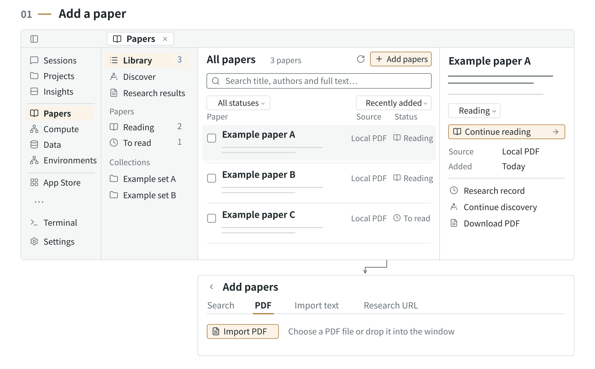
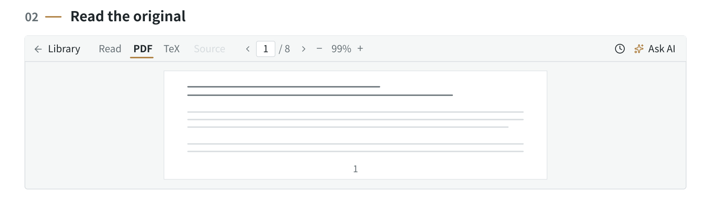
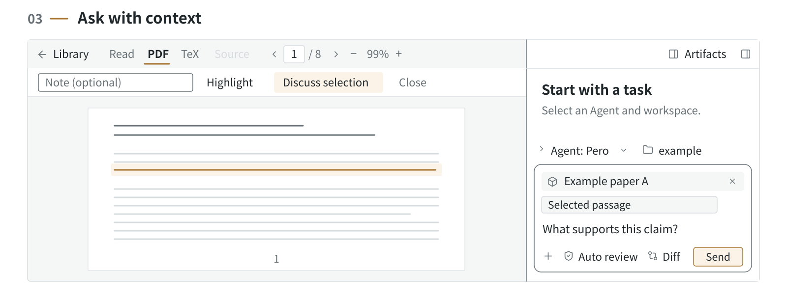
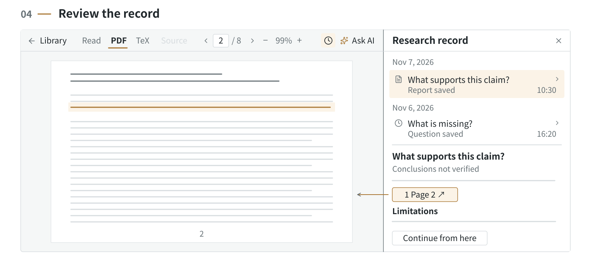
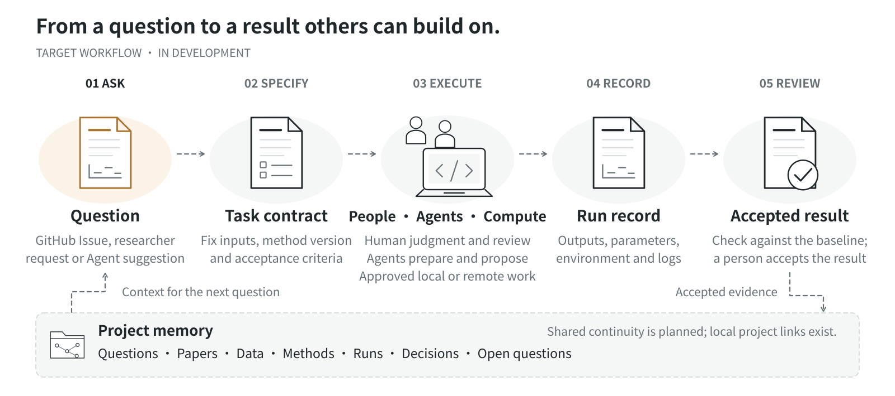
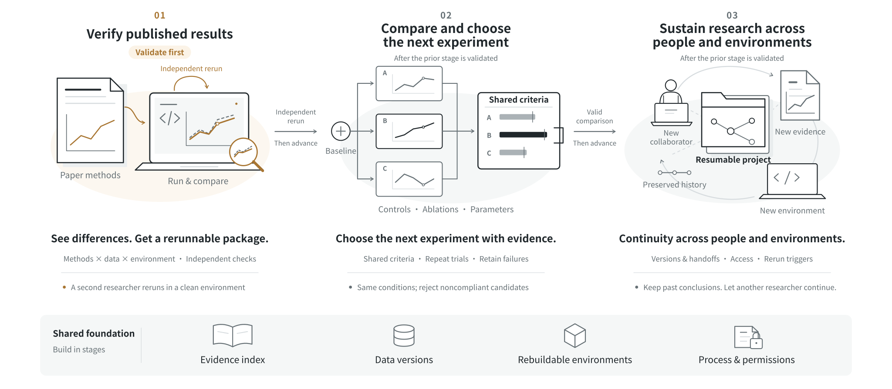
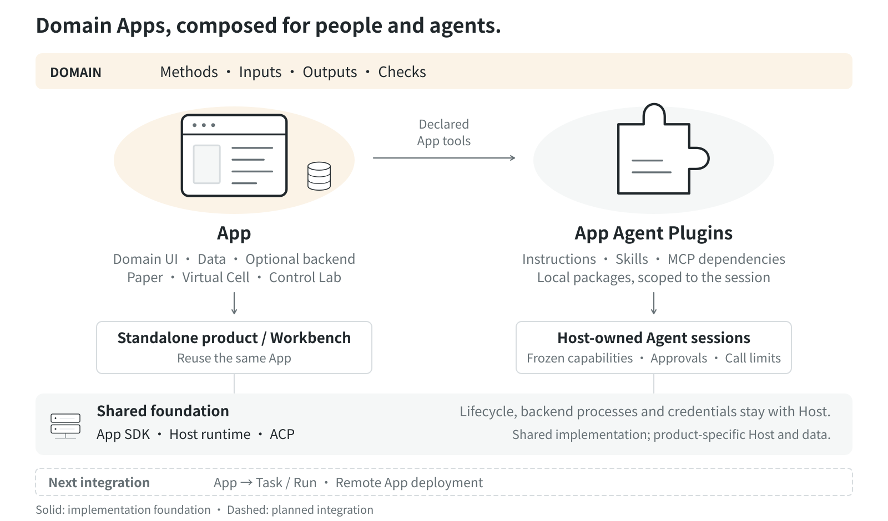
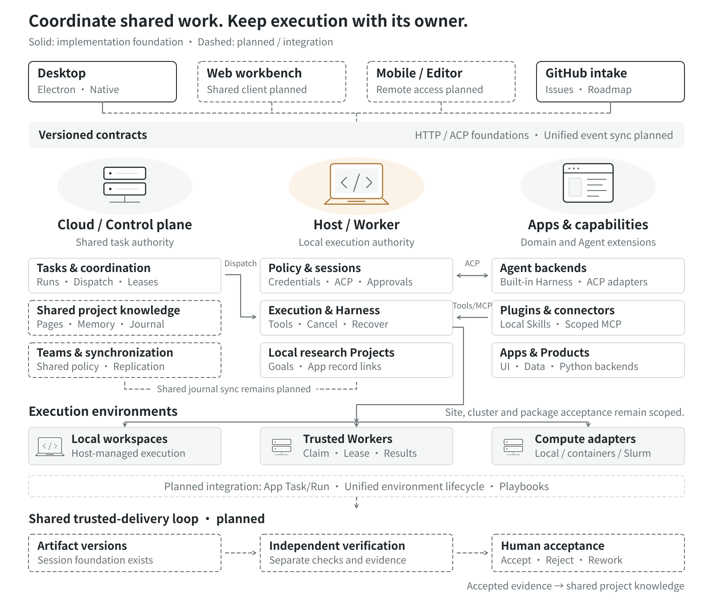

<p align="center">
  
</p>

<h1 align="center">Pero</h1>

<p align="center">
  <b>Read papers, run research Apps, and inspect the evidence behind a result.</b>
</p>

<p align="center">
  <a href="#try-pero">Try Pero</a> ·
  <a href="#a-research-example">Research example</a> ·
  <a href="#status">Status</a> ·
  <a href="DEVELOPMENT.md">Development</a> ·
  <a href="ROADMAP.md">Roadmap</a> ·
  <a href="README.zh-CN.md">简体中文</a>
</p>

Pero brings original papers, research Apps and Agent conversations into one desktop workspace. Start with a PDF: read it, ask a question, then follow the answer's citations back to the source.

> [!NOTE]
> **Development preview.** Capabilities follow current source; downloaded packages may lag behind. The walkthrough uses November 4 controls, with no new installed-package or real-model acceptance claimed here.

## Try Pero

### Download a development build

The [2026-11-04 prerelease](https://github.com/phodal/pero/releases/tag/v0.1.0-dev.20261104) provides these packages. Check [Releases](https://github.com/phodal/pero/releases) for newer builds and read the release notes.

| Product | Platform | Asset |
| --- | --- | --- |
| Pero, Electron workbench | macOS Apple Silicon | `Pero-macos-arm64.dmg` |
| Pero, Electron workbench | Windows x64 | `Pero-windows-x64.zip` |
| Pero, Electron workbench | Linux x64 | `Pero-linux-x64.tar.gz` |
| Pero Native, GPUI workbench | macOS Apple Silicon | `Pero-Native-macos-arm64.dmg` |

Build metadata and SHA256SUMS accompany the downloads. macOS packages are ad-hoc signed, not notarized; Windows/Linux packages are unsigned. Electron and Native use separate profiles. Start with **Electron** below; Native has a [fresh-profile limitation](DEVELOPMENT.md#native-fresh-profile-limitation). See [release verification](docs/fitness/release-products.md).

### Read a paper in four steps (Electron)

*These are simplified illustrations, not screenshots. Some illustrated navigation is newer than the November 4 package; the steps use that release's controls.*

#### 1. Import

Open **Papers**. If prompted, choose **Prepare environment** and wait for **Environment ready**; first use may download uv, CPython 3.12 and PDF dependencies. Select **Add papers → PDF → Import PDF**, or drop in a public PDF with selectable text. Scanned pages are not automatically searchable. See [offline/Python setup](DEVELOPMENT.md#python-environments-and-advanced-overrides).



#### 2. Read

Read the saved original. Select a passage and choose **Highlight** to keep an annotation. Importing, reading and highlighting need no model account or API key.



#### 3. Ask

Choose **Ask AI** or **Discuss selection** to open a conversation with paper context. It does not send automatically. Configure an Agent first: **Settings → Built-in Agent** needs an API provider and key; external Agents use their own login. Full-PDF research requires HTTP MCP support. See [Agent setup](desktop/README.md#agents-and-conversations).

Send a question such as: **“What evidence supports this method, and which limitations should I check? Cite the original passages.”**



#### 4. Check the source

When a report is saved, close the chat and open **Research record** (the reader's clock icon), then the saved report. Click a citation to inspect the original passage; if **Citation evidence** lists several matches, choose the relevant one. **Continue from here** prepares a follow-up for you to send.



More: [Paper usage and boundaries](apps/paper-agent/README.md#pdf-reading) · [Recorded Paper journey](docs/fitness/paper-harness-journey.md).

### Run from source or try another App

Complete [development setup](DEVELOPMENT.md#desktop-from-source), including the pinned GPUI Kit, then run from the repository root:

```sh
npm run dev:paper  # Open Paper in a separate development profile
```

- [Data](apps/data/README.md): inspect and chart dataset versions without a model. Try [six synthetic records](docs/examples/first-dataset.json).
- [Virtual Cell](apps/virtual-cell/README.md): explore the PBMC3k reference atlas and illustrative reaction simulations. `npm run dev:apps` opens its development profile; the November 4 release has no standalone Virtual Cell package.

## A research example

The [Fisher (1936) case](docs/fitness/paper-fisher-reproduction.md) recomputes **one Table III value** from 100 reviewed Table I measurements: **19.1434 cm²**, the within-species sum of squares. It freezes inputs and comparison rules, checks the arithmetic in a separate process, and exports an evidence ZIP. After extraction, `python -I -S verify.py` checks it using only Python's standard library, without a model or network.

This is a curated single-result reanalysis, not general paper reproduction; the whole-paper verdict remains `NOT_ASSESSED`. Backend/API, export and restart checks exist; browser interaction, Native/Electron integration and installed-package acceptance remain unverified. See [fixed-case instructions](apps/paper-agent/skills/paper-reproduction/references/reproduction-protocol.md#fixed-real-source-reanalysis-fisher-table-iii).

## Status

Paper reading, cited reports, local Apps and research-project links are implemented. Autonomous research has controlled-stack checks; real-model and independent human quality acceptance remain pending. Shared App Task/Run integration, project memory, team sync and shared Web/mobile research clients remain planned. [Quality gates](docs/fitness/README.md) and the [Roadmap](ROADMAP.md) separate implementation from acceptance.

## Data, permissions and costs

- **Data:** Apps store domain data on the execution machine. Remote models, literature services, MCP connectors and shared task services may receive selected prompts, sources or task data.
- **Trust:** App backends and local plugins run trusted code, not a general-purpose process sandbox. Review tools and the session's permission policy before using sensitive data.
- **Cost:** Model subscriptions/API calls and remote compute are billed by their providers. Missing usage is not zero cost; research call/time limits are not a billing cap. Local reading needs no model call after setup, and local App calculations need no control-plane service.
- **Evidence:** Citations locate sources; execution success or matching numbers do not establish scientific validity. Review conclusions and unresolved gaps yourself.

## Direction and architecture

The [Roadmap](ROADMAP.md) proposes verifying published results, comparing experiments, then sustaining research across people and environments. These are target workflows, not a completed end-to-end research loop.





Apps own domain methods and data; Host owns local processes, credentials and Agent sessions; the optional Go control plane coordinates shared tasks and Workers. In the diagrams below, solid boxes mark implemented foundations; dashed boxes and links mark planned capabilities or integration.





[Architecture](docs/ARCHITECTURE.md) · [Decisions](docs/adr/README.md) · [Development](DEVELOPMENT.md)

## Contribute

Bring a research question, a small public dataset with provenance, an App or an independent result review. For substantial changes, open an [Issue](https://github.com/phodal/pero/issues) to agree on scope and checks. See [CONTRIBUTING](CONTRIBUTING.md) and join the [community](https://github.com/openpero/community).

**License:** there is no top-level project license. Do not assume a blanket reuse grant; ask the maintainers about reuse/distribution. Third-party components retain their own licenses.

<p align="center">
  <a href="https://github.com/openpero/community">
    
  </a>
</p>
