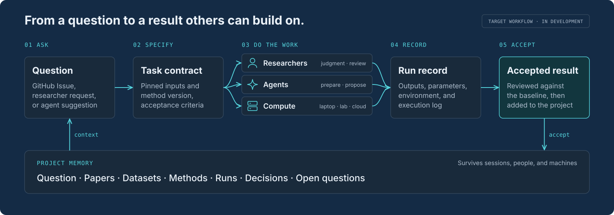
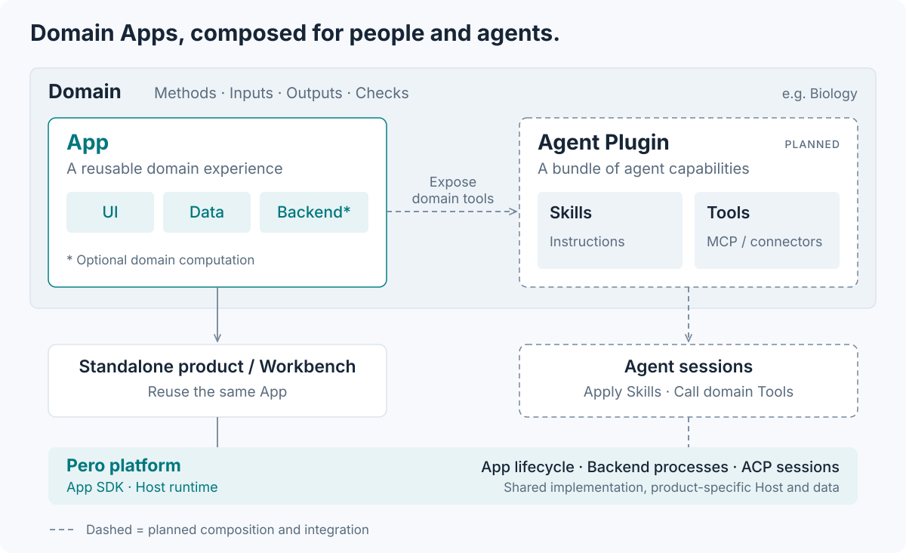
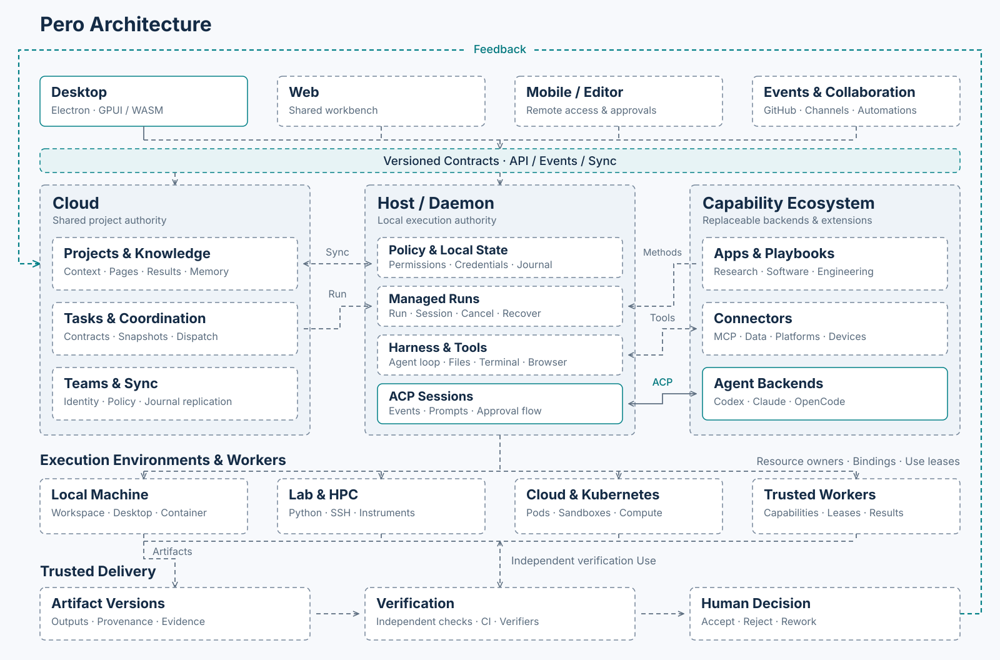

  

<h1 align="center">Pero</h1>

  <b>Composable research apps and distributed agent collaboration.</b>

  <a href="https://github.com/phodal/pero/releases">Download dev build</a> ·
  <a href="ROADMAP.md">Roadmap</a> ·
  <a href="DEVELOPMENT.md">Development</a> ·
  <a href="#status">Status</a> ·
  <a href="#contribute">Contribute</a> ·
  <a href="README.zh-CN.md">简体中文</a>

  

> [!NOTE]
> **Development preview.** macOS arm64 builds are available. There is no stable release yet.

## Why

A research workflow often starts as a script, notebook or model demo. Pero turns it into an App that can run on its own or alongside other tools in a shared workbench. Virtual Cell is the first example, with cell-atlas exploration and reaction simulation.

The longer-term goal is to connect these Apps with agents, collaborators and compute while keeping inputs, methods and results traceable.

## Status

| Area | Current status | Roadmap |
| --- | --- | --- |
| Desktop & Agent sessions | ACP conversations, tool results, approval UI, history and workspaces implemented | [Sessions](ROADMAP.md#会话与-agent) |
| Tasks & Workers | Dispatch, leases, cancellation and recovery implemented; Linux real-provider acceptance pending | [Tasks](ROADMAP.md#任务与贡献) |
| GitHub & contributions | Intake, claims and local coding implemented; real GitHub PR publication acceptance pending | [Contributions](ROADMAP.md#认领与代码贡献) |
| Apps & products | Virtual Cell runs locally and in a macOS development package; Agent tools and task integration pending | [Apps & products](ROADMAP.md#app-与产品) |
| Projects, knowledge & teams | Project journals, memory, Pages and team sync planned | [Projects & teams](ROADMAP.md#项目与团队) |
| Playbooks, plugins & connectors | Method orchestration, multi-agent teams and MCP integrations planned | [Methods](ROADMAP.md#自动化与方法) |
| Trusted delivery | Artifact versions, independent verification and acceptance decisions planned | [Verification](ROADMAP.md#验证与发布) |
| Execution environments | Environment templates, Use lifecycle, isolation and resource matching planned | [Environments](ROADMAP.md#环境与部署) |
| Web & mobile workbench | Shared workbench clients planned; a static WASM preview is published at `/workbench/`. Other Web pages are demos or task browsing | [Clients](ROADMAP.md#web-与移动端) |

## How it works

The intended workflow is to define a task with fixed inputs and checks, assign it to a collaborator or approved worker, then review the recorded result. Compute can stay on a personal machine, a lab server or the cloud; coordination can be self-hosted.

Agents propose work; people approve consequential actions and accepted conclusions. Task intake alone grants no execution permission, and runs retain the evidence needed for review.

Solid boxes mark implemented foundations; dashed boxes and links mark planned capabilities or integration. The end-to-end research workflow remains in progress. See the [architecture](docs/ARCHITECTURE.md) and [development guide](DEVELOPMENT.md) for details.

## Contribute

Bring a research use case, contribute a method or App, or review results. Pick a bounded item from the [Roadmap](ROADMAP.md); for substantial changes, open an Issue to agree on scope and acceptance criteria. Include a reproducible check with code changes. AI-assisted contributions follow the same review process. See [CONTRIBUTING](CONTRIBUTING.md).

  

