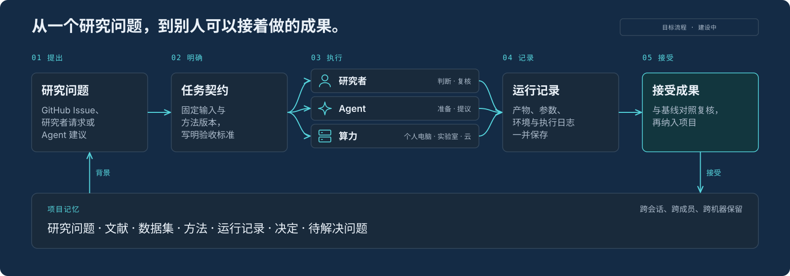

  

<h1 align="center">OpenPero</h1>

  <b>分布式 Agent 协作。</b> 
  面向 AI4S 与研发协作，连接业务专家、开源贡献者与计算环境。

  <a href="#工作方式">工作方式</a> ·
  <a href="#架构">架构</a> ·
  <a href="#路线图">路线图</a> ·
  <a href="#参与贡献">参与贡献</a> ·
  <a href="README.md">English</a>

  

> [!NOTE]
> **项目处于早期阶段。** 已有 Desktop、任务认领与远程执行基础。多 Agent 编排，以及完整的 AI4S 和研发工作流仍在建设中。

## 运行当前实现

- [Desktop](desktop/README.md)：Electron + GPUI、ACP 对话、中英文、主题、本地会话与共享远程任务。
- [Go 控制面](server/README.md)：PostgreSQL Task/Run/Worker、租约、取消与恢复、GitHub Issue 同步、项目范围认领及显式启用的自动派发。
- [社区任务广场](server/README.md#community-tasks-and-contributions-2)：公开任务、GitHub OAuth、Worker 归属、验收记分与积分撤销。
- [构建与验证](docs/fitness/README.md)：npm/Cargo 开发流程和 Bazel Go／代码生成试点。字体优先复用本地文件与缓存，缺失才下载固定版本，生成的二进制不进入 Git。

本地界面与协议验证使用测试代理；部署、真实 OAuth 凭据和独立验收需要各自的配置与证据。详见[工作树整合记录](docs/fitness/worktree-integration.md)。

## 持续集成

推送到 `master` 以及所有 pull request 会在 Linux、Windows 和 macOS 上运行[构建与验证](docs/fitness/README.md)中的命令：`npm ci`、`npm run build`、`npm run check`、`npm test`、`npm run test:contracts`，以及 `server/` 下的 `go test -race ./...`。Bazel `//:checks` 在 Linux 和 macOS 上运行，`//server/cmd/server` 在三个系统上构建。只有 macOS 本机时，另外两个系统仍会被检查。

PostgreSQL、Electron、公开 GitHub 和真实模型套件仍是可选验收。它们需要数据库、显示器或本机登录，因此这条工作流不运行它们，也不读取 secrets。

`docs/` 是 openpero.com 的静态站点。Cargo crate 设置了 `publish = false`，签名 Desktop 安装包也还不是当前交付物。Task Center 的安装是单独的主机脚本，见 [deployment/task-center](deployment/task-center/README.md)。它需要 SSH 和留在那台机器上的凭据。这条工作流不运行该脚本，不部署站点，也不发布安装包。

## 要解决的问题

AI4S 需要串起文献、数据、方法与实验结果；研发协作需要衔接需求、实现、测试与评审。专业判断、代码和算力往往分散在不同成员与机器上。

OpenPero 以**项目与任务**组织这些工作：专家定义问题和验收标准，贡献者与 Agent 分工，执行产物经过复核后交回项目。

| | 单次 Agent 执行 | OpenPero 的方向 |
| --- | --- | --- |
| **背景** | 当前任务的上下文 | 项目里的需求、文献、数据、方法与决定 |
| **协作** | 由人串联各次执行 | 围绕任务认领、分工与交接 |
| **执行** | 一个运行环境 | 获准的本机、实验室服务器或云端 |
| **完成的标准** | “跑通了” | 执行、验证与人工验收分别记录 |

## 工作方式

顶部的图就是完整闭环，分步来看：

1. **提出工作。** 从 GitHub Issue、业务或研究委托，或项目自身变化产生的建议开始。
2. **写成契约。** 固定输入与方法版本，写明预期产物、资源限制和验收条件。
3. **分配任务。** 由合作者认领，或交给获准的 Agent / Worker。
4. **执行并记录。** 产出代码、数据、方法或报告，同时保存检查和复跑所需的信息。
5. **复核并接续。** 记录决定、更新项目，必要时回写 GitHub。

## 有什么不同

**🧠 项目会记住。** 需求、问题、文献、数据集、方法、运行和决定放在一起。一个月后回来，也能看到上次做到哪里、为什么接受某个结果、还有什么没解决。

**🔔 Agent 准备下一步。** 数据集更新、运行完成、检查失败、出现相关文献：Agent 说明发生了什么、可能影响哪些工作，并提出一项具体任务。它遵守项目权限与预算，不会悄悄修改研究方法或已接受的结论。

**🌐 计算留在数据所在的地方。** 任务可以在个人电脑、获准接入的实验室服务器或云端执行。协调服务可以自部署，协调服务上云也不意味着数据必须上云。

**🔍 每个结果都有来处。** 结果关联输入、方法版本、参数、环境和执行记录。程序跑通不等于结果验收，接受结果是一次明确、经过复核的决定。

## 架构

实线框表示已有基础，虚线表示规划中。重新生成图示：`npm run gen:architecture` 与 `npm run gen:overview`。

| 部分 | 职责 |
| --- | --- |
| **Project** | 研究目标、共享背景、已接受结果、未解决问题与决定 |
| **Task** | 有明确输入、产物、约束和验收条件的独立贡献单元 |
| **Coordinator** | 依赖、授权、分配、执行状态、取消与恢复 |
| **Worker** | 声明能力，在限定权限内执行获准的任务 |
| **Result & Review** | 保存产物与来源，区分执行成功、验证结果与研究验收 |
| **Web / Desktop / GitHub** | 进入同一项工作的不同入口 |

使用入口（Web、Desktop）、执行位置（本机、实验室、云端）和部署方式（自部署、托管）是相互独立的选择。

<b>安全边界</b>

- Issue 正文、PR 和任务载荷都是**不可信输入**。提出任务不等于获得执行权限。
- 执行时限制凭据、资源与数据访问，并提供与任务匹配的隔离。
- 重试必须考虑副作用，重复投递不能悄悄重复高影响操作。
- 公开结果或修改已接受的结论，需遵守项目的审阅规则。
- 不要把不受限的个人电脑或实验室服务器接到不可信的公共任务流上。

## 路线图

| | 阶段 | 交付重点 |
| --- | --- | --- |
| 🟢 | **M0 · 基础接线** | Desktop、Host、ACP 与版本化契约；macOS 开发构建已完成 |
| 🟡 | **M1 · 远程分派** | 本地流程已接通，真实远程环境验收待完成 |
| 🟡 | **M2 · 任务来源** | GitHub 已接入，ROADMAP 导入待完成 |
| ⚪ | **M3 · 验证与发布** | 产物版本、独立验证、人工决定与授权回写 |
| ⚪ | **M4 · 环境与运维** | 环境匹配、隔离、自部署升级与恢复 |

🟢 开发构建已完成 · 🟡 部分实现 · ⚪ 规划中。详细范围与验收标准见 [Roadmap](docs/ROADMAP.md)。

## 参与贡献

不必理解整个平台也能参与。挑一块边界清楚的工作即可：

| 方向 | 适合上手的贡献 |
| --- | --- |
| **业务场景** | 真实问题、领域约束与验收标准 |
| **任务与结果契约** | Schema、样例数据、校验器 |
| **GitHub 连接器** | 事件身份校验、去重、任务映射、状态回写 |
| **Worker SDK** | 能力注册、任务领取、心跳、取消、结果提交 |
| **协调与故障恢复** | 任务依赖、租约、安全重试、拒绝过期结果 |
| **结果验证** | 产物检查、基线比较、独立复核接口 |
| **科研方法包** | 固定输入、环境、基线与检查规则 |
| **研发工作流** | 需求验证、测试与评审的 Playbook |

以上是建议方向，不代表已有对应 Issue。较大的改动请先开 Issue 对齐范围、接口与验收条件，并附上本地运行或测试方式。AI 辅助完成的贡献，与其他贡献一样需要审阅与验证。

**也欢迎业务与领域专家参与。** 提供问题、约束与验收标准，贡献科研方法，或独立复核结果。

修改演示页面

中文文案在 `pages/src`，英文对照在 `pages/locales/en.js`。运行 `node pages/scripts/build.mjs` 重新生成两个页面。色彩遵循 [`DESIGN.md`](DESIGN.md)。

---

<b>从一个问题开始，让下一份贡献更容易发生。</b>

<!-- 维护者发布检查：确定仓库许可证并添加 LICENSE；核实源代码归属和第三方声明；随实现推进，用已验证的发布状态替换原型说明。本稿不指定许可证、不承诺托管服务，也不虚构安装命令。 -->
