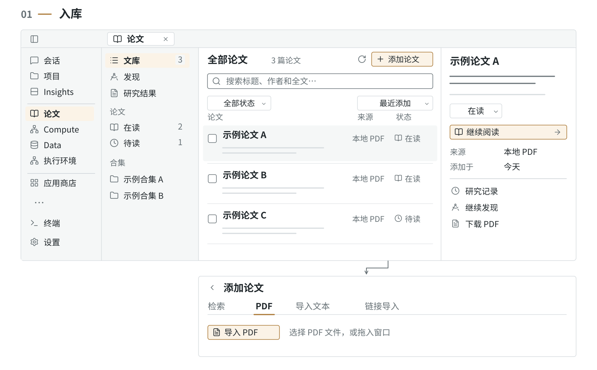
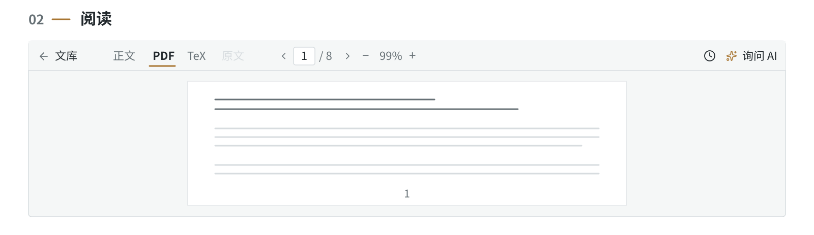
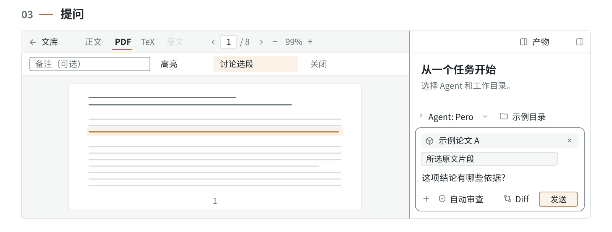
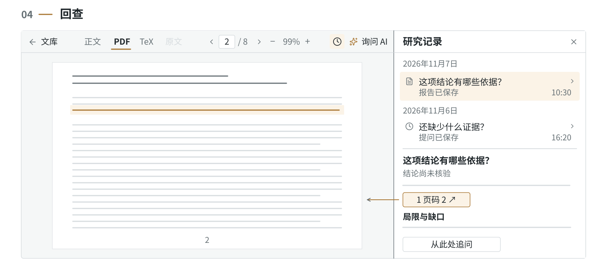
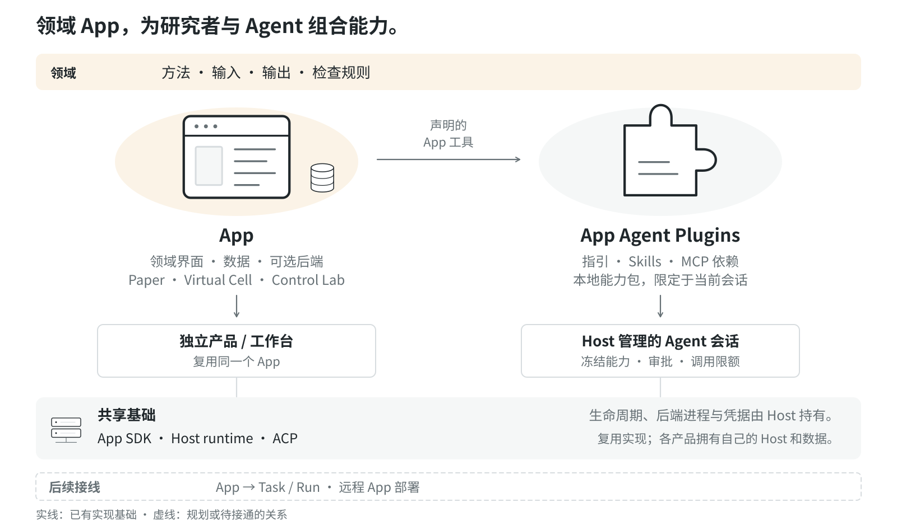
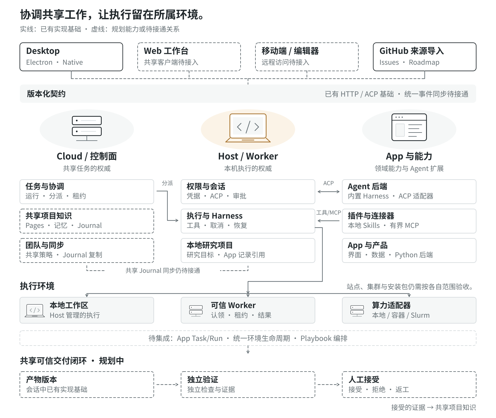

<p align="center">
  
</p>

<h1 align="center">Pero</h1>

<p align="center">
  <b>读论文、运行科研应用，复核结果背后的证据。</b>
</p>

<p align="center">
  <a href="#方法论">方法论</a> ·
  <a href="#paper从阅读到证据">Paper</a> ·
  <a href="#一个科研实例">科研实例</a> ·
  <a href="#开始体验">开始体验</a> ·
  <a href="DEVELOPMENT.md">开发指南</a> ·
  <a href="ROADMAP.md">路线图</a> ·
  <a href="README.md">English</a>
</p>

Pero 把论文原文、科研 App 和 Agent 对话放进同一个桌面工作台。从一篇 PDF 开始：阅读、提问，再沿着回答中的引用回查原文。

## 方法论

- **保留原始证据。** 保存论文，报告引用回到实际读过的原文片段；之前的回答不能替代来源证据。
- **先明确方法，再计算。** 固定输入、方法与比较规则，再独立复核。下方 [Fisher 案例](#一个科研实例)把这一做法用于一个已发表数值。
- **沿着记录继续研究。** 保留发现与未解决的问题，由研究者主动追问。


*目标流程示意：跨人员共享项目记忆和完整科研闭环仍在规划中。*

## Paper：从阅读到证据

想在 Electron 中跟着操作，可先看后面的[开始体验](#开始体验)。

*以下是简化示意图，不是产品截图。图中部分导航晚于 11 月 4 日安装包，步骤使用该版本已有的控件。*

### 1. 导入

打开**论文 / Papers**。若有提示，点击**准备环境 / Prepare environment**，等待**环境已就绪**；首次可能下载 uv、CPython 3.12 和 PDF 依赖。选择**添加论文 → PDF → 导入 PDF**，或拖入一篇公开、可选取文字的 PDF。扫描页不会自动变成可检索文本。离线准备见 [Python 环境设置](DEVELOPMENT.md#python-environments-and-advanced-overrides)。



### 2. 阅读

阅读保存的原文，选中文字后点击**高亮**保存标注。导入、阅读和高亮均不需要模型账户或 API Key。



### 3. 提问

点击**询问 AI / Ask AI**，或选中文字后点击**讨论选段 / Discuss selection**，带着论文上下文打开对话，不会自动发送。先配置 Agent：内置 Agent 在**设置 → 内置 Agent**中填写 API 服务和 Key，外部 Agent 使用各自的登录方式。PDF 全文研究需要 HTTP MCP 支持，见 [Agent 配置](desktop/README.md#agents-and-conversations)。

发送一个具体问题，例如：**“这篇论文的方法有哪些证据支持？有哪些限制需要核对？请引用原文片段。”**



### 4. 回查

报告保存后，收起对话，点击阅读器的时钟图标（**研究记录**），打开已保存的报告。点击引用回到原文；若**引用证据**列出多个匹配位置，请选择相关位置。点击**从此处追问 / Continue from here**可准备追问，再由你发送。



详见 [Paper 使用与边界](apps/paper-agent/README.md#pdf-reading) · [已有 Paper 流程记录](docs/fitness/paper-harness-journey.md)。

### 更多科研 App

- [Data](apps/data/README.md)：无需模型即可检查数据版本并绘图，可用 [6 条合成记录](docs/examples/first-dataset.json)体验。
- [Virtual Cell](apps/virtual-cell/README.md)：探索 PBMC3k 参考图谱和演示用反应模拟。

## 一个科研实例

[Fisher（1936）案例](docs/fitness/paper-fisher-reproduction.md)使用 Table I 中核对过的 100 条测量值，复算 **Table III 的一个数值**：物种内离差平方和 **19.1434 cm²**。流程固定输入和比较规则，用独立进程复核算术，再导出证据 ZIP。解压后运行 `python -I -S verify.py`，仅用 Python 标准库检查，无需模型或网络。

这是预先选定案例的单项重分析，不是通用论文复现；整篇论文仍为 `NOT_ASSESSED`（未评估）。已有后端/API、导出和重启检查，浏览器交互、Native/Electron 集成与安装包验收仍未完成。详见[固定案例说明](apps/paper-agent/skills/paper-reproduction/references/reproduction-protocol.md#fixed-real-source-reanalysis-fisher-table-iii)。

## 开始体验

> [!NOTE]
> **开发预览。** 能力说明对应当前源码，下载包可能落后。上手步骤使用 11 月 4 日版本的控件；本次文档更新不代表重新验收了安装包或真实模型。

### 下载开发版

[2026-11-04 开发预览版](https://github.com/phodal/pero/releases/tag/v0.1.0-dev.20261104)提供以下安装包。更新版本请查看 [Releases](https://github.com/phodal/pero/releases)，并阅读发布说明。

| 产品 | 平台 | 文件 |
| --- | --- | --- |
| Pero，Electron 工作台 | macOS Apple Silicon | `Pero-macos-arm64.dmg` |
| Pero，Electron 工作台 | Windows x64 | `Pero-windows-x64.zip` |
| Pero，Electron 工作台 | Linux x64 | `Pero-linux-x64.tar.gz` |
| Pero Native，GPUI 工作台 | macOS Apple Silicon | `Pero-Native-macos-arm64.dmg` |

下载页附有构建信息和 SHA256SUMS。macOS 包为 ad-hoc 签名，未经公证；Windows/Linux 包未签名。Electron 与 Native 使用独立配置。首次体验建议用 **Electron**；Native 有[新配置限制](DEVELOPMENT.md#native-fresh-profile-limitation)。详见[发行验证记录](docs/fitness/release-products.md)。

### 从源码运行

完成[开发环境配置](DEVELOPMENT.md#desktop-from-source)，包括指定版本的 GPUI Kit，再在仓库根目录运行：

```sh
npm run dev:paper  # 在独立开发配置中打开 Paper
```

`npm run dev:apps` 在独立开发配置中打开 Virtual Cell。11 月 4 日发布版不含独立 Virtual Cell 安装包。

## 当前状态

论文阅读、引用报告、本地 App 和研究项目关联已有实现。自动研究已通过受控全链路检查，真实模型与独立人工质量验收待完成。App 与共享 Task/Run 的通用接线、共享项目记忆、团队同步和共享 Web/移动科研客户端仍在规划中。[质量门禁](docs/fitness/README.md)与[路线图](ROADMAP.md)区分实现和验收。

## 数据、权限与费用

- **数据：** App 在执行机器保存领域数据；远程模型、文献服务、MCP 连接器和共享任务服务可能收到所选提示词、来源内容或任务数据。
- **信任：** App 后端与本地插件是受信任代码，不是通用进程沙箱。处理敏感资料前，请检查工具与会话权限策略。
- **费用：** 模型订阅/API 调用和远程算力由服务商计费。未报告用量不等于零费用，研究调用次数和时长限制不是账单上限。环境准备后，本地阅读无需模型调用，本地 App 计算无需控制面服务。
- **证据：** 引用只能定位来源，运行成功或数值一致不代表科学结论成立。结论和未解决的证据缺口仍需自行复核。

## 方向与架构

[路线图](ROADMAP.md)提出从复核已发表结果、比较实验，走向跨人员和环境的持续研究。这些是目标工作流，不代表已完成端到端科研闭环。


App 管理领域方法与数据，Host 管理本机进程、凭据和 Agent 会话，可选的 Go 控制面协调共享任务与 Worker。下图实线框表示已有基础，虚线框和连线表示规划能力或待接通的关系。





[架构文档](docs/ARCHITECTURE.md) · [决策记录](docs/adr/README.md) · [开发指南](DEVELOPMENT.md)

## 参与贡献

带来一个科研问题、有来源的小型公开数据集、App 或独立结果复核。较大改动请先开 [Issue](https://github.com/phodal/pero/issues)，对齐范围与检查方式。详见[贡献指南](CONTRIBUTING.md)，欢迎加入[社区](https://github.com/openpero/community)。

**许可：** 仓库没有顶层项目许可证，请勿默认获得统一复用授权；复用与分发请向维护者确认。第三方组件保留各自许可证。

<p align="center">
  <a href="https://github.com/openpero/community">
    
  </a>
</p>
