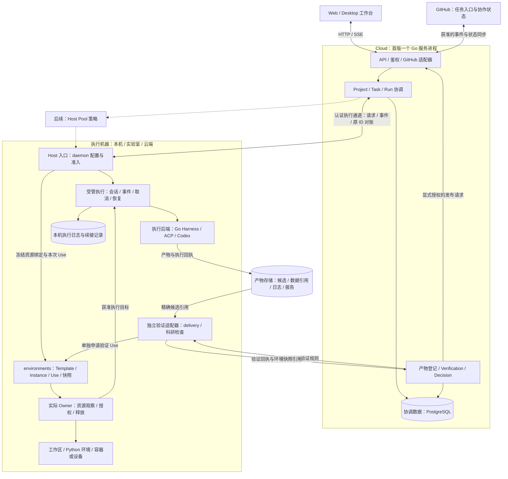

# Pero Architecture

Pero 面向研究者、Agent 与计算环境，围绕 Project 组织上下文、任务、执行记录与结果复核。本文中的目录规划与服务拓扑是 Pero 的建设方向，不代表这些模块已经实现。

当前首版接线以 [ADR 0001](adr/0001-electron-gpui-bootstrap.md) 和
[ADR 0002](adr/0002-remote-task-dispatch.md) 为准：`server/` 是 Go 控制面，
`crates/pero-runtime` 持有 Rust ACP 接入，`crates/pero-worker` 是独立远程执行入口，
`protocol/` 保存版本化契约。以下较早的 Go daemon、React 和 `cloud/` 目录规划
保留为背景，不作为并行实现另一套执行器的依据。

本地 App 机制以 [ADR 0007](adr/0007-local-app-platform.md) 为准：Rust Host
管理安装、启停与 Python 后端，GPUI 管理导航和面板区域，Web 层承载独立来源的
HTML iframe。`apps/virtual-cell` 是首个接入实例，`apps/paper-agent` 提供 Python
论文快照、引用校验和报告工作流。`packages/app-sdk` 提供主题、语言、活动状态、
本 App 后端接口，以及声明 `agent` 权限后的有界 Host 会话接入。会话和审批仍由
Host 管理；Task/Run、领域 Agent 工具和远程 App 部署尚未与此机制连接。

## 可组合应用与产品

产品装配以 [ADR 0008](adr/0008-product-distributions.md) 为准，区分三个概念：

- **App** 拥有领域界面、数据与可选后端，由 `app.json` 声明。相同 App 可在工作台内运行，也可成为独立产品的入口。
- **Product** 拥有交付身份、版本、所选 App、壳、入口和运行时策略，由 `packages/product` 的不可变类型统一校验；产品定义位于 `products/`。
- **Distribution** 是为具体平台与架构组装的产物，不增加运行时服务或任务状态机。

当前两种装配路径：

```text
领域 App + App SDK + Rust Host
  ├─ workbench：Electron + GPUI/Wasm 导航 + 共享 ChatPanel → Pero 工作台
  └─ app：Electron App 壳 + 领域面板 + 可选 chat-only Wasm + 所选运行时 → 独立产品
```

两条路径复用 `DesktopApps` 代理与 Host 的 App 生命周期实现。独立产品使用自己的 Host 进程、配置和领域数据目录；这不表示多个产品已连接到一个共享 Host 服务。App iframe 不持有 Electron preload 或后端凭据。控制面按共享任务需求接入，独立 App 的本地计算无需 Go 服务或 PostgreSQL。

### 共享 GPUI App Chat

[ADR 0012](adr/0012-shared-gpui-app-chat.md) 定义两条共享实现的装配路径：
`crates/pero-chat-ui` 拥有 Composer、消息流、折叠和已报告用量的展示；工作台的
`pero-ui` 与独立入口 `pero-chat-web` 依赖它。共享 Rust crate 不等于共享 Wasm
实例：工作台在原有 GPUI 应用内复用同一个 `Entity<ChatPanel>`，独立产品则把
chat-only Wasm 放在 `pero://chat/chat.html` iframe 中，不加载完整工作台导航。

工作台的项目、任务和 App 可展开同一个右侧聊天栏；会话、项目、任务和 App
以稳定身份进入内容标签，关闭标签只收起视图。聊天栏宽度与开闭状态通过 Host
保存，窄窗切换为聊天视图并保留领域 App iframe。布局与标签语义见
[ADR 0013](adr/0013-workspace-content-tabs.md)，本轮验收见
[Workspace 验证记录](fitness/workspace.md)。
`AppChatScope { app, panel }` 将会话与来源面板关联，切换时保留各范围最近会话和
草稿。scope 不授予工具、文件或跨 App 权限。独立产品继续使用自己的 Host 和
数据目录，不与另一个产品或工作台共享运行中的 GPUI Entity。

App SDK 的 `useAppChat().open()` 和 `compose(text)` 只打开聊天或填入草稿，
由宿主确认消息来自受管 App iframe；它们不自动发送。用户在共享 Composer
中提交后，命令仍经已有 Host 的 ACP、授权、工作区租约与取消路径执行。消息、
模型配置、权限请求及会话历史不由领域 App 后端另建实现。

`Product.chat` 默认 `false`；显式启用时，产品构建包含 chat-only Web/Wasm 产物
和 Agent adapters。`products/virtual-cell-chat` 是使用系统 Python 的开发装配示例，
原 Virtual Cell 产品继续使用其已有运行时策略。两者包体、Agent 准备条件、目标
平台和安装包验收分别记录，见 [App Chat 验证记录](fitness/app-chat.md)。
用量只展示 provider 实际报告的数据，缺失值不估算成真实消耗；产品装配与本地
源码检查不代表 Electron、签名包或真实 Agent 已通过验收。

### Agent App Use

[ADR 0014](adr/0014-app-use.md) 补齐 Agent → App 方向：Rust Host 通过 ACP
`session/new` 提供本机 MCP `app_use`，Desktop 绑定实际会话、面板实例、动作与授权，
父壳通过受管跨来源 iframe 桥接 App SDK 的语义状态和操作。Workbench 与独立
Product 共用此实现。普通会话可发现已挂载 App；App 会话限定对应面板。语义状态
可读保留的隐藏面板，操作与截图要求面板可见、活动且未被覆盖。

审批遵循 Agent 会话策略：自动模式直接执行，Agent 明确询问时使用 Chat 审批卡片；
Desktop 不再追加人工确认。只读会话授权可在 App 状态条撤销。语义操作、
有限 DOM 操作、面板截图、等待、计划和独立验证均有实际链路。执行成功不等于
验证通过，截图也不自动成为结论。Composer 支持冻结对象引用、截图与区域标注；
会话文件只通过绑定 App/任务的临时输入引用传入。`app_describe/app_write` 使用
安装包声明的数据路由，写入沿用同一 Agent 审批策略；后端继续拥有领域校验。
Host 内置 `/app-use` 工作流，完整回执保存会话、任务、实例、裁剪、时间与图片哈希。
具体证据和剩余平台边界见
[App Use 验证](fitness/app-use.md)。

### 从产品装配到领域组合

可借鉴 Point 的[可组合交付](https://github.com/phodal/point/blob/main/docs/adr/0153-composable-delivery-and-harness-over-harness.md)原则：组合单元围绕领域目标，方法和结果契约保持稳定，执行实现可以替换。PBC 在此描述封装领域功能的设计方向，不新增一个同名运行时或注册中心。

| 范围 | 当前状态 | 后续接线 |
| --- | --- | --- |
| App 界面与领域计算 | Virtual Cell 的本地界面与 Python 后端已接入 | 按具体领域需求扩展方法 |
| 产品交付 | 工作台与独立 App 壳；Virtual Cell macOS arm64 开发包已有验证记录 | 更新、迁移与其他平台打包需分别实现和验证 |
| Agent 协作 | 工作台 App 侧栏和可选独立产品聊天复用共享 GPUI ChatPanel、Host ACP 会话、取消与审批 | App 领域工具与结构化上下文需分别接线和验收 |
| 方法、任务与验收组合 | App 尚未接入 Task/Run、Agent 工具或产物登记 | 明确输入、输出、方法版本与验证规则，再接已有执行与复核边界 |

领域包可逐步组合界面、方法、上下文、工具和验证规则；当前 `app.json` 与 Product 配置只承载已实现的范围。Product 负责选择交付内容，Host 负责本机进程、凭据和执行，控制面负责共享任务及协调。独立产品继续调用这些所有者，领域 App 不另建通用调度、审批或任务状态机。

当前构建与验收范围见 [Product 验证记录](fitness/products.md)。产品装配通过不代表科学方法或研究结论已获接受。

## 目录结构

当前仓库结构：

```text
pero/
├── ROADMAP.md
├── crates/
│   ├── pero-contracts/
│   ├── pero-host/      # stdio JSONL Host
│   ├── pero-runtime/   # ACP 会话
│   ├── pero-ui/        # GPUI Wasm 工作台
│   ├── pero-chat-ui/   # 共享 GPUI Composer、会话与展示
│   ├── pero-chat-web/  # 独立 chat-only Wasm 装配入口
│   └── pero-worker/    # 独立远程执行入口
├── desktop/            # Electron 壳
├── web/                # Wasm 加载与共享静态资源
├── server/             # Go 控制面
├── protocol/           # TypeSpec 契约
├── harness/            # 自研 Agent 方向，目前只有 README
├── apps/               # 独立 Web 面板与可选领域后端
├── packages/app-sdk/   # Web App SDK 与共享控件
├── packages/product/   # 不可变 Product 模型与校验
├── products/           # 工作台与独立产品交付配置
├── pages/              # 交互原型源码
├── locales/            # 工作台文案
├── tests/
└── docs/
    ├── ARCHITECTURE.md
    ├── adr/
    ├── fitness/
    ├── issues/
    ├── index.html      # 生成的中文原型
    └── en/             # 生成的英文原型
```

后续按职责补齐目录，不要求一次创建：

```text
contracts/         # 版本化的任务、执行、产物与 Worker 协议
cloud/             # Go：Project、权限、任务协调与协作接口
harness/           # Go：Agent loop、Session、工具与执行后端接入
daemon/            # Go：Host 常驻入口、工作区准入与受管执行装配
environments/      # Go：资源绑定、Use、Owner 端口与环境快照
delivery/          # Go：独立验证协议、执行与回执
apps/              # 科研应用；Web 界面与可选 Python 后端
web/               # JavaScript / TypeScript：共享工作台与组件
desktop/           # Electron 桌面壳、浏览器与本机进程装配
```

## 语言与技术栈

| 语言 / 技术 | Pero 中的职责 |
| --- | --- |
| **Go** | Cloud 协调服务、Agent Harness、执行机器 daemon；管理任务、Session、授权、租约、取消与恢复 |
| **Python** | AI4S 科学计算、数据处理、模型与科研方法适配，以及需要独立环境的 App 后端 |
| **JavaScript / TypeScript** | Desktop 主进程与预加载桥接、Web 工作台、App 界面和 SDK |
| **HTML / CSS / JavaScript** | 当前可运行的交互原型与中英文静态页面（`pages/` 与 `docs/`），尚未接入真实协调服务 |
| **Swift / Rust（按需）** | 系统权限、设备控制、原生服务及特定渲染或计算能力；按具体能力选择，不作为首期前提 |
| **Kotlin Multiplatform（后续评估）** | 有跨端需求时提供基于同一协议的客户端；不作为首期前提 |

语言按职责选择。先固定协议和权威边界，再接入具体实现。

### Go for Cloud and Harness

Go 承担长期运行的协调与执行管理，Cloud 和执行机器分开部署：

- **Cloud**：Project、成员权限、共享上下文、任务依赖、分派、执行状态、产物登记与复核决定。
- **Harness**：Agent loop、Session、工具注册、模型调用，以及 ACP / MCP 等执行和工具协议适配。
- **Daemon**：部署在个人电脑、实验室服务器或云端执行机器上，管理获准工作区、执行进程、心跳、取消与恢复，并返回事件和产物引用。

Cloud 与 Host 分工：协调服务拥有团队与 Project 权限，执行端拥有本机文件、工具、凭据与进程。界面和科研应用复用这些边界，不另建一套审批、任务状态或重试系统。Cloud 能记录离线 Worker 的状态，但不能因此使用它的本机工具。

Pero 的 `harness/` 目前仍是占位。实现按模块和契约推进。

### Python for AI4S and Apps

Python 用于科研方法和领域计算，保持科学依赖与平台控制面分离：

- 通用计算参考 NumPy、pandas、SciPy、Matplotlib；按科研任务选择 RDKit、PyBaMM、pymatgen、Scanpy 等领域依赖。
- 每个方法声明输入、参数、数据与方法版本、环境要求、输出和检查规则；依赖通过 `pyproject.toml` 和锁定环境管理，不把全部科研依赖装进 Desktop。
- App 可以提供 Python 后端，由执行端启动并经授权代理访问；计算也可以交给获准的远程 Worker，具体适配需单独实现。
- Python 返回结构化结果、产物引用和执行记录；任务权限、租约与接受决定仍由 Go 控制面及执行权威管理。

Python 后端由 Host 监督，并按领域声明工作流依赖；数据分析可以放在独立环境中。接入某个方法不代表已接入相应模型或完成科学验证。具体科研后端以可检查的 Python 实现为准。

### JavaScript / TypeScript for Desktop and Web

**Electron + Node.js + Chromium** 组合：主进程装配窗口、浏览器与本机服务，预加载桥接提供有界接口。Agent 和科研计算运行在 Go / Python 进程或获准 Worker 中，由执行端统一管理。

当前工作台采用 GPUI Wasm；App 界面采用独立 HTML / JavaScript / TypeScript，可使用 React。App SDK 提供主题、国际化和本 App 的后端接口，Web 面板不共享工作台的 Electron 桥接对象。Desktop 通过已有 Rust Host 提供本机执行入口。

当前 Pero 原型采用原生 HTML / CSS / JavaScript，通过 `pages/scripts/build.mjs` 生成中英文页面。数值示例和导出在浏览器执行；GitHub、协作者、Agent 与远程执行仍为模拟，页面状态不等同于持久 Project 数据。

Swift / Rust 只在确有原生能力需求时引入。列入按需语言不代表 Pero 已支持这些能力或完成多平台交付。

## 跨进程协议与数据

- 以版本化契约描述 Task、执行尝试、产物、验证和接受决定；Cloud、Harness、Python App 与界面共享协议，不共享内部状态实现。
- 当前界面通过 HTTP API 与轮询读取协调服务，Worker 主动连接并携带执行租约；可续接 SSE 与统一 Host 接入仍待实现。ACP 用于 Agent 后端接入，MCP 工具接入仍在规划中；两者均不替代协调服务与执行端之间的授权协议。
- PostgreSQL 已保存 Task、Run、Worker 与来源记录；完整 Project journal、知识同步和用于提交包、日志与报告的对象存储仍在规划中。
- 输入、方法、环境和产物绑定具体版本。运行成功、独立验证与研究结果接受分别记录；重要外部写入按权限执行，效果未知时先对账，避免直接重放。

## Daemon、环境与首版服务拓扑

首版按 **Cloud 协调 → Host 执行 → 环境绑定 → 产物验证与复核** 组合。Cloud 保持一个 Go 服务进程，daemon 部署在执行机器上；environments 和验证适配器先作为模块接入，不要求各自部署为微服务。下图为 Pero 目标接线，虚线表示后续扩展；实线也不代表 Pero 已实现。



### 状态与权限归属

| 模块 | 拥有的状态和职责 | 接线约束 |
| --- | --- | --- |
| **Cloud 协调** | Project 权限、Task、冻结输入、Run、目标 Host 绑定、产物登记与接受决定 | 只分派获准任务；节点在线和容量报告不等于执行授权 |
| **Host / daemon** | 本机配置、允许的工作区、凭据引用、执行准入与进程装配 | daemon 是 Host 的常驻部署入口；本机控制令牌不能直接用作远程团队授权 |
| **受管执行** | 会话身份、消息、事件、续接记录、并发、取消和恢复 | 复用一个执行状态所有者；后续消息保持原工作区与后端绑定 |
| **environments** | Template、Instance、Binding、Use、不可变快照与生命周期协调 | 调用实际 Resource / Use Owner；不调度 Agent，也不决定任务是否接受 |
| **实际 Owner** | 资源实际身份、就绪观察、操作授权、租约、释放与清理回执 | 工作区、容器、浏览器等按能力接入；配置声明不能替代实际授权和观察 |
| **验证与复核** | 独立检查候选，登记 Verification，再由 Project 策略或研究者作 Decision | 受信验证规则与候选分离；Agent 自述、程序退出成功均不等于研究结果被接受 |

Cloud 的 Run 保存协调状态及执行绑定，Host 的 managed 保存会话执行记录，通过引用和事件关联。environments 只保存环境使用状态。避免在每一层再建一份队列、任务状态机或自动重试循环。

### 环境不是一台 daemon

同一台 daemon 可以承载多个获准工作区；同一次 Run 也可能需要工作区、Python 计算环境、数据库和浏览器等多个资源。用环境对象表达这些组合：

- **Template** 固定版本化定义、资源槽位、recipe 摘要和所需使用角色；recipe 是准备意图，不是可执行授权。
- **Instance / Binding** 关联实际资源、Owner、运行时身份与当前观察；目录路径、镜像标签或 Pod 名称不足以证明资源仍是同一个。
- **Use** 将本次 Run / Session 与资源快照、获准操作及 Owner 租约关联。执行与验证分别申请 Use，可使用不同资源与权限。
- **释放与回收** 分开：结束本次 Use 不等于销毁共享资源；确认执行停止、Use 释放并满足保留策略后，才由实际 Owner 清理其拥有的资源。未知效果按原操作 ID 对账。

工作区准备由 Host 的 Owner 适配器负责，再把批准后的路径交给受管执行。首版可从显式声明的 shared checkout 开始，每个工作区同时只允许一个写入回合，并保留已有修改。isolated worktree、容器或 VM 按任务需要再接入；worktree 本身不提供进程、网络或文件访问隔离。

Python 方法环境按 recipe 和依赖版本准备，科学数据按获准引用绑定。环境 Ready、方法运行成功、独立验证通过和研究结论接受分别记录，不默认把实验室数据上传到 Cloud。

## 执行不变量

这些规则约束所有实现，不随里程碑变化。实现和验证它们的任务写在 [ROADMAP](../ROADMAP.md)。

- **客户端不内嵌 Agent 运行时。** 模型凭据、工具、审批和持久历史留在 Host。多个桌面壳共用同一个 Host 权威。
- **授权在 Host 与协调服务的调用边界执行。** 动态求解保持在既定的数据范围、写入目标、预算和审批之内。一次 Run 的执行身份归 Host。
- **一次 Run 内可以重新规划；跨 Run 的改动走版本化 Intervention。** 修改下次使用的 Playbook、策略、Skill 或 Harness，从下一次 Run 起生效。
- **断线恢复不重放副作用。** 不确定的外部效果用原 request ID 对账；计算可以重试，外部副作用不重试。
- **重建和重新执行分开。** 重建已记录的过程用于审计和恢复；用相同输入重新执行用于评测，评测不触发外部副作用。
- **契约版本不一致时拒绝待处理复制**，并要求升级。
- **替代环境要单独获准。** 兼容性以 Playbook 声明的环境需求为准；环境不满足时停止，不降级执行。
- **未接通的能力报告不可用。** Host 按当前系统逐项报告；凭据在接通系统存储之前只放在内存。
- **默认关闭对外入口。** 非 loopback 的 web 入口默认关闭；锁屏时生产路径失败关闭。
