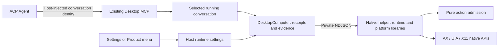

# Computer Use v1 contract

Status: accepted; macOS, Windows and Linux X11 runtimes connected, 2026-10-30.

## Problem and decision

Pero needs to observe and operate external desktop applications while keeping
its Agent sessions and authorization in the existing Host. The public values
must remain stable when the implementation changes between Point source,
Cua Driver, or a platform-specific runtime.

`protocol/computer-use.tsp` owns the wire vocabulary. Generation produces
separate observation and action bundles with their reachable definitions;
both derive from that one source. `pero-contracts::computer_use` owns the Rust
values and pure observation-admission rules. Neither imports a driver, starts a
process, reads settings, asks for permissions, or registers a model tool.
`protocol/computer-runtime.tsp` owns the separate model requests, private worker
messages, Desktop controls and Host settings extension. Generated bundles stay
small and independent of the existing Host/remote bundles. Existing App Use
continues to own managed App semantics.

## Domain values

- `ComputerCapabilities` identifies `pero.computer-use.v1`, one runtime instance,
  available observation channels, display environment and explicit
  action/delivery/addressing triples. This is
  supported vocabulary, not authorization or a promise that every app accepts
  every input.
- `ComputerTarget` describes a window or desktop. Its reference binds an opaque
  target ID to the runtime instance. Native PID, HWND, AX handles, credentials
  and transport addresses remain adapter details. Restart or target replacement
  requires fresh references, even when an OS recycles a native handle.
- `ComputerObservation` binds indexed elements and an optional screenshot to
  one target. Each element declares its available actions. Truncation does not
  invalidate observed elements, but absence in a partial tree proves nothing.
- `ComputerScreenshot` identifies immutable image bytes in the Host's evidence
  path, with MIME type and positive pixel dimensions. The adapter resolves the
  reference; the wire value exposes no local file path. Missing and null optional
  screenshots/application labels both represent absence.
- `ComputerAction` fixes a request ID, target, observation, delivery mode and
  typed input. An element anchor is observation-local; a pixel anchor also
  names that observation's screenshot. Click, text, logical key chord, scroll
  and drag are the complete v1 input vocabulary.
- `ComputerActionReceipt` echoes the request, target and observation with an
  `executed`, `rejected` or `unknown` outcome. Rejection and unknown effects
  require a structured error. Execution acknowledgement never asserts task
  verification or scientific acceptance.

References are nonempty bounded ASCII identifiers. Text limits count Unicode
scalar values, preserving whitespace, newlines and emoji. Screenshot points are
zero-based image pixels with exclusive upper bounds. Scroll deltas are logical
content pixels, positive right/down; an adapter that only supports page-based
scrolling must implement a faithful conversion or report `unsupported`.
Logical key chords are ordered key names, not OS keycodes or scripts.

## One admission function, existing authority

`ComputerAction::prepare(observation, capabilities)` consumes a typed action
and returns `PreparedComputerAction` or `ComputerError`. It checks the current
runtime, exact target and observation identity, advertised delivery/addressing combination,
element identity/action, screenshot identity and point bounds. An empty scroll
is refused. The core reads no time or external state.

The caller supplies the current Host-owned observation; a model cannot nominate
an arbitrary observation as current. A prepared value proves only these value
preconditions. Host session authorization, cancellation and current target
liveness still precede native I/O. Drivers must not silently turn background
delivery into foreground input. A mutation invalidates the old observation in
the execution owner; a subsequent action needs a new observation.

Before dispatch, denial/cancellation can be reported as `rejected`. After a
native input may have run, lost acknowledgement or cancellation is `unknown`.
Observe before continuing and retain the original request ID for reconciliation;
do not replay input automatically. Desktop persists an intent before sending input
and an outcome after acknowledgement; an interrupted intent remains unknown. Snapshot timing and process-local
freshness remain runtime concerns and are not serialized as portable clocks.

## Point and Cua mapping

Source inspection used Point `a1b915005` and Cua `cbe3991f`:

- Point's `computer/` is a Rust port of KiroCrew: core values, backend trait,
  platform implementations and service/CLI. Its separate Swift/XPC desktop
  path owns signed peers and native sessions. The two paths are not evidence
  of a single interchangeable runtime.
- Point Rust's core also contains environment/file/clock access, Point policy
  and a small JSON parser. Those do not belong in Pero's contract. The native
  adapter uses its platform backend and native compatibility predicates. Point's
  service, CLI and policy-gate wiring are not used as Pero's authority.
- Point CLI element indices live in one process; independent CLI invocations
  cannot preserve them. Cua also retains runtime/session state. The adapter must
  keep the corresponding native instance alive and map references there.
- Cua's target handles, screenshot tokens, MCP tools and input result fields
  convert at its adapter boundary. Its model loop, Spaces application and
  perception extensions are not dependencies of this contract.

References: Point ADR 0065, `computer/README.md`,
`browser/contracts/computer-use-xpc-v1.json`; Cua Driver README and embedding
guide. The five-crate native dependency closure is copied into tracked
`use/computer/vendor/point/`; `SOURCE.json`, its notice and the vendor README
record provenance and module-only adaptations. Cargo uses local paths. Builds
require no Point credentials, checkout or extraction cache; public registry
dependencies remain locked in `use/computer/Cargo.lock`.

## Package isolation

The executable root composes `computer-runtime` with one of `computer-macos`,
`computer-windows` or `computer-linux`. The runtime consumer declares the
`DesktopDriver` port and keeps its associated snapshot opaque. `computer-core`
owns Pero window identity, geometry, image values and control projection; it
has no native SDK or transport dependency. `pero-contracts` remains the single
public vocabulary and pure action-admission owner.

Only macOS/Windows adapter manifests depend on Point. Their `bridge.rs` files
convert Point values at that boundary. Linux, core and runtime contain no Point
types or dependencies. The Linux source-only build proves this by deleting
Point and its consuming implementations; only the executable composition
manifest changes. The temporary lock graph is pruned with registry versions
checked against the original pin set before the normal locked test/build.

`computer-testkit` drives the actual platform profiles through public action
admission using one shared expected-success/refusal catalogue. These value
checks are separate from the native callback/focus/pointer acceptance suites.
A Windows background UIA click advertises element addressing only; foreground
text/key also requires element addressing. X11 advertises foreground pixel
addressing. Unsupported routes are rejected before entering a native backend.

The display environment distinguishes native, X11, Xwayland, Wayland and
unavailable. Linux combines actual X11 connection success with declared session
metadata; desktop context is not a tested compositor claim. Pure Wayland has
no action capability here. A future Cua backend implements the same consumer
port; see [integration assessment](../design-docs/computer-use-cua-adapter.md).

## Runtime and ownership

The model sees `computer_use` with status, targets, open, observe, act, receipt
and stop. It cannot provide a caller identity, OS handle, permission grant,
executable path, transport URL or settings mutation. Host attaches the MCP
credentials and conversation header during ACP session creation. Desktop
admits calls only for the selected running conversation using the existing
App Use authority; Agent tool approval remains the approval owner.

`DesktopComputer` owns one serialized helper connection. The native process
owns opaque runtime/target handles and one current observation per conversation.
A new observation replaces the old one; every attempted action consumes it.
Window liveness, identity and geometry are rechecked before native dispatch.
Background input never silently escalates to global input. Foreground click and
drag are separate advertised delivery pairs; pixel text/key input focuses the
observed point in the target application before posting input there.

The helper captures eligible window pixels in memory. macOS 14+ uses an
in-process ScreenCaptureKit bridge because the legacy CoreGraphics window
capture API is obsolete in newer SDKs; older systems use the Point capture
function. Secure or incomplete AX
trees suppress capture. Desktop stores image bytes and SHA-256 metadata under
its own profile. It stores per-conversation action intents/receipts privately;
reusing an ID returns its receipt, and conflicting input with the same ID is
rejected. Duplicate pending calls share one result. No automatic retry exists.

Turning the switch off, cancelling, changing conversation, stopping, navigation,
or shutdown interrupts active input. Stop waits for confirmed process exit;
Desktop persists uncertain results before acknowledging shutdown. The emergency
shortcut is Command/Ctrl+Shift+Escape. A person's Stop also disables new
Computer Use input until re-enabled; the model's separate stop request only
resets the native connection. Process restart invalidates handles;
receipts remain queryable from the Desktop journal.

Settings are disabled by default and persisted by Host without replacing other
preferences. Only a trusted Settings/menu gesture can request OS permissions.
Preflight is advisory: recent macOS can report grants while returning the app
itself as every AX window. The adapter reports `permission_required` immediately
for that shape, rather than walking a cycle or claiming a valid observation.

`npm run build:computer` builds the pinned source plus Pero's adapter. Normal
Workbench builds and native packaging include it; Chat Products include the
same helper, MCP tool, menu controls and provenance. The native runtime now selects macOS, Windows or Linux X11 at compile time.
A shared owner handles opaque references, observation consumption and geometry
admission. Platform modules declare their supported observation/action pairs;
Windows background input is UIA invocation only, and Linux X11 supports pixel
observation and explicit foreground input. Pure Wayland returns unsupported. The standalone GPUI native
preview does not own the Electron bridge and does not expose these controls.

## Verification boundary

The shared corpus, pure admission table, native pixel-unit event test, real
Host conformance, process/MCP failure tests and Electron settings tests pass.
An actual Codex ACP session called the native status tool through the Host's
injected MCP endpoint. This proves provider transport, not desktop input effects.

The effective macOS access block was resolved. Actual AppKit callbacks now prove
AX invocation, Unicode input, key selection, exactly one callback for one pixel
click, scrolling and background drag without making the application frontmost.
Foreground drag also passed a separate owned-window run; overlapping windows
are refused by the system-wide AX hit test. A real Linux Xvfb/Tk run proves
pixel capture and all five foreground input kinds. Windows cross-compilation
and Clippy pass; Windows desktop execution, pure Wayland and signed/notarized
package launch have not passed acceptance here. Provider and package evidence
is recorded separately in [Computer Use verification](../fitness/computer-use.md).
