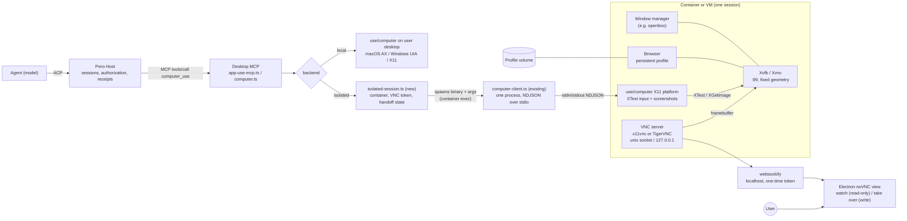

# 0019: Computer Use isolated desktop mode

Status: proposed (design only, no implementation), 2026-10-30.

Builds on [0016: Computer Use v1 contract](0016-computer-use-contract.md).
This document describes a generic, publicly documented pattern (Xvfb/Xvnc,
a window manager, XTest input, x11vnc/TigerVNC, websockify/noVNC). It is not a
description of any particular product's internals.

## 1. Goals and non-goals

Goals:

- Let an Agent operate a disposable or long-lived Linux desktop that is
  isolated from the user's own desktop, files and sessions.
- Keep browser logins across sessions through an explicit profile volume.
- Hand control to the user for login, 2FA, CAPTCHA, payment or any hidden
  (secure) input, then resume safely with a fresh observation.
- Let the user watch the isolated desktop live from inside Pero Desktop.
- Reuse the v1 contract, admission function, receipts and the existing
  `use/computer` X11 platform layer; the backend choice is invisible to the
  model except through capabilities.

Non-goals:

- Replacing the local backend. Local stays the default for operating the
  user's real apps.
- Wayland, macOS or Windows guests inside the isolated backend.
- A hosted multi-tenant cloud service, billing or remote fleet management
  (a remote Worker may host the same backend later; see open questions).
- Exposing VNC to the network, or general remote-desktop features
  (clipboard sync, file transfer, audio).
- Automating CAPTCHA or 2FA. Those are always handed to the user.

## 2. Architecture



Client choice: extend by composition, not a new transport. The existing
`desktop/src/main/computer-client.ts` already owns exactly one native process
given `binary` and `args`, serializes its private NDJSON stream, validates
replies against the generated schema and reports interrupted work as
`dispatched`. That is the same stream the isolated runtime speaks, so it is
reused unchanged: the isolated backend passes a container exec command (for
example `docker exec -i <session> use-computer`) as `binary`/`args`.

What the client must not own is session lifecycle. A new
`desktop/src/main/isolated-session.ts` owns container/VM start and stop, the
profile volume, the VNC server and websockify one-time token, view-only versus
write mode, and handoff state (pause admission, epoch invalidation, human
interval receipt). `computer.ts` selects the local `ComputerClient` or the one
held by the isolated session per backend. Folding lifecycle and VNC into
`ComputerClient` would mix a transport with a stateful session and make the
local path carry container code it never uses.

Handoff sequence:

```mermaid
sequenceDiagram
  participant A as Agent
  participant H as Host
  participant R as Isolated runtime
  participant D as Desktop noVNC view
  participant U as User

  A->>H: computer_use action
  H->>R: prepare + execute
  R-->>H: rejected: handoff_required (reason: login | 2fa | payment | secure_input)
  H->>H: pause admission, invalidate observations
  H-->>A: receipt (rejected, handoff_required)
  H->>D: handoff.requested (session, reason, token)
  D->>U: show desktop, enable input
  U->>D: operates via VNC (writes allowed)
  Note over R: screenshots and recording suppressed while secure input is focused
  U->>D: click "Hand back"
  D->>H: handoff.returned
  H->>R: switch VNC to view-only
  H->>H: record human interval receipt
  H-->>A: handoff ended; fresh observation required
  A->>H: computer_use observe
  H->>R: observe (new observation ID)
  R-->>A: observation
  A->>H: actions resume against new observation
```

## 3. Protocol change draft

Draft only; `protocol/*.tsp` is not changed by this document.

- Backend selection: `ComputerBackend { local, isolated }` in Host settings
  (`computer_set`) and in `ComputerCapabilities`. An isolated runtime has its
  own runtime instance ID, so references from local never admit there.
- Error code: add `handoff_required` to `ComputerErrorCode`, with
  `ComputerHandoffReason { login, second_factor, captcha, payment,
  secure_input, user_requested }`. Runtimes may raise it from detection
  (password field focused, known login pages) and the Agent may request it.
- Events (Desktop control channel): `handoff.requested`, `handoff.started`,
  `handoff.returned`, `handoff.cancelled`, each with session, handoff ID and
  reason.
- Receipt: `ComputerHandoffReceipt { handoffId, reason, startedAt, endedAt,
  outcome: returned | cancelled | timed_out }`. It records that a human acted,
  never what was typed.
- Observation invalidation: entering a handoff advances a target epoch; every
  observation issued before it fails admission with `stale_observation`.
  Admission stays closed (`handoff_required`) until `handoff.returned`.
- Input vocabulary: `move` (pointer to a pixel/element anchor), `hover`
  (move plus optional `dwell_ms`), and `hold_ms` on click for long-press.
  Bounded (for example `hold_ms <= 10000`), advertised per backend.

## 4. VNC security

- The VNC server listens only on a unix socket or `127.0.0.1` inside the
  sandbox; only websockify is forwarded, on host loopback only.
- Each session gets a one-time, short-lived token minted by the Host and
  passed to the embedded view in memory; never logged or put in a URL that
  persists.
- Default mode is view-only (`x11vnc -viewonly` or TigerVNC
  `AcceptPointerEvents=0 AcceptKeyEvents=0`). Write is enabled only for an
  active handoff and reverted on hand back, cancel or timeout.
- Agent actions are refused during a handoff; human input is refused
  otherwise. One writer at a time.
- The audit log records human control intervals (start, end, reason,
  outcome), not keystrokes or frames.
- While secure input is focused or a handoff is for login/2FA/payment, the
  runtime does not produce screenshots for the Agent and nothing is recorded.

## 5. Persistence

- Browser profile on a named volume per profile (not per session), opt-in, with
  a "forget profile" action that deletes the volume.
- Session lifecycle: `create -> ready -> active <-> handoff -> idle -> stopped`.
  Idle sessions stop after a configurable timeout; stop never deletes the
  profile volume.
- Resource limits: CPU, memory and pid limits on the container/VM; fixed
  screen geometry (for example 1280x800x24); disk quota on the profile
  volume; no host mounts other than the profile volume and an evidence
  directory; network egress policy configurable.

## 6. Platforms

- macOS: a Linux container through colima or Docker Desktop.
- Windows: Docker Desktop or a WSL2 distribution.
- Linux: a local container (Docker/Podman), or a host Xvfb display without a
  container as a lighter, less isolated option.
- The image contains Xvfb (or Xvnc), a window manager, a browser, the
  `use/computer` binary, a VNC server and websockify. Desktop detects the
  container runtime and reports `unsupported` with a reason when absent.

## 7. Relation to existing acceptance

- `docs/fitness/computer-use.md` remains the acceptance source; isolated mode
  adds rows rather than replacing local rows.
- CI already runs the X11 source check under `xvfb-run`
  (`tests/build/computer-source.mjs --x11`). The isolated backend reuses the
  same platform layer, so that lane stays the first gate. A later lane would
  start the image, run observe/act/receipt, a scripted handoff (view-only
  check, write window, invalidation) and teardown. Workflow changes are left
  to the maintainer.
- macOS/Windows hosts need manual evidence that the container runtime path
  works.

## 8. Related

- Draft PR #20 adds [0017: Isolated Agent with an external trusted Worker](0017-isolated-agent-runtime.md)
  and [0018: Trusted Worker runtime on Agent Sandbox](0018-agent-sandbox-runtime.md).
  Those decide where the **Agent process** runs: Kubernetes Agent Sandbox
  Pods, the Worker/bridge trust split, PVC workspaces, ACP stream grants and
  artifact export. 0018 explicitly introduces no Desktop/VNC path.
- This ADR only covers the **Computer Use desktop backend**: which desktop the
  `computer_use` tool operates, how the user watches it and takes over. It
  does not change Agent placement, Worker authority or remote execution.
- The two compose but stay independent. An Agent running under 0017/0018
  still reaches Computer Use only through the host MCP tool, which 0017
  currently fails closed for the hostile profile; enabling an isolated desktop
  for a remote Agent is the open question below, not part of either decision.

## 9. Phases and open questions

1. Contract: `handoff_required`, handoff events/receipt, epoch invalidation,
   move/hover/hold_ms in tsp and `pero-contracts`.
2. Linux isolated backend: image, session lifecycle, Xvfb + WM + XTest.
3. VNC: view-only noVNC view in Desktop, token, handoff write window, audit.
4. Persistence and limits: profile volumes, idle stop, quotas.
5. macOS (colima/Docker) and Windows (Docker/WSL2) hosts, fitness evidence.

Open questions:

- Should a remote Worker be able to host the isolated backend, and how is the
  VNC stream relayed without exposing it?
- Image distribution: built in CI and pulled, or built locally?
- Which browser, and whether the AT-SPI tree is enabled for accessibility
  observations in the image.
- Who detects handoff reasons: runtime heuristics, the Agent, or both?
- Default network policy for the sandbox.
- Handoff timeout and whether an abandoned handoff cancels the task.
- Clipboard between the user and the sandbox during a handoff.
