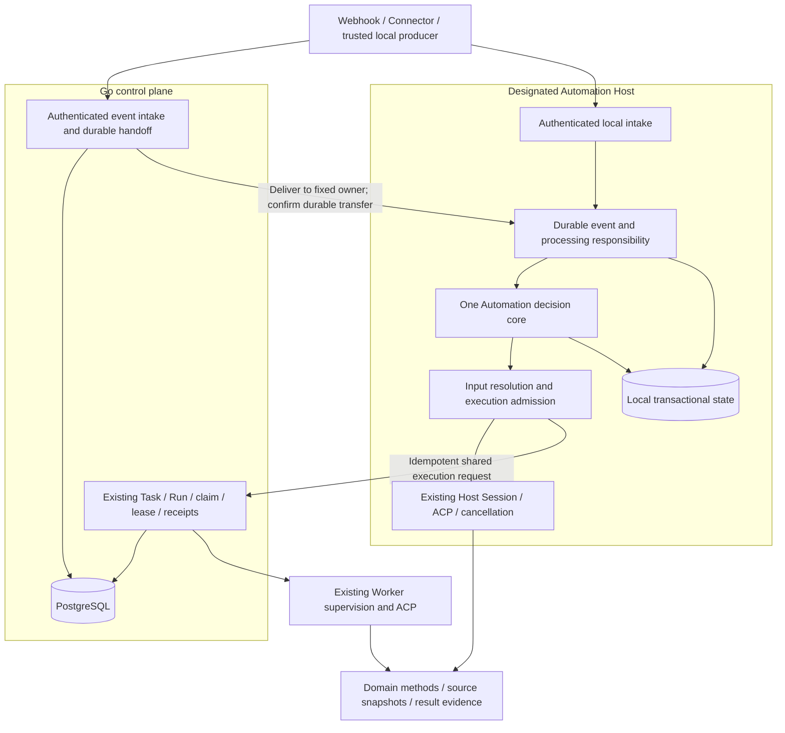

# Reliable, composable event-driven Automation

Status: accepted architecture, 2026-10-31. Implementation and runtime acceptance
are pending. This decision defines the target architecture, not an implementation
sequence or a delivery milestone.

## Context

Pero needs to compose authenticated events, schedules and explicit requests with
Agent work and domain methods. Reliability means retaining responsibility for
accepted work across interruption, while preserving the existing execution and
permission owners. It does not mean replaying every operation until it succeeds.

This decision combines the current Pero source with the Point Automation review
and architecture discussion in [the reference chat](thread://01a1904f-a00b-77f0-9108-639c36e4be4c?hostId=local).
The Point reference is `docs/architecture/automation.md`, document commit
`b45190a3d`, read from the local Point checkout. It describes Point, not installed
Pero capabilities. Its useful lessons are durable acceptance, one scheduling
core, typed method bindings, separate event/request/candidate identities, and
reconciliation of unknown effects. Its v1–v9 product branches, routes and package
structure are not the Pero model.

Pero source was inspected at `690f95975e11beee7065a276b179cf7d7654a963`.
Before committing this decision, relevant source changes through
`d792f3abeaa7dd8648bf9b7b53b3632ddead3acc` were checked; the ownership and
durability observations below remain unchanged.
The following are source observations, not newly executed acceptance tests:

| Existing boundary | Evidence and implication |
| --- | --- |
| Rust Host owns local ACP sessions | [Host entry](../../crates/pero-host/src/main.rs), [session owner](../../crates/pero-host/src/agents.rs), [ACP lifecycle](../../crates/pero-runtime/src/acp/session.rs). The current Host accepts stdio and is supervised by a Desktop shell; it is not an installed always-on daemon. |
| Host history is a replay projection | `agents.rs` loads the last 5,000 valid events and appends history asynchronously. File-open/write failures do not provide a durable acceptance failure to callers. This journal is not an event Inbox or a dispatch receipt. |
| Built-in Harness has separate durable Sessions | [Session persistence](../../harness/go/session/persistence.go) owns writer leases and flush checkpoints. It belongs to that Agent backend. Rust currently uses `session/new`; backend support for load/resume does not establish universal Host resume. |
| Go owns shared Task/Run transitions | [dispatchTx](../../server/internal/store/tasks.go) freezes Spec and saves Run/receipt transactionally. An additional dispatch request can return an already-active Run, so dispatch idempotency alone does not prove that another exact input was processed. |
| Worker coordination already exists | [claim/renew/events/complete](../../server/internal/store/execution.go) bind Worker, instance, generation and lease. [Lease reaping](../../server/internal/store/store.go) produces `reconcile`, never a replayable queued Run. |
| Worker recovery already avoids prompt replay | [Worker journal](../../crates/pero-worker/src/journal.rs) persists before execution; [recovery](../../crates/pero-worker/src/main.rs) reconciles the original claim. [Supervision](../../crates/pero-worker/src/supervisor.rs) handles lease loss, cancellation and process cleanup. |
| Source observations already freeze provenance | [GitHub ingestion](../../server/internal/store/github.go) separates retained goal revision from latest provider facts, records source versions, and supports fixed, labelled, first-dispatch automation. [Sync](../../server/internal/github/service.go) is not a generic event scheduler. |
| App Agent requests already use Host execution | [App adapter](../../crates/pero-host/src/app_agent.rs) binds request ID and frozen prompt, checks ownership and uses existing cancellation. Its replay-based binding is not a durable generic Inbox. |
| App domain state is not execution state | [Paper research](../design-docs/paper-research-agent.md) keeps frozen sources, observations and evidence in `ResearchStudy`, while Host/ACP own execution and permission. |
| Session analysis is not Automation | [schedule.rs](../../crates/session-analysis/src/schedule.rs) joins classification futures and reduces transcript turns with checkpoints. It has no trigger subscription, execution admission or Run scheduling authority. |

The current [remote protocol](../../protocol/remote.tsp) has GitHub/ROADMAP source
and Run contracts, but no general accepted-event, trigger-decision or Automation
input-snapshot contract. The historical `backend/`, Go daemon and gateway paths
in repository guidance are not alternative implementations to extend.

Related decisions: [remote dispatch](0002-remote-task-dispatch.md),
[source ownership](0003-github-issues-and-client-claims.md),
[local Apps](0007-local-app-platform.md),
[products](0008-product-distributions.md),
[Worker enrollment](0010-desktop-worker-enrollment.md),
[local ROADMAP](0011-local-roadmap.md),
[App Chat](0012-shared-gpui-app-chat.md),
[App Use](0014-app-use.md), and
[isolated execution](0017-isolated-agent-runtime.md).

## Decision

Automation is a versioned composition of:

```text
Automation = Trigger + InputContract + MethodBinding + Target + Policy
```

A durable event intake records processing responsibility. One Rust Automation
decision core turns accepted inputs into trigger decisions and idempotent
execution requests. A fixed Host owns each definition and its scheduling state.
Host admission binds actual inputs and execution authority. Existing Session or
Cloud Run owners execute the request and provide receipts.

The Go control plane remains the owner of shared tasks, execution allocation,
Worker claims/leases and results. It does not implement a second interpreter of
Automation matching, overlap, coalescing or retry rules. A server event endpoint
can durably accept an event and deliver it to the designated Automation Host.
The Host may run on a personal machine or as a separately operated headless
execution endpoint; that deployment choice does not change the core or create a
second scheduling authority. Headless lifetime is target work, not current Host
functionality.

There is no automatic ownership failover. A disconnected Host leaves accepted
work waiting. Ownership migration requires explicit quiescence and transfer of
pending identities and receipts; importing a definition on another Host does not
authorize execution of its previous work.

### Authority and state



This is a target graph. New event intake, handoff and Automation state are not
implemented by the existing edges shown here.

| Owner | Authoritative state | Boundary |
| --- | --- | --- |
| Source adapter | Authentication result and normalized provider facts | No Agent selection, scheduler, business queue or execution grant |
| Receiving authority | Event identity, acceptance receipt and outstanding handoff/matching responsibility | ACK means durable responsibility, not execution |
| Automation core on its designated Host | Definition revisions, trigger decisions, pending requests, merge coverage and dispatch intent | No Agent loop, copied Run status machine or provider I/O |
| Host admission | Local workspace, Agent/tool configuration, credential references and current authority | Event data cannot widen this binding |
| Existing local Session owner | Local ACP connection, turns, permissions and cancellation | Automation holds references, not another transcript or process owner |
| Go Task/Run owner | Shared task authorization, frozen Run input, generation, Worker placement/lease and completion | A local receipt cannot replace server admission |
| Existing Worker | Durable execution journal, actual process supervision and original-Run recovery | No new Run creation or speculative execution retry |
| Domain App/method | Domain invariants, exact source versions, outputs and evidence | No general scheduler, approval queue or independent Agent runtime |
| Verification/acceptance owner | Checks of exact outputs and explicit acceptance decisions | Agent completion cannot manufacture these records |

One owner per transition is per concept: durable delivery and Run execution are
different transitions. Additional rows or projections must not become alternative
owners of the same transition.

Workbench and standalone Products reuse this implementation, with their existing
separate Host processes and data profiles. They do not share running state merely
because they contain the same App. An App scope is an association, not a grant.

## Domain contracts

TypeSpec owns versioned wire schemas; Rust domain values own invariants and pure
decisions. External data is parsed once at the owning boundary, then passed as
typed values. Transport adapters do not repeat the decision core's checks.

| Value | Required meaning |
| --- | --- |
| `SourceBinding` | Authenticated source identity, authority/project scope, permitted event kinds and fixed destination owner; secrets remain private references |
| `AutomationDefinition` | Stable ID, schema version, semantic revision, enabled state and the five composition fields |
| `AcceptedEvent` | Source-scoped producer event ID, event type, subject, optional source revision, normalized attributes/input reference, canonical digest and receiver-assigned acceptance position/time |
| `TriggerDecision` | Event or manual/time intent, matched definition revision, per-consumer disposition, reason and covering request if merged |
| `RunRequest` | Stable request identity, frozen definition/method binding, input intent, dispatch reservation and execution reference |
| `InputSnapshot` | Exact source identities/revisions/digests, relevant method parameters and immutable content references |
| `CandidateRef` | Actual object/version observed by a method resolver, distinct from the event's assertion about it |
| `ExecutionRef` | Host identity plus thread/ACP Session/turn, or control-plane identity plus Task/Run/generation |
| `EvidenceRef` | Output identity/digest and its input/execution association; verification and acceptance remain separate |

The pure transition shape is:

```text
apply(state, typed_input, supplied_time, supplied_ids)
    -> (next_state, effects) | domain_error
```

Inputs include accepted events, manual requests, due time slots, observed
admission results, cancellation, execution receipts and reconciliation facts.
Effects request bounded source resolution, execution submission, cancellation or
receipt lookup. The core reads no clock, file, environment, process or network.
The shell persists the transition and its effects before delivering them.

The core belongs in a pure Rust Automation domain module, following the existing
contract/admission pattern. Host composition imports it; it imports no Desktop,
ACP client, HTTP handler or generated transport implementation. Go consumes the
wire contract for durable delivery/shared execution rather than duplicating
the core. Storage and method interfaces are introduced only for actual alternate
implementations, with the consumer declaring the methods it uses.

### Composable triggers and methods

Event, manual and time triggers produce the same request concept. A time request
identifies its scheduled slot and definition revision; an observed clock tick is
not its identity. Catch-up and expiry are explicit policy decisions. Event-only
definitions do not fabricate time-based work after an outage.

A method binding identifies a trusted method/version, its input contract,
workspace or domain scope, permitted execution target and result contract.
An Agent method uses existing ACP. An App method uses an installed, declared
domain route and that domain's validation. A deterministic method does not need
an Agent. Merely naming a method does not imply its executor is implemented.

Provider-specific raw data is normalized into these contracts. Business selection
and candidate rules belong to a named domain method, not branches in webhook
handlers. New schema versions describe compatibility; they are not v1–v9
feature switches for unrelated business modes.

Source intake never implicitly starts its own Agent. A direct event-to-Agent
workflow is an explicit Automation method binding, subject to the same durable
acceptance, admission and recovery. Multiple consumers must be intentional and
visible; the API must not accidentally run both a source Agent and an Automation.

## Event, request and candidate identity

1. Event identity is `(receiving authority, source binding ID, producer event ID)`.
   Retries preserve it. Sources lacking stable event IDs must supply a producer
   idempotency key or a documented stable domain identity. A receiver-generated
   random ID on every delivery does not provide deduplication.
2. The first match fixes the definition revision and creates a stable logical
   request identity. Delivery retries and uncertain submit responses reuse that
   identity. A definition edit does not rematch an already-accepted event into
   another request implicitly.
3. Actual candidate identity comes from an authorized read: object ID, source
   revision and content digest. Separate deliveries may resolve to the same
   candidate. Candidate coverage is scoped to the Automation, method contract
   and subject; it is not global deduplication across unrelated consumers.
4. The canonical digest covers semantic normalized input and binding references,
   excluding transport attempt timestamps/signatures. Same ID and same digest
   returns the original receipt. Same ID and different digest is a conflict,
   never an overwrite. Raw-byte digests may be retained for audit separately.
5. Explicit reprocessing creates a new intent linked to the original candidate
   and request. New event IDs, definition revisions or targets cannot bypass an
   unresolved external effect for that candidate.

Inputs and outputs both retain identity. A source URL, title, mutable path or
Agent summary cannot stand in for a frozen content version.

## Input obligations and coalescing

`InputContract` has two different semantics:

| Contract | Example | Obligation |
| --- | --- | --- |
| `RecheckLatest` | Inspect current CI state for one PR | Re-read the authorized source, then freeze the actual candidate; equivalent outstanding wakeups can share work |
| `ProcessExact` | Process meeting M revision 7 or feedback F | Preserve that exact input and give this obligation an explicit result; later input cannot replace it |

Coalescing is scoped by `(Automation, definition revision, method, subject key)`.
The subject key is derived through the configured source/domain binding. Different
PRs, meetings or projects cannot overwrite each other's work just because they
match one Automation.

For latest-state input, a waiting request can absorb equivalent wakeups, preserving
an event-to-request coverage link for every accepted event. The running request
uses an immutable snapshot. Wakeups arriving after that snapshot leave a durable
dirty position requiring a subsequent observation; they cannot be marked covered
by the older snapshot. The core closes coverage only through the observed
acceptance position, so a racing later event remains outstanding.

For exact input, each obligation is retained independently or linked to existing
work for the same verified candidate. A busy executor defers it; capacity limits
reject new acceptance rather than replace old obligations. FIFO, if configured,
means receiver acceptance order within its declared subject scope, not a claim
that providers delivered events in business order.

Exact input must be durably available as frozen bytes or a versioned reference
whose retention the owning source can support. Intake can persist responsibility
to resolve a reference, but that receipt must distinguish `input_unresolved`
from `input_frozen`. If the exact version is unavailable, retain a visible
`input_unavailable` result/attention state; never silently substitute latest.

## Reliable acceptance and processing lifecycle

### Authentication, filtering and durable ACK

The adapter authenticates, bounds and normalizes external data. Authentication
binds a source and authority; event content cannot select a different identity.
Provider signatures are verified over the original bytes before normalization.

Deterministic source filters and consumer predicates run without model calls.
They use bounded, versioned typed predicates, not arbitrary code. Source filters
apply to all consumers of that source; consumer conditions belong to a definition.
Filter revisions and matched definition revisions are recorded with decisions.

Before an acceptance ACK, the receiving authority commits event identity/digest
and either all consumer decisions/requests or durable responsibility to finish
matching against an identified configuration snapshot. A crash after ACK cannot
leave responsibility only in memory. If matching is deferred, configuration
changes do not silently change which historical definition revisions were in
scope at acceptance.

Durable event plus pending matching responsibility is a valid commit boundary;
separate best-effort event and queue writes are not. Fan-out cannot acknowledge
all consumers while only some have recorded responsibility. Each consumer has an
independent disposition, so one blocked method cannot erase another's result.

| Response | Meaning |
| --- | --- |
| Accepted / HTTP 202 | Durable responsibility, with an acceptance ID and status lookup; no promise of immediate start |
| Duplicate | Original acceptance and current disposition; no new work |
| Filtered / unmatched | Explicit terminal intake decision, distinct from successful execution |
| Conflict / HTTP 409 | Same identity with incompatible normalized input/binding |
| Capacity rejection / HTTP 429 | No new responsibility accepted; retry with the same identity after the advertised delay |
| Storage unavailable / HTTP 503 | Acceptance was not confirmed; query/retry the same identity |
| Unauthorized, invalid or oversized | Rejected at the boundary; no execution responsibility accepted |

### Scheduling, admission and dispatch

The core applies overlap, coalescing, concurrency, expiry and budgets to typed
requests. Delay is a durable pending disposition, not a successful execution or a
lost event. Definitions, requests and observed receipts are separate values.

Before each new execution, Host admission resolves the configured method and
freezes the input, Agent/tool configuration, workspace identity and authority
ceiling. The shell then supplies the result to the core. Host resolves local
paths and credentials; event data contains no executable or credential authority.
Frozen authorization is a ceiling, not immunity from later revocation.

Persist a dispatch reservation and the chosen execution identity before process
start or prompt submission. After that boundary, an uncertain submit is resolved
by querying the original request, never by creating a replacement request.
Only an authoritative `not_started` result permits automatic dispatch retry.

Local execution enters the existing Host Session owner with the frozen workspace,
independent of the currently selected UI workspace. Shared execution enters Go's
existing Task/Run transaction and then Worker claim/lease. Cloud-owned work never
falls back to a local unmanaged Session, even on the same computer.

The shared transaction must associate request, frozen input and Run. The current
`dispatchTx` behavior of returning an active Run is insufficient for a different
exact input: that input remains pending, or receives its own domain task binding.
It cannot acquire a false processed receipt by being attached to another input's
Run. Normal Task/Run guards remain authoritative and are not copied into adapters.

### Execution, cancellation and result interpretation

Reuse ACP setup, permission response, workspace write lock and cancellation.
Unattended work denies interactive permission requests unless a preauthorized,
bounded existing machine policy applies. Neither Automation nor an App adds a
second approval queue. A provider's `never` approval mode is not proof that tools
without approval requirements are read-only.

Background App data access requires the existing trusted Host-created App binding
and declared routes. It does not authorize hidden UI actions or screenshots:
selected-session, active-surface and visibility requirements still apply. A
headless Automation must use available domain methods or report the required UI
capability unavailable; it cannot manufacture a mounted panel or permission.

Cancellation first records intent, revokes pending authority and asks the existing
Session/Run owner to stop. A cancel request is not proof of stopped processes or
rollback. Worker cleanup receipts and local Session observations retain their
own meanings. The current local ACP cancellation path must not inherit a claim
of descendant-process cleanup merely because Worker supervision provides one.

`end_turn`, execution success, method result validity, independent verification
and business/scientific acceptance are distinct. Evidence binds the exact input,
execution and output version. Domain validation remains in the domain; the
scheduler does not parse an Agent closing message into an acceptance decision.

### Recovery and unknown effects

| Persisted boundary | Recovery behavior |
| --- | --- |
| Event accepted, matching unfinished | Complete the saved responsibility against its recorded configuration snapshot |
| Pending request, no dispatch reservation | Re-evaluate current admission without changing the request/input identity |
| Shared submission reply lost | Look up the original idempotent request/Run receipt |
| Dispatch reserved, execution start uncertain | Reconcile original execution; do not recreate Session or resend prompt |
| Confirmed result, result delivery incomplete | Redeliver the identical result receipt |
| Lease lost or process cleanup unconfirmed | Keep `reconcile`/unknown and stop automatic action replay |
| External write outcome unknown | Query the original operation ID through its actual owner; otherwise require explicit review |

There is no arbitrary external exactly-once guarantee. At-least-once delivery of
an idempotent intent is distinct from replay of the intent's effects. Trusted
method adapters supply operation IDs and effect receipts where the external
system supports them. Generic ACP tool text cannot fabricate such receipts.
When a provider offers no lookup, retain Session/tool-call references and unknown
status. A fresh request cannot be used to evade that uncertainty.

## Storage, handoff, retention and bounded operation

The target local store uses SQLite transactions in the Host profile; server
intake/handoff and shared Run records use existing PostgreSQL. Definitions,
acceptance identities, trigger decisions, pending requests and dispatch effects
share an atomic local commit boundary. Large frozen source objects may be
immutable blobs committed before references to them become accepted. Store
metadata never acknowledges a missing required blob as frozen input.

This selects transactional storage for responsibility and queryable indexes;
it does not introduce a broker, shared filesystem database or separate storage
service. A bounded, single-aggregate atomic file could satisfy the same contract
for a restricted deployment, but independent JSON files and the current chat
journal cannot provide the cross-record commit guarantee. A storage change must
preserve identities and demonstrate crash recovery before adoption.

Server-to-Host handoff is durable and addressed to a fixed owner. Server retains
delivery responsibility until the Host confirms its durable receipt. Lost replies
cause duplicate delivery with the same identity. Host completion is a later fact,
not a precondition for delivery ACK. The server keeps the transfer receipt so
status queries can distinguish queued-for-Host, delivered and execution outcome.
Each receiving boundary owns its own receipt; no distributed database transaction
is assumed.

Every deployment declares limits for event bytes, predicate complexity, fan-out,
pending obligations, source snapshots, storage, concurrency and execution budget.
Check full fan-out responsibility capacity before acceptance, or durably retain
the entire unfinished matching obligation. Never acknowledge partial work as a
complete fan-out. Accepted exact work and unknown effects are not eviction
candidates. Quota exhaustion applies backpressure; it does not drop old work.

Retention is part of the source contract, separate from a UI history limit:

- Declare a supported redelivery horizon and maximum offline/handoff delay.
  Event and request identity retention covers both, plus unresolved execution.
- Never expire pending responsibility, unknown effects or the input/evidence
  required to resolve them because ordinary history reached a count limit.
- Raw-body diagnostic retention can be shorter or disabled. It is neither the
  Inbox nor the authoritative exact input snapshot.
- After terminal processing, payloads can expire while compact identity/digest,
  disposition, candidate and execution links remain for the promised horizon.
- Retiring identity records requires a source watermark or trustworthy age bound
  that permits old deliveries to be rejected. Without one, retain compact
  tombstones for that source's lifetime or explicitly end the guarantee and
  retire/rebind the source. Do not silently accept an old ID as fresh work.
- Input deletion or App uninstall cannot silently erase an outstanding exact
  obligation. Expose the unavailable dependency and require explicit resolution.
- Cleanup occurs only while its owner runs. Offline time does not imply that a
  background retention process has deleted data.

## Definition changes, authorization and offline behavior

Definition edits create immutable semantic revisions. Existing requests retain
their matched revision and frozen input. Old pending exact work is held as
`definition_changed` until explicitly continued, migrated or cancelled; edits do
not discard it. Old latest-state work may be marked superseded with a reason and
coverage link only when replacement responsibility has been recorded. Running
work retains its binding unless authority is revoked.

Pause stops new admission. Revocation stops new privileged access and requests
cancellation of affected active execution. Credential rotation alone does not
invent a second identity for an already-accepted event. Before admission and
privileged method boundaries, intersect the frozen authority ceiling with current
grants. Source authentication never grants membership in a project or access to
an arbitrary App. Revocation cannot reverse completed effects.

Current Worker claim intersects device capabilities with owner grants, but renew
guards do not establish immediate cancellation when Client project grants change.
The target requires an explicit revocation-to-cancellation path and measured
propagation bounds. Lease expiry and observations are bounded mechanisms, not
instantaneous remote revocation guarantees.

Local work can proceed without the Go service when its input and required
capabilities are available and locally authorized. Network-dependent sources and
providers can remain unavailable; that is not permission to invent an answer or
use another target. Shared work requires current control-plane admission and
execution leases. A partition never promotes a Cloud request to local authority.

Desktop quit, Host shutdown and machine sleep are different from network outage.
Existing stdio Host lifetime does not provide always-on receiving or execution.
A persistent deployment must run the same Host/core with explicit supervision,
data ownership and startup recovery. Server reception can retain events while
the designated Host is unavailable; it cannot use that Host's local tools.

## Observability and acceptance criteria

The query projection must answer: why an event did not run, which rule revision
matched, where it merged, whether responsibility reached the Host, which exact
input was used, which execution owns it, and whether output was independently
accepted. It reads authoritative records; it owns no new workflow state.

```text
Event → per-consumer TriggerDecision → RunRequest
      → InputSnapshot / actual CandidateRef → Session or Cloud Run
      → output EvidenceRef → independent verification / acceptance
```

The architecture is considered suitable when these behavior-level properties
hold, not when a directory or interface with the right name exists:

| Property | Observable criterion |
| --- | --- |
| Durable ACK | Crash immediately after ACK leaves either a terminal decision or recoverable processing/handoff responsibility for every consumer |
| Duplicate/conflict handling | Repeated identical deliveries reuse one logical intent; changed normalized content with the same identity is rejected |
| Subject-scoped coalescing | Latest-state work eventually covers every accepted wake position without losing another subject; events after a running snapshot require another observation |
| Exact obligations | Every accepted exact input retains its version and explicit result; saturation rejects before acceptance rather than overwriting work |
| Candidate coverage | Different delivery IDs resolving to one candidate do not cause accidental duplicate execution; unrelated methods/subjects remain independent |
| Safe recovery | Failures at acceptance, matching, submit, external write and result commit preserve original IDs and never automatically replay uncertain effects |
| Permission | Payload fields cannot alter trusted bindings; queued revocation, changed grants and lease loss stop the corresponding privileged paths within recorded bounds |
| Single execution ownership | Local requests enter Host Session; shared requests enter existing Go Run/Worker; neither path starts a shadow executor |
| Extensibility | A source adds normalization/authentication; a domain method adds typed binding/resolution/execution, without modifying webhook business branches |
| Cost | Filtered events make no model call; memory, disk, fan-out, concurrency and provider budgets remain bounded and expose backpressure |
| Explainability | Event-to-input-to-execution-to-evidence links survive deferral, merge, restart and ordinary UI history truncation |

Validation uses pure value tables for domain decisions and a small number of
real-shell tests over temp profiles, loopback and isolated databases. Supply time
and IDs explicitly; wait on readiness/effects, never sleep to arrange races.
Crash injection must also test corrupted/unavailable storage failing closed,
lost ACKs and execution owners that cannot confirm whether work started.

Acceptance levels follow [the repository gates](../fitness/README.md):

| Level | Required evidence and limits |
| --- | --- |
| L0 | Compilation, domain tables, contract checks and persistence/transport fault tests; no implied Desktop or live-provider acceptance |
| L1 | Actual development Desktop with fixture Agent, status/recovery/cancel behavior and the relevant Workbench/standalone Product assembly |
| L2 | Real source, provider or environment evidence recorded separately; PostgreSQL with a scripted Agent proves coordination, not real Agent tools or third-party writes |
| L3 | Signed target-platform package install, upgrade, data continuity and recovery; production operations and business/scientific acceptance still need their own evidence |

No Automation L0–L3 result is established by this ADR. Source review, a design,
a fixture result, real Agent execution, package acceptance and production
acceptance must never be reported interchangeably.

## Alternatives and consequences

The optimum is defined within Pero's current topology: satisfy durability,
authorization, recovery, audit and capacity requirements with the fewest state
owners, business branches and operating dependencies. This is not a claim of
measured maximum throughput.

| Alternative | Decision |
| --- | --- |
| Copy Point's complete Scheduler and product versions | Reject. Reuse semantics, not another runtime or product-specific condition tree. |
| Run all Automation inside Go server | Reject as the universal owner. It makes local offline operation depend on another local service or requires another interpreter, and cannot confer local tool authority. |
| Implement matching/scheduling separately in Go and Rust | Reject. Semantic drift would duplicate the owner of pending, overlap and recovery decisions. Go retains its existing execution allocation role. |
| Let each App schedule and approve its work | Reject. App removal and Product composition would create divergent execution, retry and permission systems. |
| Treat a webhook as an immediate prompt | Reject. It hides durable responsibility and lets direct and trigger-only paths diverge. Express it as an explicit Agent method. |
| Use chat history as the Inbox | Reject. History limits, best-effort writes and lack of transactional fan-out do not establish durable acceptance. |
| Add a broker, generic workflow graph or transparent Host failover | Not justified by current evidence. Add only for a concrete requirement with measured constraints and an explicit ownership protocol. |
| Only wake existing GitHub sync | Appropriate when the requirement is GitHub observation latency. Durable source wakeup can call existing Sync and Task/Run without introducing generic Automation. It must not double-dispatch with an overlapping Automation binding. |

The principal tradeoff is availability: a fixed Automation Host can be offline,
and uncertain execution can require review. Retaining responsibility and refusing
unknown action replay takes precedence over automatic replacement execution.
Always-on deployments use the same core and explicit operating identity rather
than a new scheduling implementation.

No implementation order, fixed numeric capacity, initial feature subset or
commit plan is prescribed here. Concrete adapters, scheduling expressions,
method executors and deployment profiles must satisfy these contracts and record
their own available capabilities and acceptance evidence.
