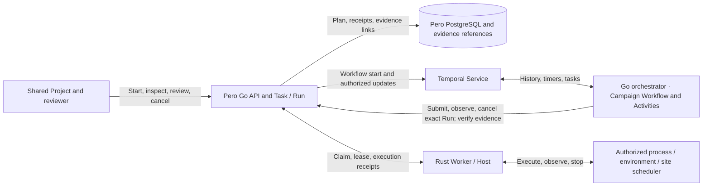

# 0037 — Temporal for durable shared research campaigns

**Status** Accepted on 2026-11-27. Exact Run control and trial receipts are
implemented and locally verified. The Temporal Campaign runtime and its
end-to-end acceptance are pending.

**Parent** [Compute Epic #249](https://github.com/phodal/pero/issues/249)

## Context

Pero can already submit locked PyBaMM CPU workloads through Go Task/Run and the
independent Rust Worker. Earlier deployment evidence covers repeated submissions,
confirmed cancellation, and connection loss with the original Run retained for
reconciliation. A research campaign adds durable responsibility across runs. It
waits for computation and independent verification, may spend a night waiting
for a reviewer, and starts the next round only after the current decision.
[Worker acceptance](../issues/2026-11-13-self-hosted-worker-acceptance.md)

Existing client Task details and Task-level cancellation target `current_run_id`. Create
and dispatch receipts are scoped to the logical client, and a new dispatch key
may reference an existing active Run. A campaign therefore needs exact Run
identity and stable request scope when the orchestrator restarts or a later
generation appears. [Task dispatch](../../server/internal/store/tasks.go) ·
[Client operations](../../server/internal/store/clients.go)

Source precedents support three specific choices. Pi records tool dispatch before
execution and returns an unknown outcome after a lost result. Phleet delegates
to existing Agent runtimes and documents the limits of in-flight deduplication.
Durable Research Fleet shows parallel aggregation and parked human review.
[Pi tool execution](https://github.com/temporalio/pi-temporal/blob/09d7c82576eeb34656403e692354bedf5e8e1fbd/src/core/activities.ts#L479-L538) ·
[Phleet delegation](https://github.com/anurmatov/phleet/blob/94edddb02ed123a578bd6dc561b0c818e39502aa/src/Fleet.Temporal/Activities/DelegateToAgentActivity.cs#L393-L407) ·
[Research Workflow](https://github.com/temporal-community/durable-research-fleet/blob/53609c4313664bd8680bdc31f21ad1a1d5faaadb/research_workflow.py#L391-L408)

## Decision

Use Temporal for manually started campaigns in an authorized shared Project.
One finite `ResearchCampaign` maps to one stable Workflow ID. Deploy a Go
orchestration process alongside the Go control plane. Its Activities enter the
control plane through project-scoped operations. Desktop and shared-project
clients go through the Pero API for start, read, review, and cancellation.

The campaign domain owns typed values and transitions for advancing a plan,
waiting for evidence, applying review, and spending the round and trial budget.
The Workflow drives that transition logic using deterministic inputs. The Go
shell supplies time, identities and observations, and runs I/O through short
Activities. The campaign domain remains independent of Temporal SDK types.

| Owner | Authoritative facts |
| --- | --- |
| Shared Project and scientific method owner | Research plan, immutable input and method versions, resource and budget requests, verification rules and scientific interpretation |
| Temporal Workflow | Campaign phase, completed and waiting steps, next-round eligibility and workflow timers |
| Go control plane | Project authorization, campaign identity and frozen plan reference, request/decision receipts, exact Task/Run and lease, published evidence and result links |
| Rust Worker, Host and scheduler | ACP session, original process or site job identity, environment use, cleanup and observed stop |

## Identity and recovery contracts

**Campaign admission.** Persist the authorized `CampaignID`, frozen plan digest,
and start intent before contacting Temporal. Derive the Workflow ID from that
identity. A repeated start with the same frozen plan resolves the original
request, including after a lost reply. Treat changed input for the same request
as a conflict. Keep pending start intents visible and use the same ID to recover
them. Record original start and final outcome references in Pero. Use Workflow
history for running phase and timers. [Workflow ID policies](https://docs.temporal.io/glossary#workflow-id-conflict-policy)

**Trial admission.** Each trial uses one stable operation ID from campaign,
plan revision and trial identity. Intentional repeats get their own trial ID.
The operation ID survives Workflow and Activity attempts, Agent tool call IDs,
and credential rotation for the same logical client.
The same operation and frozen input resolve the original `RunRef` (`task_id`,
`run_id`, `generation`) under a stable project-scoped logical client or a
control-plane-owned project binding. Commit the trial binding, Task and Run in
one Go control-plane transaction using the existing creation and dispatch rules.
Dispatch waiters may use the receipt only after that commit. Observe and cancel
by exact Run. [Activity idempotency](https://docs.temporal.io/activity-definition#idempotency)

**Cancellation and uncertainty.** Stop scheduling new trials when the campaign
is cancelled. Resolve any in-flight submission against the same operation
identity at the Go owner. A cancellation recorded before dispatch takes effect
fences later dispatch of that operation. A committed dispatch directs cancellation
to its original Run. Missing receipt alone leaves the result unknown. Lease
expiry or an unconfirmed stop remains pending reconciliation, with visible
operator action and blocked dependent steps. Resolve from the original owner
evidence. [Automation recovery contract](0024-event-driven-automation.md#recovery-and-unknown-effects) ·
[Compute environment ownership](0030-compute-environment-capabilities.md)

### Recovery follows the effect owner

| Operation | Recovery rule |
| --- | --- |
| Pure calculation on frozen inputs | Reevaluate the pure calculation. A new scientific execution still needs explicit trial admission. |
| Observation or evidence read | Repeat against the same identity and version under current authorization. |
| Submission with a durable business receipt | Repeat the control operation with the original operation ID and payload. |
| Existing process, session or scheduler job | Observe or request cancellation through the original owner. Use only the recovery positions its protocol exposes. |
| Effect entered and outcome unavailable | Retain `reconcile` with the original operation and any Run or job identity. Resume dependent work when the owner supplies evidence. |

The Run lease fences writes to execution state. An expired lease still leaves
the external process or site job subject to observation and cleanup. Preserve
the difference between a request, a committed dispatch, and an observed stop.
The same principle applies to future Harness tool receipts. When a tool invokes
shared execution, its journal links to the Run or trial receipt. Temporal's Codex
integration exposes an explicit session resume boundary after transport loss.
Pero uses the recovery capabilities of its actual ACP or compute adapter.
[Pydantic step persistence](https://pydantic.dev/docs/ai/harness/step-persistence/) ·
[Codex transport and recovery](https://github.com/temporalio/ai-integrations/blob/165fe93b5b4908a443076058b903d0f1b6aa3413/python/openai_codex/README.md#L174-L195)

**Review and evidence.** Pero authenticates the reviewer and sends an Update
identified by the decision request. The Workflow checks the active gate,
frozen plan revision and evidence reference. Persist one accepted decision
receipt with the reviewer identity before scheduling the next round. A stale
gate or review expiry leaves the next round unapproved. Runtime success,
independent verification and the research decision are separate observations.
Retain failed, cancelled and missing trials in the declared denominator.
Before advancing a dependent step, persist its exact Run, frozen input and
observed environment identity, artifact or result digest, and verification
reference. When a method resumes from workspace or solver state, include the
owner's versioned workspace or checkpoint reference in that evidence. A
filesystem snapshot attests to those files. Live kernel, job and device state
require observations from their owners. Store bounded references and summaries
in Workflow history. Resolve data, artifacts and credentials through their
existing authorized owners. [Temporal Go messages](https://docs.temporal.io/develop/go/workflows/message-passing) ·
[Coordinated agent snapshots](https://hatchet.run/blog/agent-statefulness)

## First delivery and acceptance

Run the existing locked PyBaMM method for two predeclared rounds in one shared
project. First round results feed the existing independent checker. After the
authenticated review, dispatch the exact frozen follow-up. Use a durable Timer
and short exact-Run queries for observation. Run the Temporal Service and the
Go orchestrator in an opt-in shared deployment. Retain a representative history
for a Go SDK replay check and document how an in-flight campaign survives an
orchestrator upgrade. [PyBaMM method](../../scripts/science/pybamm-sweep/README.md) ·
[Go replay testing](https://docs.temporal.io/develop/go/best-practices/testing-suite#how-to-replay-a-workflow-execution)

Acceptance requires observed behavior for lost start and dispatch replies,
approval across a restart with duplicate and stale decisions, cancellation in
the dispatch window, a later Run generation, and lease loss. Capture physical
solver starts alongside Workflow and exact Run identities. Record numerical
verification separately from scientific acceptance and the actual deployment
tested.

| Implementation | Depends on | Local record |
| --- | --- | --- |
| [#251 Exact Run control and retry-safe submission](https://github.com/phodal/pero/issues/251) | Existing Task/Run owner | [Run control](../issues/2026-11-27-campaign-run-control.md) |
| [#252 Go Temporal Campaign runtime](https://github.com/phodal/pero/issues/252) | #251 | [Runtime](../issues/2026-11-27-temporal-campaign-runtime.md) |
| [#253 Authenticated review and evidence](https://github.com/phodal/pero/issues/253) | #251, #252 | [Review and evidence](../issues/2026-11-27-campaign-review-evidence.md) |
| [#254 Real PyBaMM recovery and replay](https://github.com/phodal/pero/issues/254) | #251, #252, #253 | [Runtime acceptance](../issues/2026-11-27-temporal-pybamm-acceptance.md) |

## Other integration points

Per-turn Temporal execution becomes useful when the underlying ACP runtime can
resume the exact model or tool boundary and attest its side effects. Hosted
Automation becomes a separate deployment choice once a deployment needs an
always-on Automation owner. It must reuse the Rust decision core and preserve
single ownership of pending requests. Local Project and Automation workflows
continue through their Host paths. Later decisions can evaluate push-based Run
notifications, adaptive model proposals and additional execution environments
against a concrete campaign requirement.
