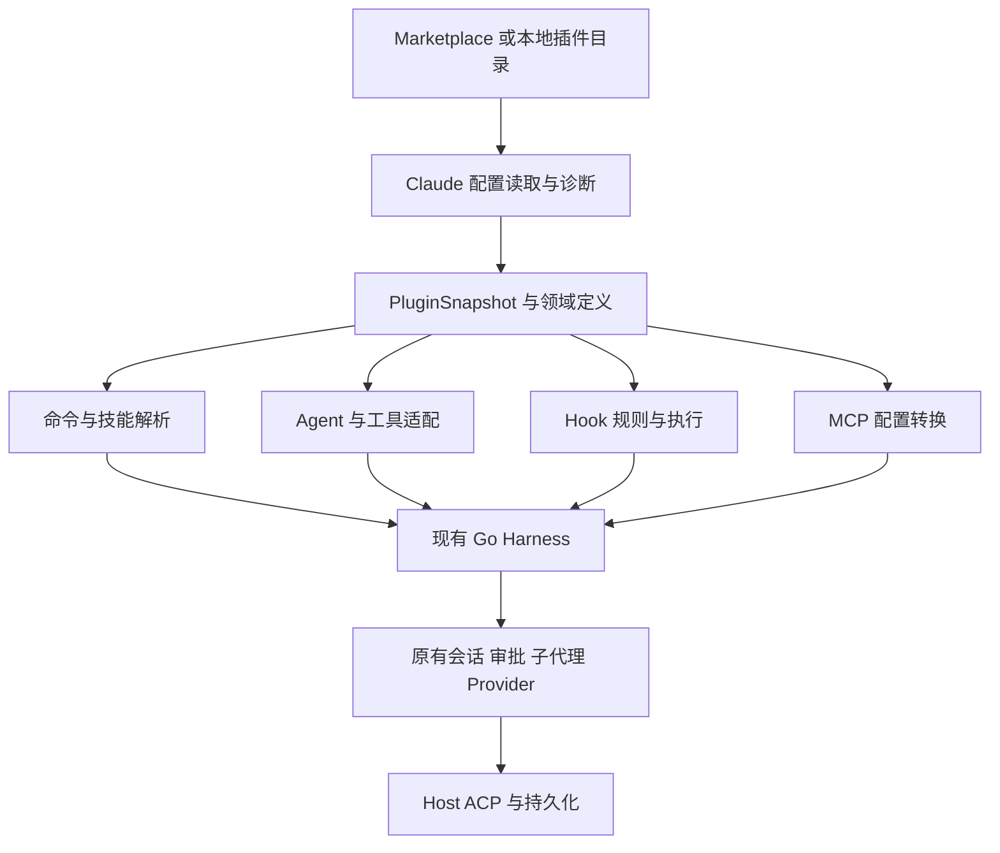

# Claude Code 插件完整兼容性分析与实施方案

日期：2026-11-02。目标：让 `harness/go` 完整运行本次评估的 Claude Code 插件，并能准确说明每个配置的兼容程度、依赖和剩余工作。

结论：应在现有 Go Harness 上增加 **Claude 插件格式与执行语义适配层**，复用现有会话、工具注册、审批、MCP、子代理和持久化。仅扫描 `skills/`、替换工具名或装配 DSH 的现有模块，都不足以完整运行这批插件。插件宿主、Claude 执行语义和插件自身问题需要分别处理。

本方案覆盖当前仓库全部 **15 个插件目录**：14 个 marketplace 条目，加上未注册的 `new_code`。清点结果为 **102 个 SKILL.md、23 个 agents/*.md、6 个 commands/*.md**；其中 8 个 agent 文件缺少 frontmatter，因此 23 是文件数，不是有效注册数量。完整逐文件记录见 [配置清单](claude-code-plugin-inventory.json)，其中 frontmatter 为静态字段与原始 YAML 记录，不是 typed schema 验证结果。第 2–14 节保留实施前基线与设计依据，第 15 节记录配置检查；**当前运行时实现、真实模型证据与逐插件剩余项见第 16 节**，完整目标仍在推进。

## 1 分析基线与项目准备

### 1.1 固定源码版本

| 对象 | 版本 | 用途 |
| --- | --- | --- |
| Pero | `78881615e37790b0a0b4635a197e18f974ea6867`，工作区有既存未提交变更 | 当前 Harness 实现基线；本次不改动既存变更 |
| 目标插件集合 | 已固定源码快照 | 用户当前目录与新克隆目录的源码一致；逐文件以相对路径定位 |
| 官方 DSH 当前 checkout | `ce7073d51254c26cd63b22a60835b8f948deb447` | 本次查阅的官方能力 |
| Pero 既有 DSH 对照版本 | `f3803c96974ad4a94195fb97e5c637e9c2a3afe3` | `harness/go/SOURCE.json` 与既有 parity 文档固定的历史基线 |
| Claude Code 规范 | 2026-11-02 查阅的官方文档 | 配置、命令、技能、agent、hooks、MCP 的目标语义；不是以旧博客作为规范 |

官方 DSH 的源码能力不等于已经移植到 Pero。当前能力还应结合 [Harness 行为对照](../fitness/harness-behavior-parity.md)、[Go Harness 说明](../../harness/go/README.md) 阅读。

### 1.2 已克隆项目

源码统一位于 `/Users/phodal/workspaces/agents-plugins`。依赖项目的远程地址、提交、提交日期、浅克隆状态与失败原因保存在 [projects.lock.json](/Users/phodal/workspaces/agents-plugins/projects.lock.json)；目标插件集合仅记录匿名来源标识。

| 目录 | 项目 | 分析用途 |
| --- | --- | --- |
| 目标插件源码 | 本地已克隆的插件集合 | 本次全部目标插件；含 coder 内嵌源码 |
| `deepseek-harness` | [deepseek-ai/deepseek-harness](https://github.com/deepseek-ai/deepseek-harness) | DSH hooks、skills、问答、plan、workflow 等实现参考 |
| `claude-code` | [anthropics/claude-code](https://github.com/anthropics/claude-code) | 官方公开插件示例与变更记录；不假定它包含 Claude Code 全部实现源码 |
| `mcp-atlassian` | [sooperset/mcp-atlassian](https://github.com/sooperset/mcp-atlassian) | Jira 与 Confluence 的实际 MCP 依赖 |
| `one-search-mcp` | [yokingma/one-search-mcp](https://github.com/yokingma/one-search-mcp) | private-buddy 搜索依赖 |
| `mcp-servers-archived` | [modelcontextprotocol/servers-archived](https://github.com/modelcontextprotocol/servers-archived) | issue-fixer 声明的旧 GitHub MCP 包源码 |
| `lark-cli` | [larksuite/cli](https://github.com/larksuite/cli) | meeting-summary 的飞书 CLI |
| `drawio-skill` | [Agents365-ai/drawio-skill](https://github.com/Agents365-ai/drawio-skill) | sad 内嵌绘图 skill 的上游 |
| `drawio-desktop` | [jgraph/drawio-desktop](https://github.com/jgraph/drawio-desktop) | sad 生成 SVG 所需绘图程序的上游 |
| `claude-agent-sdk-python` | [anthropics/claude-agent-sdk-python](https://github.com/anthropics/claude-agent-sdk-python) | plugin-tuner 试验脚本的 Claude 专用运行依赖 |

coder 的独立上游克隆返回 `Repository not found`，不能确认是私有、改名还是删除。分析使用集合内的 `coder/` 副本，不将其冒充独立上游克隆。文档中仅作为设计参考的图谱工具、优化方法项目没有批量克隆。

源码准备阶段仅克隆，没有安装依赖或执行插件；后续本地执行与模型验收见第 16 节。依赖仓库 HEAD 只是源码快照，不代表插件实际声明的包版本；例如 private-buddy 固定 `one-search-mcp@1.2.2`，必须另锁其发行包。

### 1.3 完整支持的验收层级

| 层级 | 完成标准 |
| --- | --- |
| 配置 | 所有实际使用的 manifest、frontmatter、hooks、MCP 配置能被解析；非法配置有文件和字段诊断 |
| 语义 | slash、参数、变量、工具权限、子代理、hook 时机和输出、取消、恢复与目标约定一致 |
| 依赖 | 外部 skill、CLI、MCP、凭据、模型、图片能力和工作区访问已满足 |
| 工作流 | 每个插件的代表任务实际产出正确文件，确定性校验通过；审批拒绝、取消与失败也有明确结果 |

不能用“JSON 解析成功”代替工作流支持。需要修插件的地方标为 `plugin-fix-required`；缺外部能力标为 `dependency-missing`；有意保留 Pero 策略差异的地方标为 `policy-different`。

## 2 Pero 与官方 DSH 的能力对应（实施前基线）

下表的 DSH 路径相对于已克隆的 `deepseek-harness`；未带仓库前缀的 Go 包路径相对于 `harness/go`。DSH 可用表示有实现可借鉴，不表示可直接导入 Go，也不表示已经完成运行等价测试。

| 能力 | Pero 现状与证据 | 官方 DSH 对应 | 实施判断 |
| --- | --- | --- | --- |
| 插件包和 marketplace | 无 Claude 插件安装、清单装配或 namespace；`harness/go/README.md` 明确排除产品插件装配 | DSH 自身插件机制，不等于 Claude marketplace loader | 新增格式边界与安装快照，复用现有 runtime |
| 技能目录 | `skills/catalog.go:20-23`：8 roots、64 skills、单文件 64 KiB；只读固定目录 | `packages/skill/skill-filesystem`、`tool-skill` | 全量 102 skills、15 roots 超出现有限制；先设计命名目录，不能只调常量 |
| 技能元数据 | `skills/catalog.go:251-266` 只消费 name、description、disable-model-invocation | DSH 有更完整 visibility/catalog 语义 | 补齐字段；区分用户调用与模型调用 |
| 用户 slash | `skills/invocation.go` 已有直接用户文本的显式调用 | DSH `tool-skill` | 可复用 admission 时机；新增参数、namespace、commands 统一注册 |
| 文件与 Bash | `nativetools`、`fstools`、`shell` 已有工作区边界及审批 | `packages/fs`、shell 相关插件 | 适配 Claude 参数与返回结构，不只改名称 |
| MCP | `harness/mcp.go`、`mcp/tools.go`；ACP 可显式传 stdio/HTTP server | DSH MCP 插件 | 增加插件配置导入、变量、作用域、命名和冲突处理 |
| 子代理 | `subagents/inprocess.go` 有 Persona、ToolFilter、OutputSchema；工具只接 description/prompt | `packages/subagent/tool-subagent` 等 | 基础可复用；需 AgentDef、模型路由、异步任务及授权设计 |
| 子代理写入 | 子代理固定 `ApprovalNever`，需审批的 Write/Edit/Bash 会被拒 | DSH 有较丰富 agent preset/provider 装配 | 当前无法运行大量写文件型 agent；不能靠 prompt 绕过 |
| 生命周期事件 | runtime/harness 有内部事件与工具执行接缝 | `packages/experimental/hooks-claude-code`、`hook-protocol` | 新建有返回决策的同步 hook 路径，不能只监听通知事件 |
| 用户问答 | CLI 明确未装配 user-question service；权限审批不是问答 | `packages/interaction/user-questions`、`tool-ask-user` | 新增可取消问答服务并接 Host；无人值守提供显式回答策略 |
| Plan mode | 有审批与 permission-mode 基础，没有 Claude Enter/ExitPlanMode 工作流 | `packages/plan` 相关实现 | 复用权限机制，补 plan 状态与退出确认 |
| Todos 与 Task | `todos` 为会话内整表替换、下一 turn 重置 | DSH todo/subagent 机制 | 不能等同 TaskCreate/Update/List 或 TaskOutput |
| WebSearch 与 WebFetch | Go CLI 明确未挂载 Web tools | `packages/web/tool-web` | 可移植搜索/抓取契约或以受信任 MCP 实现；需返回出处 |
| 指令文件 | `agentinstructions/README.md`：只载显式 workspace 根 AGENTS.md | `packages/context/agent-instructions` 有更广发现逻辑 | CLAUDE.md 的目录作用域、导入和本地覆盖需明确实现 |
| JS Workflow | Go 未装配 Workflow runtime | `packages/workflow/tool-workflow`、`workflow-ptc` | 有实现参考，但 coder 脚本不能直接执行，见第 8 节 |
| 会话和压缩 | 已有 durable journal、compaction、取消与工具结果投影 | DSH 对应核心 | 继续使用同一会话；补 skill 可见性提醒与 Claude transcript 投影 |
| LSP 与 Notebook | 未见对应 Claude LSP、NotebookEdit 装配 | 需独立核实语言服务/编辑能力，不视为已有 | LSP 是 issue-fixer 的实际需求；NotebookEdit 是 hook matcher 涉及面 |

现有 [parity 矩阵](../fitness/harness-behavior-parity.md) 已指出：技能正文压缩后不会自动重新加载、MCP 默认不走 native RequiresApproval、动态目录发现与权限策略存在有意差异。新兼容层要继承这些已知边界并逐项补足。

Desktop 与 CLI 的装配要分别判断：`crates/pero-runtime/src/acp/registry.rs:105-119` 已为内置 agent 启用 workspace、AGENTS 和 todos，`:191-194` 在非 Windows 启用 shell/research-clone；没有传 skills-root 或 enable-subagents。不能把 CLI 的默认关闭描述为 Desktop 所有原生工具都没开启，也不能把库里有子代理误写为 Desktop 已挂载。

## 3 Manifest 与 marketplace 的逐项支持

目标规范见 [官方 manifest reference](https://code.claude.com/docs/en/plugins-reference) 与 [marketplace reference](https://code.claude.com/docs/en/plugins/marketplace-reference)。以下“处理”均为拟实现行为。

### 3.1 本批插件实际字段

| 配置 | 实际使用 | 拟实现处理 |
| --- | --- | --- |
| `.claude-plugin/plugin.json` | 15 个插件均有 | 可选清单按官方默认目录发现；存在时一次性转为 typed PluginManifest |
| `name` | 包名含 new-code，与 new_code 目录不同 | 用 manifest 身份注册 namespace；目录只是来源路径 |
| `version` | 多处与 marketplace 不一致 | 解析两个来源并报告漂移；实际加载内容与锁定 commit/digest 绑定，禁止仅凭 marketplace version 缓存 |
| `description`、`displayName`、`author` | 描述、显示名、作者对象 | 作为展示与审计元数据，不产生执行授权；author 按官方对象 schema 校验 |
| `homepage`、`repository`、`keywords` | 多个插件 | 保留为元数据；repository 不自动改变 marketplace 的 source |
| `skills` | new_code 指定目录 | 标准目录与附加路径合并，按最终 canonical identity 去重 |
| `commands` | new_code 指定目录 | 显式位置按当前官方替换默认位置；统一成 InvocationDefinition |
| `agents` | new_code 使用目录数组 | 当前官方要求 agent Markdown 文件路径；报诊断并提供逐文件修复，不默许为官方语义 |
| `mcpServers` | private-buddy 路径；repo-admin inline object | 支持路径与 inline 两形态，按官方与 `.mcp.json` 合并规则归一；冲突显式报告 |
| 默认 `hooks/hooks.json` | ask/private/repo/coder/new_code | 自动发现；顶层必须有 hooks 包装；不是有文件就保证有效 |
| 默认 `commands/`、`skills/`、`agents/` | 多数插件不显式声明 | 默认发现必须工作，否则绝大多数插件会“清单合法但没有功能” |

当前官方对显式路径的规则不能统一写成“全部追加”：commands、agents、outputStyles 替换默认位置；skills 追加；hooks、MCP、LSP 合并。实现时用各字段自己的规则，并对默认与显式同一文件做一次加载。

### 3.2 Marketplace

当前 `.claude-plugin/marketplace.json` 使用 name、description、owner、plugins，条目使用 name、source、description、version、displayName、homepage、repository、author。`source` 为 `./plugin-dir`，都位于同一个 Git 仓库，不是 14 个独立 clone 项目。

安装入口需支持本地目录与 Git marketplace，选择条目后先形成 **安装内容快照**，再加载组件。更新只影响新快照；活动会话保留自己的版本。第一个版本支持当前实际使用的相对 source 即可；其他 Git/URL/npm 等官方 source 形态应列入能力描述并给明确 unsupported 诊断，不能忽略后声称完整 marketplace 支持。

必须保留 marketplace 与 manifest 的来源信息。版本漂移至少涉及 ask-buddy、repo-admin、req-agent、test-agent、sad、model-reasoning-distillation；例如 repo-admin marketplace 仍描述旧多仓管理员，而本体已变成 Graphify 包装插件。展示和依赖判断应基于实际加载组件。

### 3.3 官方扩展面

当前 corpus 没有实际声明 `outputStyles`、`lspServers`、`settings`、`userConfig`、`dependencies`、`channels`、`experimental.monitors`。若产品目标是接受任意 Claude 插件，这些都属于后续兼容面，不能标成已支持。按 [组件说明](https://code.claude.com/docs/en/plugins/components)、[插件依赖](https://code.claude.com/docs/en/plugin-dependencies)、[插件加载参考](https://code.claude.com/docs/en/plugins/loading) 分别实施。

| 其他字段组 | 支持边界 |
| --- | --- |
| `$schema`、`license`、`metadata` | schema 提示和元数据，不产生工具授权 |
| `icon`、`documentationUrl`、`supportUrl`、`privacyPolicyUrl`、`termsOfServiceUrl` | 目录展示信息，与 agent runtime 分开 |
| `defaultEnabled`、`dependencies` | 默认启用与跨 marketplace 的依赖/版本解析，不能只下载一个目录 |
| `settings`、`userConfig` | 有限插件默认值与 typed 用户配置；secret 使用宿主存储 |
| `channels` | 绑定插件 MCP server 的入站消息通道，需路由和会话授权 |
| `types`、`workflows`、`experimental.themes/monitors/evals` | 独立的扩展执行/呈现能力；未实现时明确 unsupported |

建议 loader 输出 capability report：本批插件的必需字段必须实现；元数据类未知字段保留并警告；改变执行、权限、后台活动的未知字段阻止启用对应组件。未来新增字段不能在未解析语义的情况下静默丢失。

## 4 Commands 与 Skills 的逐项支持

官方已将自定义 commands 合并进 skills 的调用模型，参见 [Skills](https://code.claude.com/docs/en/skills)。Go 层应统一两种文件来源，保留来源类型用于诊断。

### 4.1 Frontmatter

| 字段 | 当前使用者 | 当前 Harness 与实施要求 |
| --- | --- | --- |
| `name` | 多数 skill；部分旧 skill 缺省 | 当前强制显式 name 等于目录名，不能覆盖所有 Claude 定义；按官方默认名与可接受名称建立 logical name |
| `description` | 全部工作流入口 | 解析 YAML 多行字符串；用于模型发现，不用简单正则截取第一行 |
| `argument-hint` | coder、biz、sad、MRD、new_code 等 | 进入命令发现 UI/描述；不是 schema，也不是实际参数 |
| `allowed-tools` | 多个插件，字符串和 YAML list 两种写法 | Claude 语义是当 turn 的免询问工具授权，不是工具可见 allowlist；需与 Pero operator 权限求交并明确差异 |
| `disable-model-invocation` | coder、coder-hotol、coder-contracts | 禁模型自动调用，仍允许用户显式调用；当前 Catalog 会把它整体排除，需要拆成两个布尔维度 |
| `user-invocable` | coder 内部各阶段 false、debug/epic true | false 控制用户菜单/显式入口，模型仍可按规则使用；不得与上一字段合并 |
| `version`、`license`、`compatibility`、`metadata` | meeting-summary、req、repo、sad 等 | 保留元数据；compatibility 可提示缺依赖，不自动安装 |
| `homepage`、`platforms` 等额外字段 | drawio 等 | 保留为扩展并诊断；不能凭字段名推定 Claude 会执行任何平台选择 |
| `context`、`agent`、`model`、`hooks`、`effort`、`paths`、`shell` 等当前官方扩展 | 本批 skills 未形成普遍使用 | 作为任意插件兼容的独立功能项；需 fork、模型、hook 生命周期、路径触发、shell 选择真正落地 |

若不接受插件授予额外免询问权限，应在 compatibility profile 标为 `allowed-tools: policy-different`；这属于 Pero 产品策略，不能描述为官方 allowed-tools 的原义。

### 4.2 命名、冲突与调用

注册名使用 `<plugin>:<logical-skill>`，例如 `/product-manager:pa`。本 profile 拟采用确定性解析规则：插件内部 `Skill({skill:'drafting'})` 按调用来源优先解析同插件，再查显式声明的外部依赖；全局裸名只有唯一候选时才可形成便捷别名。这个便捷规则需要独立标为适配策略，不暗示已证明与 Claude 全部裸名优先级一致。`init`、`research`、`as-is` 等通用名不能随机覆盖。

显式 slash 在模型请求前解析，保留用户输入、解析出的参数、调用来源与插件 digest。`/new-code:new-code` 同时有 command 与 skill 时按已锁规范的优先级解析并诊断重复，不执行两遍。`knowledge-analyst/commands/ka.md` 只写“调用技能 /ka”，需要避免命令展开再次递归到同一个 alias。

`$ARGUMENTS` 作为完整原始参数传入；`$ARGUMENTS[N]`、`$N` 按规范解析位置参数。缺少占位符时按官方规则补带参数。参数是数据，不能通过模板替换变成额外 shell 片段。命令、skill 工具调用和用户 slash 应进入同一 Invocation 类型。

### 4.3 变量必须按使用位置求值

| 变量 | 本批使用 | 处理 |
| --- | --- | --- |
| `${CLAUDE_PLUGIN_ROOT}` | hooks、MCP、skill 脚本路径 | 指向当前安装快照，不是 `.claude-plugin`，也不是用户 CWD；路径解析与 shell 参数引用分开 |
| `${CLAUDE_PROJECT_DIR}` | private-buddy MCP、meeting-summary 等 | 绑定会话工作区的定义；与临时 cwd/worktree 关系必须一致，并按使用面核对官方支持 |
| `${CLAUDE_SESSION_ID}` | Claude 官方技能替换能力 | 会话启动和恢复使用稳定身份；不能拿随机进程 ID 代替 |
| `$CLAUDE_SESSION_ID` | new_code skill 的非花括号写法 | 不是相同的正文替换语法；报兼容提示，优先修插件，或明确声明额外扩展 |
| `${JIRA_*}`、`${CONFLUENCE_*}`、`${GIT_TOKEN}`、GitLab header 变量 | MCP 配置 | 从受授权运行环境/secret 绑定求值；本 profile 选择缺失时停止该 server，需标为策略差异 |
| `${VAR:-default}`、插件数据/配置等当前官方变量 | 本批不普遍使用 | 按 manifest、MCP、正文、hook 不同规则实现；不能对所有文件做无条件全局替换 |

模型上下文只需要的安装路径可投影；secret 不进入 prompt、日志或持久化命令展开记录。工具参数中的 secret 使用运行时绑定引用。

当前官方 MCP 的 `${VAR}` 缺失且无默认值时会警告并保留字面文本；`${VAR:-default}` 只在 unset 时用默认，变量已设置为空字符串时不回退。若 Pero 选择缺失即拒绝启动，这是明确的 `policy-different`，不能称完全相同。官方变量各使用面的可用性也要分别核对。

### 4.4 动态上下文与资源文件

coder 的 6 个 skill 使用 `!` 加反引号命令读取 workflow snapshot。需要在技能正文进入模型上下文前执行，捕获输出、退出状态和取消；沿用 shell 授权，而非让模型自己看到并猜测执行。其脚本只读取状态的事实不能推广成所有动态命令都只读。

实现需要区分 Markdown 标点与真实单行命令语法，不能用跨全文的非贪婪反引号正则。只扫描原始正文一次，不把 stdout 再解析为新的动态命令。每次激活的展开结果绑定 invocation；恢复历史不重新运行旧命令。审批拒绝或进程失败返回明确结果，不能把命令源码当成成功输出。任意插件支持还需覆盖官方代码块预处理语法。

skill 的 hooks 激活后默认持续至会话结束，`once:true` 成功一次后移除；普通 agent hooks 则随 agent 生命周期，二者不能共用“调用结束就卸载”的规则。

102 个 skill 的 references、templates、scripts、assets 要随包保留。只挂可写 workspace 的文件工具，往往读不到安装目录；应给插件快照提供显式只读资源能力，同时保留用户 workspace 写权限。相对资源路径由定义所在目录解析，不靠改变全局 cwd。压缩后仍保留可见技能目录与已激活工作流的恢复提示，避免丢失必需流程。

## 5 Agent 定义与工具兼容

官方契约见 [Subagents](https://code.claude.com/docs/en/sub-agents)。应将 agent 文件解析成 AgentDefinition，而不是把全文简单追加进父 prompt。

### 5.1 Frontmatter 与模型

| 字段 | 本批情况 | 处理 |
| --- | --- | --- |
| `name`、`description` | req-agent 8 文件均无 frontmatter；biz process-analyst 缺 name | 正式注册需补齐。只当 Read 模板与正式 Agent 调用是不同路径 |
| `tools` | YAML list、内联数组、逗号字符串并存 | 归一为工具集合；这是子代理可见工具限制，与 skill allowed-tools 不同 |
| `model` | opus、sonnet、inherit；req 正文另提 fable | 用 operator 声明的 alias → provider/model/capabilities 映射；未映射明确失败，不静默继承 |
| `color` | sad-designer 为 magenta | 当前官方枚举不含 magenta；仅展示警告/显式回退，不阻断核心工作流 |
| `whenToUse` | issue-fixer、biz、test-agent | 不当成官方分派字段；修入 description 或以显式 Pero 扩展保留 |
| `disallowedTools`、`maxTurns`、`autoCompactWindow`、`skills`、`memory`、`effort`、`background`、`omitClaudeMd`、`isolation` 等 | 多数未在当前 corpus 声明 | 任意插件兼容时逐项实现；不能扩大 operator 已授予的 authority |
| `permissionMode`、`mcpServers`、`hooks`、`initialPrompt` | 当前官方对插件 agent 忽略 | 严格 profile 保持忽略并诊断；若 Pero 执行属于显式扩展。普通项目/用户 agent 的行为另行实现 |

fable 或其他视觉任务需要图片输入和对应模型能力；Pero 的 `--image-input` 是显式 opt-in，文本模型不能假装分析图纸。模型名称兼容与行为质量兼容也要分别验收。

### 5.2 Claude 工具名与实际契约

| Claude 工具 | 可复用底座 | 必须补齐的语义 |
| --- | --- | --- |
| `Read` | `read_file` | file_path、offset/limit、带行号文本与错误；PDF/图片能力单列，不把二进制当文本 |
| `Write` | `write_file` | file_path/content、替换规则、审批；保留 hook 看到的 Claude 输入形状；新目录创建另有实际执行路径 |
| `Edit` | `edit_file` | old_string/new_string、唯一匹配与 replace_all；不能只重命名参数 |
| `Glob`、`Grep` | `list_directory`、`search_files` | 当前为有限目录/字面搜索，缺真实 glob/regex；需实现能力后再做参数适配，排序和截断清楚可见 |
| `Bash` | `shell` | command、timeout、cwd 与退出码；后台运行另需任务句柄，不能假装同步返回 task_id |
| `Skill` | `skill` catalog/read | namespace、args、调用者可见性、局部授权与正文生命周期 |
| `Agent` / 历史 `Task` | `spawn_agent`、`fork_agent` | subagent_type、prompt、description、模型、后台/恢复结果；旧 agentType 作为显式迁移别名 |
| `TaskOutput`、`TaskStop` 等任务工具 | 现有 activation handle 只在受信任 API 层 | 对模型提供稳定任务 ID、等待、取消、完成结果与错误；任务状态不能靠文件名猜测 |
| `TaskCreate`、`TaskUpdate`、`TaskList`、`TaskGet` | 不等于 todo_write | 带 ID 的任务表、依赖和状态变化；与 Agent 后台执行句柄保持概念区分 |
| `TodoWrite` | `todo_write` | 明确 list replacement、ID/status 与跨 turn 策略差异；不冒充持久 Task API |
| `AskUserQuestion` | 需要新增服务 | 选项、自由文本、回答关联、取消；权限审批卡片不能代替业务提问 |
| `EnterPlanMode`、`ExitPlanMode` | 审批与权限底座 | 计划期工具权限、计划文件、用户批准退出；不能返回一句“已进入”即视为实现 |
| `WebSearch`、`WebFetch` | 可借鉴 DSH 或受信任搜索 MCP | 搜索/抓取、链接与内容边界；key、网络和 HTML 转换独立配置 |
| `LSP` | 未挂载 | issue-fixer 诊断需要定义/引用等结构化查询；Grep 只能作为标明差异的降级 |
| `NotebookEdit` | 未挂载 | 真正修改 notebook cell；当前主要见 hook matcher，未挂载时也要报告 |
| `mcp__server__tool` | MCP registry | server identity、实际 tools/list 名称、prefix 与别名；同样进入权限/hook 决策 |
| `Workflow` | DSH 有参考，Go 无 | 第 8 节独立扩展，不能包装成 Bash/node |

统一适配后应保留 `ToolIdentity {canonical, claudeName, pluginOrigin}`。Claude hook matcher 匹配 Claude 可见名称，实际调度用 canonical identity；不能让名称别名形成绕过 PreToolUse 的第二条执行路径。

Claude 权限表达式需要独立编译：`Bash(git:*)` 是命令规则，`mcp__server__*` 是工具族，Read/Edit 路径规则还涉及工作目录和 glob。现有 `harness/tools.go:460-550` 主要按已注册工具名精确匹配，不能把这些字符串原样塞进 ToolRestriction 后宣称生效。deny/ask/allow、工具可见性和审批模式分别建模；Claude 的 acceptEdits/dontAsk/bypassPermissions 与 Pero 的 ApprovalNever/auto-review 不能按字面一一对应。

### 5.3 子代理权限和生命周期

coder、sad、MRD、biz 的子代理都需要写报告或执行 Bash。现有 `ApprovalNever` 会直接拒绝这些操作。建议提供 operator 选择的 plugin profile：子代理只能使用父授权与 agent.tools 的交集；需审批的操作经现有 approval 机制交给父会话 Host，并正确绑定 child/run/tool identity。插件的 permissionMode 或 allowed-tools 不得单方面扩大授权。

后台代理使用现有 activation Result/Dispose/Wait 生命周期，由同一个 session journal 保存任务状态投影。父取消要传播；进程重启后将无法恢复的运行显式标为 interrupted，不自动重放可能已写文件的任务。模型可等待或取得明确中断结果。涉及多层 delegation 的插件需要按实际调用图配置深度，不能全局取消现有一层限制。

### 5.4 运行时环境和脚本执行

当前 `nativetools/tools.go:122-124,164-179` 的 shell 使用固定 `PATH=/usr/bin:/bin`、默认 30 秒、最多 120 秒、16 KiB 输出，并且只有前台执行。`shell/local.go:34-36,102-125` 环境白名单只允许 PATH、LANG、LC_ALL、TZ；不会自动继承 HOME、登录 CLI 配置、API key 或插件变量。macOS 上 Homebrew 的 node/uv/npx、lark 用户登录和长时间 trial 都可能因此无法运行。

应在显式插件运行 profile 中配置可信解释器绝对路径、argv、cwd、环境/secret 绑定、只读资源根与超时。hook stdin JSON 是单独的进程输入，不应塞进普通 Bash command 字符串。长任务通过真实后台句柄运行；不能只放宽所有 shell 的时间和目录权限。strict sandbox 的网络限制仍生效，插件脚本、解释器和依赖库也必须位于运行时可读范围。

## 6 Hooks 的完整执行路径

当前实际出现 **SessionStart、PreToolUse、PostToolUse、PreCompact、Stop** 五类事件，全部是 command hook。官方详细契约见 [Hooks reference](https://code.claude.com/docs/en/hooks)，以下是本批需求的实现设计。

### 6.1 官方 DSH 已有实现与缺口

`packages/experimental/hooks-claude-code` 和 `packages/experimental/hook-protocol` 已覆盖 7 类事件：SessionStart、UserPromptSubmit、PreToolUse、PostToolUse、Stop、SubagentStart、SubagentStop；本批 private-buddy 必需的 **PreCompact 未覆盖**。已审阅实现还存在这些边界：

- 只实现 command，不代表官方 prompt、agent、HTTP、MCP tool hook 全部可用。
- 现有 DSH parser 不读取 Claude `args`，移植时须补 argv 形式；仅修插件配置仍不够。
- updatedInput 被解析后未完成工具输入替换；`continue:false` 未形成完整 run 停止效果。
- SessionStart 分离运行可能错过第一次模型请求需要的上下文。
- Stop 续步需要防止无进展循环；本批 coder/new_code 明确依赖 Stop 阻止过早结束。
- 没有以 Claude 完整 transcript 形状为前提的通用投影。

因此可移植协议类型与匹配思路，但要在 Go 工具准入、压缩和完成路径上补齐同步语义。当前 checkout 与 Pero pin 在上述核心 hook 代码上没有功能变化，不能以升级 DSH 版本代替补齐。

### 6.2 实际事件的接入位置

| 事件 | 同步位置 | 本批用途 | 需要的输出效果 |
| --- | --- | --- | --- |
| SessionStart | session/new 或 resume 激活、首个 provider 请求之前 | coder 恢复、repo 上下文、private 记忆、new_code session ID | 上下文持久化；区分 startup/resume/clear/compact 的真实来源 |
| PreToolUse | Claude 参数归一后、实际审批与执行前 | 只读守护、coder/new_code 写入门禁、MCP 只读限制 | deny/ask/allow、additionalContext、合法 updatedInput；修改后重做参数/权限校验 |
| PostToolUse | 成功工具结果提交时 | coder 文档更新提醒 | 追加上下文/支持的结果修改；不能撤销已经发生的写入 |
| PreCompact | summary/上下文替换前 | private-buddy 状态保存 | 保存状态；按当前官方支持 exit 2 或 decision:block 阻断压缩，并区分手工、主动自动和溢出恢复 |
| Stop | 当前 agent 准备结束、最终结果完成前 | coder/new_code gate；private 学习回顾 | block 后继续同一 agent，保存 reason；允许等待用户阶段正常结束 |

其他官方事件应保留独立状态：UserPromptSubmit、SubagentStart/Stop 可随通用层补齐；SessionEnd、PostToolUseFailure、PermissionRequest、Notification、Pre/PostCompact、WorktreeCreate/Remove 等按官方各事件契约实施。最新参考还列出任务、配置、模型切换、elicitation 等事件，不能把任何同名内部通知自动视为兼容。

### 6.3 Matcher、输入、进程和返回

matcher 是针对事件值的规则：工具事件匹配 Claude 工具名；SessionStart 匹配 source；无 matcher/空 matcher/`*` 的全匹配需按规范处理，不能拿 `*` 当裸 regex 编译。简单工具名 alternatives 与含特殊字符的 JS RegExp 区分处理；Go RE2 不是所有 JS 正则的等价实现，不支持的语法要诊断。MCP matcher 如 `mcp__.*` 必须看到实际 server/tool identity。Stop 不支持 matcher，应忽略并提示插件中此冗余字段。

标准输入需提供 event-specific JSON：至少 session_id、cwd、hook_event_name，以及工具事件的 tool_name、tool_input、tool_use_id；Stop 的 stop_hook_active；需要时 transcript_path、permission_mode。不能把 `file_path` 平铺在顶层替代 `tool_input.file_path`。

command 字符串与 `command + args` 是不同执行形态：当前官方 `args` 存在时走直接执行，`args:[]` 也一样。private-buddy 的 `command:'python3 <script>'` 搭配 `args:[]` 会把多词字符串当 executable，需要修成 command=python3、args=[script]，或移除 args 使用 shell command。repo-admin 的单脚本路径搭配 [] 则另需检查 executable 位与 shebang。

hook runner 捕获 stdout/stderr、退出码、超时、取消；0 时解析支持的 JSON，2 按事件产生阻断反馈，其他退出码和 timeout 按事件与配置定义处理。不能统一把所有失败都当 deny，也不能统一忽略守护脚本失败。多 hook 匹配时按明确聚合规则，deny 不被另一个 allow 覆盖。未知返回字段要报告，不能看见 `permissionDecision` 却丢弃。

hook `allow` 不能越过 operator 的基础权限上限。Stop block 的 reason 进入后续上下文，并有可观察的续步预算；预算耗尽返回 blocked 状态，不能把未满足 gate 的结果显示为成功。内部 hook 输出、用户输入与模型输出分别归因。

PreCompact 的阻断需要独立处理：手工压缩显示阻断原因；主动自动压缩被跳过并继续；因 API context-limit 错误触发的恢复压缩被阻断，则暴露原请求错误。当前官方丢弃此事件的 systemMessage/continue，不能将它们当通用上下文注入或停止指令。[官方事件契约](https://code.claude.com/docs/en/hooks#precompact)

### 6.4 Transcript 与环境

private-buddy `hooks/learning-review.py:88` 读取 transcript_path 并提取用户消息。Pero 的 journal 不是 Claude JSONL；必须从同一已提交会话投影出脚本所需的 Claude transcript 结构，保持稳定会话 ID，或显式修改插件以消费 Pero 格式。不能只把现有 `.jsonl` 的路径填进去。

CLAUDE_PLUGIN_ROOT、项目变量、受支持的环境写入文件等由 session/plugin 运行上下文生成；hook 子进程采用已批准 workspace/sandbox 策略。读插件路径、写用户状态路径、调用网络的授权要与同一执行模型一致。安装插件本身不等于批准任意 hook 进程与全部 MCP 行为。

## 7 MCP、依赖和工具权限

依据 [官方 MCP 配置](https://code.claude.com/docs/en/mcp) 与插件组件规则，将配置适配为现有 MCP client 的输入，而不是再建第二套 MCP runtime。

| 配置项 | 当前实例 | 实施要求 |
| --- | --- | --- |
| `type:stdio`、`command`、`args`、`env` | Atlassian、GitHub、private 本地 Python、one-search | 不经 shell 拼接；PATH 命令解析成现有 MCP 所要求的绝对 command；argv 启动，使用授权环境 |
| `type:http`、`url`、`headers` | Graphify、4 个 bench | 明确传输与凭据绑定；内部 HTTP 端点的可达性与授权独立验证 |
| 缺省 type 的 url server | ask-buddy gitlab_cn | 按锁定 Claude 规范推断或明确迁移，不能凭 URL 假定 SSE 与 Streamable HTTP 等价 |
| `timeout:120` | test-agent bench | 当前 Claude 接受毫秒单位，但小于 1000 的值会被忽略并回退全局/default；如原意为 120 秒应修成 120000，转为内部 duration 时保留单位 |
| 路径与 inline `mcpServers` | private、repo-admin | 与默认 `.mcp.json` 归一、merge、去重，给每项保留来源位置 |
| `${VAR}` 和默认值 | Jira/Confluence、GitLab、GitHub token | 启动前展开验证；不保存已展开 secret 的配置快照 |
| OAuth、SSE、headersHelper 等其他形态 | 当前未验证使用 | 需要专门 adapter 和 Host 凭据流程；不以当前 HTTP 支持代表全部认证支持 |
| resources、prompts、tools/list_changed | 一般 MCP 扩展面 | 分开广告与路由；工具名更新不得绕过冻结授权和 hook 匹配 |

每个 plugin server 的逻辑身份、实际连线身份与 Claude 工具前缀应有映射表。当前官方插件 server 身份为 `plugin:<plugin>:<server>`，工具前缀为 `mcp__plugin_<plugin>_<server>__<tool>`。仓库正文还存在旧式短前缀；test-agent 声明 `MB-atlassian`，正文却大量使用 `mcp__mcp-atlassian__jira_*`，需要修正文或提供有记录的 legacy alias，不能编造工具响应。

req-agent、ask-buddy、test-agent 声明同名 Atlassian server，但官方逻辑身份按插件隔离。第一版无需全局抢占同名 server；如果按相同配置摘要复用连接，也必须保留各自可见身份与授权。只有选择旧短前缀别名时才会产生跨插件冲突，别名应在无歧义时启用。

MCP timeout 与 hook timeout 的单位不同。前者的 wall-clock、首响应和 idle 计时也不同；最小实现不能以收到 progress 就无限延长 deadline。`timeout:120` 的实际回退行为见 [官方超时规则](https://code.claude.com/docs/en/mcp#time-limits-on-mcp-tool-calls)。

现有直接 MCP 工具没有自动标记 native `RequiresApproval`。因此 `--approval never` 不能确保只读；repo-admin/private-buddy 的 MCP 守护必须在真实调用路径执行，并结合 operator tool allow/ask/deny。readOnlyHint 只能辅助展示，不是授权。repo-admin 清单中的硬编码 Authorization 应改成 secret 绑定；本文与附件不复制凭据值或内部端点。

## 8 其他 Claude 能力与非标准扩展

### 8.1 CLAUDE.md、settings 与 output style

项目级 CLAUDE.md、目录嵌套作用域、导入、用户/项目本地覆盖需要专门的上下文发现策略；现有根 AGENTS.md loader 不提供这些语义。按 [官方 Memory](https://code.claude.com/docs/en/memory) 和 [Settings](https://code.claude.com/docs/en/settings) 实现时，应记录每段指令的来源和作用域，仍作为不授予权限的上下文。

插件根的 CLAUDE.md **不会自动成为项目指令**，更不用说仓库内 `claude.md.cn`、`claude.md.en` 这样的说明文件。ask-buddy、repo-admin 等若依赖这些说明自动注入，需改成入口 skill、正式 output style 或明确的 Pero 扩展，不应在兼容 loader 中静默把所有说明文件当 system prompt。

settings 不能整文件导入成为 Pero runtime settings。模型、permissions、hooks、MCP、env、sandbox、outputStyle、启用插件等分属不同领域；在格式入口按字段映射并保留来源与优先级。未知权限配置不能忽略后继续以全权限运行。官方 [Output styles](https://code.claude.com/docs/en/output-styles) 是独立上下文功能，不是 UI 颜色配置。

普通项目/用户 settings 与插件默认 settings 不同：当前插件根 settings.json/manifest.settings 仅应用 agent、subagentStatusLine，其他键被丢弃，默认值低于用户配置。兼容层不得把插件 settings 中任意 env/permissions 当宿主配置生效。

### 8.2 AskUserQuestion、Plan 与后台任务

业务澄清频繁出现在 product-manager、req-agent、biz、knowledge-analyst、coder。应复用同一 Host 会话关联，在 client 支持时通过明确的扩展协议传递问答，不假称标准 ACP 已实现任意业务问答。无界面运行使用 operator 提供的回答器；未提供时返回 needs-input，不自动替用户选择批准发布、改需求或接受风险。

Plan mode 必须实际约束写入/工具权限，退出后恢复策略。任务表、后台 Bash、后台 Agent 有不同状态类型，但可共享现有会话事件和取消基础。coder 的 TaskOutput 等待必须拿到真实子代理结果，不能用“仍在运行”的文字当完成。

repo-admin 的 auto-sync 资料还给出 cron/Git hook 直接执行 `/sync-graph` 的示例；slash 不是操作系统可执行文件。需要明确的 CLI prompt 入口，或把刷新脚本接到现有宿主 scheduler。meeting-summary 的 auto-run 也依赖唤醒、一次 discovery 与一次 lease。若还支持 Claude 会话级 CronCreate/List/Delete，应与现有持久 automation 分开建模，按 [官方会话调度契约](https://code.claude.com/docs/en/scheduled-tasks) 处理。

### 8.3 Workflow DSL

coder 与 MRD 提到 `Workflow({scriptPath,...})`，这不是可假定存在的 Claude Code 通用标准工具。官方 DSH 有 tool-workflow/workflow-ptc，可借鉴，但存在可核对的差异：

1. `tool-workflow/src/index.ts:335-369` 接收 script body、独立 meta 和 object args；coder-review.js 使用 `export const meta`，不能直接作为函数体运行。
2. `workflow-ptc/src/runtime.ts:85-93` 注入 agent、parallel、pipeline、phase、log、args，没有 coder 使用的嵌套 `workflow({scriptPath}, args)` global。
3. coder 的脚本需要相对脚本加载、schema 输出、模型别名、最多 3 个并行 reviewer，以及写报告的 child 工具权限。

可选方案 A：将插件脚本适配成 DSH 支持的规范，构建时提取 meta、打包嵌套阶段；Go 用受控 JS runner 承载、通过明确 RPC 进入现有 harness 子代理。方案 B：将已用到的编排转成 Go 的有界阶段执行定义，但应标为插件迁移，不能宣称任意 JS Workflow 兼容。若追求原包运行，应实现 scriptPath loader、嵌套 workflow、受限 globals、取消和结果 schema，并对这些脚本做端到端验收。

无论哪种方案，Workflow 都不能重新拥有一套模型 API、会话、审批和任务系统。`agent()` 通过原有 provider 路由与 activation 运行；外部脚本不直接取得 provider secret。

### 8.4 Claude Agent SDK 的直接依赖

`plugin-tuner/scripts/run_trial.py:53-54,150-175` 直接使用 ClaudeAgentOptions、ClaudeSDKClient、PermissionResultAllow，传 local plugins、allowed_tools、permission_mode、claude_code preset，并处理特定事件。这不是加载插件配置能解决的问题。

支持路径需要明确选择：保留 Claude SDK 作为 Claude 对照 runner；同时增加 Harness runner，将本地插件快照、回答策略、预算、超时、事件、工具结果与实际用量映射成统一 TrialResult。两者并存才能让 tuner 优化 Pero 行为，并进行对照。不要伪装 Python 包同名 API 让脚本误以为仍在 Claude 上运行。

MRD 的 trace 工具还要求区分模型变化与 harness 变化。新增 Pero trace exporter 只导出可观察事件、决策摘要、工具回执和压缩信息，不生成或声称恢复不可观察的内部思维链。

## 9 每个插件的实现与验收

下列路径以目标插件集合的根目录为基准；每个定义的 frontmatter 和 server/hook 信息均可在 [配置清单](claude-code-plugin-inventory.json) 中定位。

### 9.1 product-manager

版本 0.3.1，1 skill，无 agent/command/hooks/MCP。入口 `skills/pa/SKILL.md`，通过 `/product-manager:pa` 交付或修改一份中文 PRD。

需要 namespace、$ARGUMENTS、读写工具、必要时 AskUserQuestion。是第一批验收候选，但不能把“结构简单”写成当前已完整支持。无代码项目也应能创建文档；不得从仓库里旧说明推导已经删除的 Story/UAT 工作台。

验收：从一段充分需求生成带验收标准的 PRD；再次指定同一文件修改，保留已有正确内容；只有实质缺口才发问；拒绝写入时给可恢复结果。

### 9.2 biz-interview

版本 1.0.0，8 skills、1 agent。访谈、材料分析、综合、调研、流程图、数据流和术语表组成长会话工作流。

需要 WebSearch/WebFetch、AskUserQuestion、文件写入、跨 turn 状态、agent 模型路由。`agents/process-analyst.md` 缺 name，whenToUse 不是标准触发字段，需修入 name/description。默认 opus 不能静默映射到任意当前文本模型。

验收：一次基于材料的自主分析和一次多轮访谈，最终产出 session-notes、report、process-map、data-flow、glossary；中断恢复后不重置已确认层级。

### 9.3 knowledge-analyst

版本 0.1.0，1 skill、1 command。`commands/ka.md` 转向 skill；`skills/ka/SKILL.md:19-27,161-175` 明确强制调用外部 deep-research，缺失时停止。

需要统一 command/skill 解析、参数、研究能力、出处和文件保存。当前包没有提供 deep-research；普通 WebSearch 不能自动满足这个依赖。可接入经声明的研究 skill/provider，但需要满足引用报告和原文保留契约。

验收：有依赖时保留 research 原始结果、来源台账、带出处的最终报告；缺依赖时明确 dependency-missing，不伪造研究报告；command 不产生递归调用。

### 9.4 sad

本体 1.4.0，marketplace 1.3.4，8 skills、2 agents。生成 AsciiDoc SAD、引用映射、Draw.io SVG，并进行确定性校验与对抗审查。

需要可写子代理、Skill 在子代理中可用、opus 路由、脚本执行、只读插件资源、绘图工具链。`agents/sad-designer.md` 的 color:magenta 需展示回退。绘图 skill 的环境与 draw.io 可执行程序要作为运行依赖核验，安装目录不能当产物目录。

包中未附任务相关 `.context` 知识注册表，需要用户材料或环境注入。验收：在临时项目生成 SAD/ref/images，运行实际 validate-sad 脚本；让一次校验失败进入修复与复验；跨压缩后保持 review gate。

### 9.5 req-agent

本体 1.2.1，marketplace 0.1.0，9 skills、8 个无 frontmatter 的 agent 文件。包含上下文检索、澄清、起草、合规检查、对抗审查、CSV 导出和 Jira 发布。

`skills/context-retrieval/SKILL.md:121-197` 使用 agentType 和 `req-agent:jira-retrieval` 等类型，实际对应文件却不是可注册 agent；应补 name/description/tools/model，调用改成 subagent_type，或有记录地转换成模板型委派。diagram-analysis 的视觉需求另需模型图片能力。MCP 需要 Atlassian 凭据与正确命名。

包中未附 `.context` 知识注册表，需补依赖注入。验收：先以 Jira/Confluence fixture 完成检索、起草、确定性合规与 CSV；每项引用可追踪。5 路审查在默认并发 4 时正确排队。发布单独经过用户授权/策略，失败不把本地文档标成已发布。

### 9.6 test-agent

本体 1.2.0，marketplace 0.5.0，16 skills、2 agents；是本批 skill 最多的插件。依赖 Atlassian 和 4 个内部 HTTP bench MCP，包含刷写、测试执行与日志收集。

需要 MCP 前缀修复、毫秒超时配置修复、网络连通、长工具取消、Bash/Python、模型审查；部分路径还要求 Docker socket。`MB-atlassian` 与正文 `mcp__mcp-atlassian__...` 不一致。平台固件和测试台不是可由通用 harness 模拟成已完成的能力。

验收：先用 loopback bench fixture 验证状态、审批、超时、失败及回执；再由有权限的环境做真实测试台验收。格式兼容完成也不等于真实刷写流程可用。

### 9.7 ask-buddy

本体 2.1.0，marketplace 1.0.0，5 skills；有 PreToolUse 和 Atlassian/GitLab MCP。

`hooks/hooks.json` 缺顶层 hooks 包装；`hooks/scripts/readonly-guard.sh` 从顶层提取 file_path，而标准输入位于 tool_input，可能拒绝包括记忆目录在内的写入。需先修插件，再验证“代码只读、限定记忆可写”的规则。只匹配 Write/Edit 不足以证明 Bash/MCP 也只读，需结合真实可见工具与 operator policy。

验收：代码读取与问答成功；源代码写入被拒，记忆目录内写入成功；Bash/MCP 写操作不能绕过授权；引用和历史记忆可检索。

### 9.8 private-buddy

版本 3.1.0，9 skills；4 类 hooks；2 个本地 Python MCP 加 one-search。

除常规问答外，需要 SessionStart 首步上下文、PreCompact、Stop transcript 投影、项目环境变量、MCP 按工具只读与记忆写入规则。3 个 Python hook 的 command/args 组合需修复。`servers/memory_server.py` 和 `lark_readonly_server.py` 属包内程序，不需要单独寻找不存在的上游仓库。

验收：新会话加载记忆，压缩前正确保存，Stop 只从真实用户消息学习；private 目录能写、其他目录按策略拒绝；搜索引用保留；飞书只读调用与认证失败明确区分。

### 9.9 repo-admin

本体 2.0.0，marketplace 1.15.0，9 skills；SessionStart、PreToolUse；inline HTTP Graphify MCP。当前实现是 Graphify 包装，不应按旧 marketplace 文案规划完整多仓管理器。

需要 inline MCP、headers secret、MCP hook 匹配、readonly guard、正确快照上下文。清单中有硬编码凭据，应外移 secret；文档与诊断只保留字段存在性。内部 Graphify 端点是否可达、工具是否与提示一致需要在运行环境核验。

验收：fixture 下代码图查询与来源链接正确；Graphify 修改性工具确实被拒；无凭据/不可达时显示依赖状态，不声称图谱分析成功。

### 9.10 meeting-summary

版本 0.5.3，3 skills，无 agent/hooks/MCP；通过 lark-cli、包内脚本和 bot 配置工作。

需要 Bash/Python、插件路径、工作目录、用户级飞书登录、轮询与取消、文档位置配置。搜索/下载逐字稿与创建文档/通知是不同操作，应分别保留回执。通用定时调度不应悄悄加入 agent loop；如需周期运行接现有 automation 体系。

验收：使用受控转录 fixture 生成摘要和来源；文档目标明确；重复任务不把已有回执误当新发布；真实文档创建与 bot 通知另做授权服务验收。

### 9.11 issue-fixer

版本 0.3.0，10 skills、2 agents；GitHub stdio MCP 依赖 `@modelcontextprotocol/server-github`。诊断 agent 声明 LSP，审查与发布涉及 Bash、测试与 PR。

需要 LSP adapter、模型路由、子代理、GitHub 工具名称校验和分支/测试流程。当前 GitHub 包对应归档源码，应先验收原配置，再显式评估迁移到受维护 server；不同实现的工具名不能直接替换。描述中的“只读诊断”也不能证明 Bash 在运行时只读。

验收：本地 issue fixture → 根因 → 可复现失败测试 → 修复 → 测试与审查 → PR 草稿回执；不实际发布也能验证主链路。缺 LSP 时提示降级边界。

### 9.12 model-reasoning-distillation

本体 0.5.0，marketplace 0.1.0，8 skills、3 agents。涉及 trace 规范化、差异分析、优化、快速评估和 Model × Harness 归因。

需要 Python 工具、可写 agent、可观察 trace exporter、模型路由；重型优化路径另依赖第 8 节 Workflow 扩展。已有脚本支持多种记录形式，必须用实际 Pero journal 样本核实，不把文件后缀相同当作格式相同。

验收：一份受控 Pero run 规范化后通过 canonical trace validator；A/B 报告保留 harness 与 model 身份；未实现的 Workflow 路径明确阻断；不生成隐藏思维链。

### 9.13 plugin-tuner

版本 0.2.0，1 skill，大量逻辑在 scripts。直接依赖 Claude Agent SDK，属于“外部执行器绑定”，并非纯提示插件。

完整支持需要增加 HarnessTrialRunner，与现有 Claude runner 输出同一 trial schema。映射 permission 回调、事件、自动回答策略、预算、超时、续跑与成本；provider 未报告用量/价格时标 unknown，不能冒充精确 USD。优化目标插件的写操作也要保留原审批约束。

验收：两种 runner 在同一最小目标上各跑 baseline/variant，产出可比较但不混淆 runtime 的结果；取消/超时能清理子进程；不能为了跑通而偷偷使用 Claude 执行 Pero 试验。

### 9.14 coder

版本 0.58.0，12 skills、4 agents、4 类 hooks；本批综合复杂度最高。依赖用户专用入口、内部技能、动态上下文、任务表、后台 Agent/TaskOutput、工作区脚本、JS Workflow、review gates、文件租约与 worktree。

`skills/coder/SKILL.md` 与 hotol 的 disable-model-invocation 必须允许用户调用；plan/understand/implement/review 等 user-invocable:false 仍需内部调用。PreToolUse 的 deny、PostToolUse 的 additionalContext、Stop 的 decision:block 都要产生真实效果。不能为了结束对话绕过 stop-gate。

子代理需要 Write/Bash，Workflow 的 export meta 与嵌套 scriptPath 也要适配。对工程子目录的 worktree 路径访问必须纳入同一 workspace authority，不能默认现有工作区边界自动覆盖 sibling worktree。

验收按阶段推进：理解与澄清 → 确认方案 → task decomposition → 后台实现与收集 → spec gate → 并行质量审查 → 返修 → 当前变更报告 → 用户确认交付。至少覆盖 Stop 拦截一次、后台 reviewer 一次、方案修复一次、取消一次与恢复一次。

### 9.15 new_code

目录 `new_code`，manifest name `new-code`，版本 0.5.0，2 skills、1 agent、5 commands；未列 marketplace。包含多仓同名分支 worktree、会话需求绑定、测试证据、发布与完结。

manifest agents 目录配置需修；command/skill `new-code` 冲突需按优先级处理；非官方 `$CLAUDE_SESSION_ID` 正文写法需修。hooks/scripts/session-start、pre-tool-write-guard、stop-gate 都依赖稳定 session_id，若恢复后身份变化会使绑定和守护失效。

验收：本地 plugin-dir 可发现；多仓各建受授权 worktree；一会话绑定一请求；证据通过才可 publish；publish 不等于 completed；显式 done 才解绑并按策略清理。实际 push/部署与纯本地状态机验收分开。

## 10 建议架构与领域模型

不另建一套 Claude agent loop。兼容层将格式转换成现有 Harness 能消费的定义和效果，核心会话、provider、工具执行、审批和取消仍只有一个 owner。



### 10.1 模块归属

| 拟新增/扩展位置 | 拥有的概念 | 复用边界 |
| --- | --- | --- |
| `harness/go/plugins` | PluginID、PluginSnapshot、ComponentOrigin、安装声明与兼容诊断 | loader I/O 在 shell；快照与冲突决策是纯值逻辑 |
| `harness/go/compat/claude` | Claude 配置解码、字段转换、工具参数/结果与 transcript 投影 | 外部 JSON/YAML 只在入口一次校验 |
| 现有 `skills` | InvocationDefinition、可见性、参数、激活内容与目录提醒 | 保留现有 digest、admission 与上下文生命周期 |
| 现有 `subagents` | AgentDefinition 与稳定后台 activation 投影 | 继续使用原 registry、生命周期、capacity、模型路由 |
| `harness/go/hooks` | HookRule、HookInvocation、HookDecision、事件聚合与续步决策 | runner 执行进程；领域 reducer 不直接 I/O |
| 现有 MCP/config | server 运行定义、secret 绑定、作用域与命名 | 不建第二个连接池或配置存储 |
| Host/ACP composition | 安装/启用、命令展示、用户问答、子代理审批、能力描述 | UI/transport 不重复解释插件策略 |

包名是实施建议；若一个概念能由现有包自然拥有，优先扩展现有包，不创建只转发调用的 manager/service。新增接口仅放在已有真实替换点，例如 runner/provider/store。

### 10.2 关键值类型

```go
// 设计草图，尚未实现。
type PluginSnapshot struct {
    ID         PluginID
    Version    string
    Digest     ContentDigest
    Components []ComponentDefinition
}

type InvocationVisibility struct {
    User  bool
    Model bool
}

type AgentDefinition struct {
    ID          AgentDefinitionID
    Description string
    Instructions string
    Model       ModelRoute
    Tools       ToolSelection
}

type HookDecision struct {
    Permission ToolPermissionDecision
    Stop       StopDecision
    Context    []AttributedContext
    InputPatch *ValidatedToolInputPatch
}
```

不要让 map[string]any 或原始 frontmatter 在领域包之间流转。源格式保留在兼容层以提供诊断，核心只接已验证定义。权限求交、命名冲突、任务状态、hook 聚合分别有单一领域规则。

### 10.3 会话快照和能力报告

会话绑定插件 digest、启用组件、模型映射、MCP tool grants 与兼容 profile。插件更新后，新会话用新快照；恢复旧会话时能找到原快照，否则明确要求迁移，不能悄悄换脚本继续。已有 digest 检查可继续使用，不需要额外发明配置数据库。

建议能力报告逐项使用 `supported`、`policy-different`、`plugin-fix-required`、`dependency-missing`、`unsupported`，附 plugin、component、source location、reason、remedy。报告来源于同一已解析定义，避免另写一套文本扫描器重复解释配置。

已实现前两项配置检查接口；`--profile` 和用于运行时启用插件的 `--plugin-dir` 仍为拟议功能：

```text
pero-agent-acp plugins inspect /path/to/plugin-suite
pero-agent-acp plugins validate /path/to/plugin-suite
pero-agent-acp --plugin-dir /path/to/product-manager
```

inspect/validate 仅检查配置；启用插件执行沿用既有 operator 显式装配，不能因目录被发现就启动 hook/MCP。

## 11 分阶段实施顺序

| 阶段 | 工作 | 验收出口 | 依赖 |
| --- | --- | --- | --- |
| P0 配置与缺陷清单 | typed manifest/frontmatter/MCP/hooks 解析、来源、冲突和能力报告；修复明确插件错误 | 全部 15 插件能准确报告组件与阻塞项，无静默丢弃 | 无模型、无外部服务 |
| P1 指令与技能 | namespace、commands、参数、双维度 visibility、只读资源、动态展开、压缩提醒 | product-manager 主流程；biz 无外网材料流程；coder 用户入口可调用 | P0、现有 skills/files/shell |
| P2 Agent 与交互 | AgentDefinition、模型 alias、工具适配、AskUserQuestion、子代理审批和受控深度 | sad 与 req 的 fixture 主流程、biz 访谈 | P1、Host 问答/审批接入 |
| P3 Hooks 与 MCP | 五类必需事件、标准 I/O、Stop gate、transcript、server namespace/secret/tool policy | ask/private/repo fixture 可用；coder/new_code gate 生效 | P1；agent hooks 依赖 P2 |
| P4 任务与扩展运行 | Task 表、后台 Agent/Bash、TaskOutput、worktree authority、Workflow runtime | coder/new_code 完整本地工程闭环；MRD 重型策略 | P2、P3 |
| P5 依赖与对照 | deep-research、Web/LSP、SDK Harness runner、lark/Atlassian/GitHub/bench 真实连通 | knowledge-analyst、tuner、issue-fixer、meeting/test 的对应真实环境验收 | 各自前置阶段与授权环境 |
| P6 任意插件规范扩展 | output styles、额外 settings、LSP server 配置、其他 hook 类型/事件、OAuth、依赖/渠道等 | 单独发布官方规范覆盖矩阵 | 不阻塞针对本批插件的 profile 发布 |

P5 的依赖核查可与早期实现并行，但需要真实环境的验证不应被 fixture 通过代替。实现多个阶段后再统一标“15/15 完整支持”会掩盖进展，建议每插件记录四层验收状态。

## 12 验证方案

### 12.1 核心契约测试

| 测试概念 | 代表场景 | 必须证明 |
| --- | --- | --- |
| 来源与发现 | 默认目录、显式路径、同文件去重、两个 init | 身份和优先级确定；错误有文件位置 |
| Frontmatter | 缺 name、list/string tools、多行 description、未知执行字段 | 解析正确且不靠 README 推测 |
| 可见性 | coder 用户专用入口与内部阶段 | user/model 两维独立，不能把技能整体隐藏 |
| 调用参数 | slash、Skill args、引号、空参数、重复调用、ka 转发 | 无递归、无参数丢失或 shell 注入式替换 |
| 技能资源 | 只读安装快照、workspace 输出、修改后 digest | 能读模板，不给插件目录写权限 |
| 动态上下文 | coder snapshot 成功、拒绝、超时、历史恢复 | 首请求含真实输出；恢复不重执行旧命令 |
| Agent | tools 交集、缺模型 alias、图片需求、写报告、父取消 | 授权不扩大，任务结果真实、取消可观察 |
| Hook timing | 首请求前 SessionStart、PreCompact、Stop | 事件不是仅发日志，决策改变实际流程 |
| Hook I/O | command/args 两形态、exit 2、JSON deny/ask/allow、input patch | 真实脚本效果与预期一致；deny 优先 |
| Transcript | private 用户消息提取、恢复和压缩后的记录 | 不混用 journal 格式，不把工具输出当用户事实 |
| MCP | 重复 server、工具前缀、missing env、401、timeout、只读拒绝 | 配置未授权时不启动；hook/policy 覆盖真实调用 |
| 任务 | Task ID、后台等待/取消、并发上限、重启 interrupted | 不伪造完成、不重放不确定副作用 |
| Workflow | meta、嵌套 scriptPath、schema、并发 3、child 写入 | coder 原有 review 阶段确实执行 |
| 外部 runner | SDK 与 Harness 两种 trial | 运行时身份、事件和用量不混淆 |

测试遵循现有 repo 约束：纯值规则用表驱动；少量 shell 测试用临时 workspace、loopback 模型与 MCP fixture；不为每层复制相同断言。hooks/插件脚本是关键真实程序，应在临时目录带 fixture 输入执行，不能只 mock 出期望 JSON。

### 12.2 每插件工作流与产品验收

先执行第 9 节每插件的本地代表任务，再做服务环境验收。Desktop 命令发现、问答、审批、后台状态、失败恢复至少完成 L1；真实模型、MCP、飞书、测试台分别记 L2；安装包支持另记 L3。既有 [质量门禁](../fitness/README.md) 的层级继续适用。

完成 P0–P4 的必要检查包括对应 Go 包的 `go test`/`go test -race`、变更目标 `go vet`，以及实际 CLI/ACP 的首请求、审批拒绝、父取消、子进程退出、会话恢复。第 15 节只记录配置检查器的已验收范围，不能以既有测试通过代替后续运行时功能的验收。

## 13 应先修复的插件问题

| 插件/位置 | 问题 | 修复归属 |
| --- | --- | --- |
| marketplace 多个 version/description | 与真实本体漂移 | 插件仓库统一版本与说明；loader 仍保留来源诊断 |
| ask-buddy/hooks/hooks.json | 缺 hooks 顶层 | 插件修复 |
| ask-buddy readonly-guard | 读取错误的 file_path 层级 | 插件改读 tool_input 并加真实 payload 测试 |
| private-buddy 三个 Python hook | 多词 command 加 args:[] | 插件改 argv 或 shell 形式 |
| req-agent/agents/*.md | 8 文件无注册 frontmatter | 插件补正式定义或改模板型委派 |
| req-agent/context-retrieval | agentType 参数与正式工具契约不同 | 优先修插件；可提供显式迁移别名 |
| biz process-analyst | 缺 name，whenToUse 非正式字段 | 补 name，将触发说明并入 description |
| sad-designer | 非标准 color:magenta | 展示级修复 |
| test-agent MCP 调用 | MB-atlassian 与 mcp-atlassian 前缀漂移 | 插件统一 server 名；adapter 只做明确 alias |
| repo-admin inline MCP | 包中硬编码 Authorization | 移出包，改 secret 绑定；不把值写进诊断 |
| new_code manifest | agents 指向目录、未注册 marketplace | 修清单；本地 plugin-dir 仍可成为正式入口 |
| new_code 正文 | 非标准 session ID 占位符；同名 command/skill | 修变量并确认优先级 |
| knowledge-analyst | deep-research 未随包提供 | 显式声明、配置和验证外部依赖 |
| coder/MRD Workflow | 把额外 Workflow DSL 当作环境已有工具 | 提供明确 runtime adapter 或迁移脚本 |
| plugin-tuner | trial 固定 Claude SDK | 新增 Harness runner，保留对照 runner |

这些问题应有独立的插件修复记录。兼容层可以提供迁移 profile，但不能通过静默容错把非法配置伪装成官方标准，从而让后续行为无法解释。

## 14 官方资料与源码入口

- Claude 插件：[创建插件](https://code.claude.com/docs/en/plugins)、[组件](https://code.claude.com/docs/en/plugins/components)、[Manifest reference](https://code.claude.com/docs/en/plugins-reference)、[Marketplace](https://code.claude.com/docs/en/plugin-marketplaces)、[加载参考](https://code.claude.com/docs/en/plugins/loading)。
- Claude 执行：[Skills](https://code.claude.com/docs/en/skills)、[Subagents](https://code.claude.com/docs/en/sub-agents)、[Hooks](https://code.claude.com/docs/en/hooks)、[MCP](https://code.claude.com/docs/en/mcp)。
- Claude 配置：[Settings](https://code.claude.com/docs/en/settings)、[Permissions](https://code.claude.com/docs/en/permissions)、[Memory](https://code.claude.com/docs/en/memory)、[Output styles](https://code.claude.com/docs/en/output-styles)。
- 目标插件逐文件配置与源码相对位置见 [本地清单](claude-code-plugin-inventory.json)。
- [DSH 固定源码](https://github.com/deepseek-ai/deepseek-harness/tree/ce7073d51254c26cd63b22a60835b8f948deb447)，关键入口是 `packages/experimental/hooks-claude-code`、`hook-protocol`、`packages/skill`、`packages/subagent`、`packages/workflow`、`packages/web`。
- Pero 当前实现：[skills](../../harness/go/skills/README.md)、[subagents](../../harness/go/subagents/README.md)、[agentinstructions](../../harness/go/agentinstructions/README.md)、[native tools](../../harness/go/nativetools/README.md)、[MCP 与工具链路](../fitness/mcp-tools-resources.md)、[行为对照](../fitness/harness-behavior-parity.md)。

## 15 配置检查阶段的实现状态

2026-11-02：新增 `harness/go/plugins` 和实际 CLI 入口：

```sh
go -C harness/go run ./cmd/pero-agent-acp plugins inspect /absolute/path/to/plugin
go -C harness/go run ./cmd/pero-agent-acp plugins validate /absolute/path/to/marketplace
```

已实现本地插件/marketplace 读取、typed frontmatter、组件 namespace、独立调用可见性、默认/显式路径规则、版本漂移、hook 格式与执行形式诊断，以及 MCP 配置归一和摘要脱敏。MCP 默认配置先读，显式定义后读，同名 server 由后者覆盖；路径与 inline 混合数组按顺序处理。

报告固定 `inspectionOnly:true`。inspect 会保留错误诊断并返回报告；validate 在存在 error 时返回非零。两者都不需要模型凭据，不启动 hook/MCP，也不进入 ACP 会话。metadata 类型错误、缺失 agent 元数据、错误路径和未知能力有明确诊断。插件安装名与 manifest 名分别保存；不将二者不同判为非法。

P0 检查命令不执行远程获取、marketplace entry 组件合并或 Workflow。entry 上出现尚未处理的组件声明时给出明确错误，不静默忽略。后续运行时实现见下节；检查报告的 `inspectionOnly` 不表示运行时入口被禁用。

详细使用与输出边界见 [配置检查说明](../../harness/go/plugins/README.md)。验证使用临时配置、真实 CLI 分派、未执行 sentinel 和既有 ACP 测试，不把格式检查通过表示成插件工作流已经可运行。

本阶段验证通过 `go test -race ./...`、`go vet ./...`、相关 Bazel 测试及 Gazelle 一致性检查。实际检查了全部 15 个插件，识别 102 个 skill、6 个 command 和 22 个 agent 定义文件；另 1 个 agent 因 manifest 指向非法目录而没有加载，诊断已明确指出。检查器也复现了 9 处缺失 agent name、8 处缺失 agent description、3 处 hook argv 形态错误、6 处版本漂移和 4 处 MCP timeout 单位问题。validate 对这些配置返回非零是预期结果。

## 16 运行时实现与真实验收

2026-11-02，CLI 已新增可重复的 `--plugin-dir`，将已检查的本地插件或 marketplace 通过现有 harness composition root 装配。运行时不再停留于配置检查。插件正文、资源和权限规则来自同一份已解析定义；没有另建 agent loop、MCP client 或任务数据库。本轮已完成全部 **15/15 插件的配置迁移与运行态编译**，接通 Host/Runtime/Desktop 结构化问答、同步 Workflow、前后台 Bash 输出与超时转后台、所选 LSP，以及独立 ACP Trial runner。配置编译、开发版 UI、loopback 模型及真实服务验收仍分别记录；这些结果不表示 15 个插件的全部流程已经通过，也不表示与 Claude Code 完全同等。

| 能力 | 当前实现 | 验证与边界 |
| --- | --- | --- |
| 插件装配 | 默认/显式组件、namespace、同名 skill 覆盖 command、安装目录与工作目录分离 | 临时目录与真实 CLI fixture；无远程安装/更新入口 |
| 调用可见性 | 用户与模型入口分别枚举；用户专用 slash 能加载，模型 Skill 无法绕过 | 首个真实 provider 请求检查正文、参数与隐藏目录 |
| 参数与资源 | 完整/位置参数、路径和 session 变量；Read 能读取所选包模板；Write 创建工作区父目录 | digest 固定、包路径拒写、父目录/symlink 测试 |
| 动态上下文 | 原始正文只扫描一次，执行已声明命令，通过既有 shell executor 与审批策略；stdout 不再次解释为模板 | 无交互权限检查、拒绝/取消/持久化失败测试；成功输出超过 64 KiB 保留私有文件并给首尾预览；与 Bash 复用文件捕获和 5 GB 输出上限，呈现策略仍有差异 |
| 工具预批准 | allowed-tools 在调用 turn 生效，下一直接用户输入清除；hook ask 与部署拒绝优先 | 普通工具名、限定 server 的 MCP wildcard、简单 Bash pattern；复杂 shell syntax 不自动批准 |
| 原生工具 | Read/Write/Edit/Glob/Grep/Bash 的 Claude 名称和参数 | 真实工作区效果；Grep 用 RE2，图片/PDF/NotebookEdit、完整 ripgrep 行为仍待补 |
| 后台 Bash | `run_in_background`、真实 task_id、TaskOutput 等待/轮询、TaskStop、超时及进程回收 | 启动前持久化 intent；同一调用者拥有任务；JSONL 冷恢复保留终态，未知运行标记 interrupted，不重放副作用 |
| Bash 超时与转后台 | 前台等待与进程期限分离，超时后同一已启动进程延续；sleep/disable/bare 例外；显式 unattended/interactive host mode | promotion 单独 Append/Flush；失败取消并 join；真实同 PID、一次副作用、环境上限、交互无后台期限与失主恢复验证 |
| 命令输出文件 | 共用文件捕获；原生 Bash 成功默认 30000 字符 inline，超出返回最多 64 MiB artifact 与 2000 字符预览，失败最多 10000 字符头尾 | 工作日志使用独立 working_log_file；取消保留实际日志；Unicode、冷恢复、一次执行/审批和原工作区身份检查均有真实进程测试；动态模板仍采用独立呈现 |
| 子代理 | 自定义 Agent、模型 alias、工具交集、父审批、实际后台 ID/等待/停止 | loopback 子代理真实读写和取消；冷恢复后台任务尚未完成 |
| 内置子代理 | general-purpose、Explore、Plan | Explore/Plan 采用较窄的只读交集，暂不提供官方只读 Bash 与任意 MCP |
| 隔离技能 | context:fork、内置/自定义 agent、参数/资源前缀、子模型与子 turn 授权 | 真实 CLI 证明父历史隔离、子读模板/写文件、父仍需审批；ACP 同步等待，恢复不重跑 |
| 结构化问答 | AskUserQuestion、问题/选项校验、Other、多选、取消及恢复后的新 broker；Host/Runtime/Desktop 共用有类型请求与回答 | ACP 扩展需双方协商；未协商不注册工具；实际 Electron 验证单多选、Other、未填阻止、取消、FIFO、turn 取消、Enter、明暗主题与窄窗 |
| 任务状态 | TaskCreate/Update/List/Get、依赖图、metadata、CAS、JSONL 恢复 | 完成前置任务后解除阻塞；不把 Agent 后台 ID 当 Task ID |
| Command hooks | 标准 stdin、argv/shell、超时/取消、exit 2、JSON 决策、updatedInput 重验 | SessionStart、UserPromptSubmit、Pre/PostToolUse、PostToolUseFailure、Pre/PostCompact、Stop、SessionEnd、SubagentStart/SubagentStop |
| 子代理 hook | Start 在首请求前注入上下文，按 agent type 匹配；Stop 反馈可要求真实子代理续跑，独立子 transcript | 文本答案与 structured_output 都经过结束检查；被拒候选只在实际续跑时撤销，父只接收最终结构化结果；普通工具步骤重置连续反馈计数 |
| Hook 会话归属 | 主会话生命周期不对子代理重复触发；子工具事件使用主 session/transcript 并携真实 agent_id/type | 真实子代理回归；Stop 默认连续续跑 8 次、工具调用后重置、达到上限正常结束 |
| 压缩生命周期 | PreCompact 可阻止；PostCompact 后 SessionStart(source=compact) 上下文进入紧接的请求 | manual 与真实 context-overflow retry fixture；不延迟到下一个 tool step |
| 压缩后的技能 | 最近一次已渲染正文与参数从原始日志恢复，单项 5000、合计 25000 估算 token | Unicode 安全截断；不重新读安装文件、不重跑命令、不恢复过期授权，不恢复 fork 正文到父会话 |
| MCP | stdio/streamable HTTP/旧版 SSE、环境替换、namespace、root-agent 连接生命周期 | SSE 实际发现、调用、取消与退役回收；拒绝向外部 origin 转发配置凭据；OAuth/每工具迁移仍待补 |
| LSP | `--lsp-config`、所选插件 `.lsp.json`/manifest 声明默认装配；9 类 query、UTF-16 坐标、能力协商、取消与进程生命周期 | 实际 `/usr/bin/clangd` hover、operator/bundled 两种真实 CLI 路径通过；不安装服务器，不应用编辑；自动 diagnostics 与动态注册仍缺 |
| WebSearch/WebFetch | 显式 DeepSeek Search/Fetch provider；域名过滤、引用、offset 分片及无工具子代理提取 | CLI loopback 验证审批、共享预算、取消和拒绝写文件；真实 API 两次请求通过；缓存与跨域 redirect handoff 尚未实现，搜索后端不同 |
| 同步 Workflow | 原始 scriptPath、export const meta、args、嵌套 workflow、agent/parallel/pipeline/phase/log；RPC 复用 ClaudeContribution.Invoke | 原始 3 个审查脚本实际运行；9 次 agent()、10 次 loopback HTTP、峰值并发 3；后台 Workflow 明确拒绝，详见 16.4 |
| Trial runner | 显式选择 Harness ACP 或原 Claude runner；工作区/session/续跑/问答策略/审批/真实 usage/进程回收 | 15 项本地测试通过；所有 session 与最终产物复核，取消/关闭失败/非零退出不伪成功；不估算 USD，不重试已提交 prompt |
| 显式研究依赖 | 选定固定来源后生成内容寻址 package view；原 research → research-deep → research-report 留在 root，保留人工 gate | 原链 CLI loopback 已通过：6 次问答、2 个后台研究代理、10 Search、2 Fetch、2 次无工具提取、16 次审批、原 validator 和 raw 字节归档；不宣称真实研究质量 |

### 16.1 真实模型结果

使用项目 `.env` 中的 `DEEPSEEK_API_KEY`，显式选择 `deepseek-flash`、关闭 thinking、单次输出上限 4096 token、总请求上限 6、重试 0。实际消耗 **4 次 HTTP 请求**，`session/prompt` 返回 `end_turn`。

验收输入为订单 CSV 导出需求，指定输出 `reports/export-prd.md`。日志确认真实调用顺序：并行 Read 插件 PRD 模板与自检清单 → Write 工作区文件 → Read 保存后的文件 → 结束。生成文件 6988 字节，包含验收条件、角色权限、1000 条上限及 CSV 转义要求。首个请求已经含展开后的 `/product-manager:pa` 正文与用户参数。

该次 ACP 会话使用既有默认 auto-review，未弹写入审批；不能用此结果证明交互审批。独立 CLI fixture 显式选择 workspace-write，验证一次真实 ACP 写入审批，并在 session/load 后再次请求，确认旧技能只加载一次、参数与来源仍保留，实际文件不被重放改写。

本次真实验收证明 product-manager 的本地 PRD 路径可运行，不能扩展成“15 个插件全部通过”或“全部 Claude 行为相同”。输出内容仍是模型生成结果；文件落盘和工具链验证不代替逐条需求审查。

同机 Claude Code 2.1.309 通过 DeepSeek 的 Anthropic 兼容入口运行相同插件与输入，也正常结束并保存 4290 字节的 PRD，包含验收标准与 1000 条约束。对照关闭了用户/项目 settings 和额外 MCP，保留 Read/Write，设置 `--max-turns 6`。首次运行被 Claude 本地美元费用估算上限中止，未保存文件；提高该估算上限后的重跑成功，结果报告 `num_turns:7`。此字段不等于 Pero 的 HTTP attempt 计数，未作为等量用量对比；Claude 对自定义模型的本地费用估算也未作为 DeepSeek 实际账单。两边输出并非逐字一致，本次只对比插件加载、资源使用与可落盘交付。

### 16.2 继续实现的出口

完整目标仍未达成。接下来按第 11 节验收出口推进：Workflow 的后台执行与可恢复任务句柄；动态模板的精确呈现；后台子代理的驻留、cold-resume、turn/run 区分及命令完成通知/自动唤醒；LSP 自动 diagnostics 与动态能力注册；研究技能的真实模型/真实语料质量；外部依赖和实际服务连接。任务生命周期和其他附加 hook 事件也未全部装配。条件 Bash 权限和 search/comparison 的 exit 1 例外当前只处理能明确解析的 simple command，复合语法还未达到官方能力。配置结构错误已有可重放迁移；版本漂移、外部认证、脚本依赖与实际流程缺口继续保留，不能由配置编译通过代替验收。Trial 的最终产物复核、关闭失败和进程退出处理已完成独立回归，真实优化效果仍需另行验收。

任务归属也需区分目标契约：当前任务查询限定创建者，子代理退出时取消并等待其命令，这与 pinned DSH 的 owner 隔离及 disposal 语义相符。Claude 官方要求前台子代理结束时停止命令，但允许后台子代理在当前 turn 结束后继续持有后台命令，并接收完成通知；run 真正退出时才停止。现有 one-shot 子代理在结果返回后回收，尚未实现后一种驻留。不能把它写成所有子代理命令都应无限存活，或已经支持根会话接管所有子任务。当前 Claude 文档还注明 TaskOutput 自 v2.1.277 移除、改为 Read 输出文件；本批插件所用旧 TaskOutput 接口作为显式兼容接口保留。

官方行为依据：[技能动态命令和权限](https://code.claude.com/docs/en/skills#permission-checks-on-injected-commands)、[Bash pattern 和 compound command](https://code.claude.com/docs/en/permissions#bash)、[工具输出与 exit 1 例外](https://code.claude.com/docs/en/tools-reference#output-limits)、[后台命令停止条件](https://code.claude.com/docs/en/tools-reference#when-a-background-command-stops)、[后台子代理的工具与结果](https://code.claude.com/docs/en/sub-agents#tools-permissions-and-results-of-background-subagents)、[工具可用性与 TaskOutput 版本变化](https://code.claude.com/docs/en/tools-reference#available-tools)、[CLI 运行限制](https://code.claude.com/docs/en/cli-reference)。

### 16.3 逐插件运行态复核

本轮对插件配置完成 17 处显式修复后，逐项调用 `plugins.LoadPackages`，**15/15 均可编译**。迁移包括 agent 正式元数据与路径、hook 包装/执行形态、MCP timeout/名称、历史调用字段及技能会话变量。版本漂移和嵌入式认证仍需独立整改。运行时没有通过吞掉结构错误取得此结果。全部 15 包也通过真实 CLI 的无会话启动/EOF 退出检查，完成配置、资源与工具装配；该检查不连接外部 MCP、不执行 hook 或模型。

第 15 节记录的原始检查问题，以及此前“10 个可编译、5 个结构阻塞”的结果，保留为迁移前证据。当时 10 个插件合并加载得到 69 个 skill、13 个 agent、1 个 command、436 个文本资源、6 个 hook 与 7 个 MCP 配置；这些历史计数不代表迁移后的全部集合。

LoadPackages 复核不执行 hook、脚本、MCP 或模型请求。“可编译”只证明当前配置可装配，下面继续保留各插件的实际闭环要求。

| 插件 | 当前编译结果 | 剩余闭环与下一步 |
| --- | --- | --- |
| ask-buddy | 迁移后可编译 | 实测代码只读与记忆可写；配置外部服务认证 |
| biz-interview | 迁移后可编译；Web 工具已装配 | 显式选择 Web provider、配置 opus 路由并验收实际访谈闭环；客户端问答 UI 已接通 |
| coder | 可编译；原始审查 Workflow 已验证 | 同步审查的 spec gate、质量 fan-out 与聚合已跑通；仍需实际工程的 worktree、完整 review gate、后台代理驻留与恢复验收 |
| issue-fixer | 可编译；LSP runtime 已提供 | 选择可用的项目语言服务器、显式模型路由与 GitHub MCP；验证分支、测试、审查及 PR 实际回执 |
| knowledge-analyst | 可编译；显式研究依赖原链已通过 CLI loopback | 原三阶段与人工 gate、validator、report 回读/原样 raw 归档、来源台账和最终报告已验证；真实模型/网页研究质量与实际任务仍需验收 |
| meeting-summary | 可编译 | Python、飞书 CLI、登录与目标配置；真实下载、轮询取消、文档创建及通知验收 |
| model-reasoning-distillation | 可编译；同步 Workflow runtime 已装配 | Pero journal 到 canonical trace 的实际适配、重型优化脚本与 sonnet 路由；coder 审查 fixture 不证明该插件的优化流程已验收 |
| new_code | 迁移后可编译 | 多仓 worktree、恢复绑定、发布及解绑状态机的实际验收 |
| plugin-tuner | 可编译；ACP Harness runner 的 15 项本地回归通过 | 保留 Claude runner、显式选择运行时；最终产物、关闭失败和非零退出已验证，仍需真实优化试验验收 |
| private-buddy | 迁移后可编译 | 本地 Python MCP、搜索、认证、记忆与压缩流程实测 |
| product-manager | 可编译；真实模型已验证 | 材料充分的中文 PRD 生成/保存/读回可运行；问答 UI 已接通，仍需真实需求澄清的完整任务验收 |
| repo-admin | 可编译 | 凭据外移；图谱服务工具契约与认证连通；只读 hook 的真实修改阻止测试 |
| req-agent | 迁移后可编译 | 准备知识材料、图片能力和 Atlassian 发布验收 |
| sad | 可编译 | draw.io CLI/export、项目材料与 opus 路由；跑确定性校验和失败返修闭环 |
| test-agent | 迁移后可编译 | 测试台/固件/Python/Docker 环境；真实刷写、取消及日志回执 |

此前集中在 coder 与 MRD 重型路径的同步 Workflow runtime 缺口已经补齐，其中只有 coder 原始三脚本有本轮端到端证据。sad、test-agent 正文中的普通“workflow/流程”标题不能当作使用该 DSL 的证据。完整验收继续按第 12 节逐个执行；配置迁移、实现缺口与外部环境缺失分别保留。

### 16.4 本轮关键路径与验收证据

结构化问答经过实际 Desktop/GPUI → Host → Runtime/ACP → Agent 的请求与回答路径。`node tests/e2e/user-questions.mjs` 使用真实 Electron 与脚本化 ACP fixture，无真实模型或外部服务；[result.json](../../test-results/user-questions/result.json) 记录 `passed:true`、`errors:[]` 和 10 项检查。实际渲染图为 [浅色](../../test-results/user-questions/answered-light.png)、[深色](../../test-results/user-questions/answered-dark.png)、[窄窗](../../test-results/user-questions/answered-narrow.png)。这属于开发版 L1 证据，不扩大为所有操作系统或签名安装包验收。

同步 Workflow 只执行所选插件资源清单中的 `workflows/*.js`/`.mjs`，要求绝对 scriptPath 和未变化的文件 digest。CLI 仅在选中这些脚本时解析 Node，默认从 PATH 查找 `node`，可用 `--workflow-node` 指定；当前进程回收支持 macOS/Linux。脚本保留 `export const meta` 和原始 args，支持嵌套 workflow 及 agent、parallel、pipeline、phase、log。agent() 经 RPC 复用 `ClaudeContribution.Invoke`，模型路由、结构化输出、工具限制、审批、取消和会话记录均进入现有 Harness；脚本不取得 provider 凭据。Node VM 不构成 OS sandbox，所选脚本仍属于可信安装代码。

[原始审查脚本测试](../../harness/go/workflow/review_test.go) 实际执行未改写的 `coder-review.js`、`review-cr-phase.js`、`review-aggregate-assessment-phase.js`：批准路径执行 **9 次 agent()、10 次 loopback HTTP 请求、峰值并发 3**，包含真实子代理 Write、schema 回执、四个质量维度、两个 skeptic 与最终聚合；结果为 fixture 设定的 `needs_rework`。拒绝写入路径触发一次审批、spec hard gate 返回 `spec_failed`，只执行 1 个代理和 2 次 HTTP，不创建被拒绝文件，也不继续质量审查。该证据覆盖编排和工具副作用，不评估真实模型审查质量。

Workflow 并发默认 3、总 agent() 调用预算默认 64，嵌套脚本共享同一预算；它们统计脚本 helper 调用，不宣称覆盖模型自行委派的整棵代理树，后者继续受现有 agent 策略与全局 provider 请求预算约束。与 pinned DSH 相同，脚本 return 后保留返回值并取消未等待的成员，等待实际回收后工具才返回；`stopReason=completed` 表示程序返回，不表示每个成员都成功。真实未 await fixture 验证 `approved:true` 保留，同时持久记录未完成成员为 cancelled/aborted，agent-end 早于 workflow/end，且仅剩根代理。取消、runtime disposal 和异步 CPU 循环 fixture 也确认 Node 与子代理均被回收。[生命周期测试](../../harness/go/workflow/lifecycle_test.go)、[DSH host 固定源码](https://github.com/deepseek-ai/deepseek-harness/blob/ce7073d51254c26cd63b22a60835b8f948deb447/packages/workflow/workflow-ptc/src/host.ts#L286)

前台 Bash、后台 Bash 和动态命令共用 `shell.FileCapture`，输出流写入受工作区授权约束的私有目录，文件权限 0600、目录 0700，并拒绝 symlink 替换。Bash 回执保留 output_file、字节数与 partial 标记；动态命令只保留成功的大输出文件，失败或取消清理临时文件。真实进程 fixture 验证超过 70 KB 的前后台 Bash 输出可完整回读，Bash 取消后保留实际日志；输出上限使用有界小阈值测试验证，不产生 5 GB 测试文件。后台任务还覆盖等待超时不终止进程、失败退出码、TaskStop、owner 中断/回收、重复调用不重放，以及 JSONL 恢复的 completed/interrupted 与文件引用。当前冷恢复恢复的是事实和输出，不会重新启动已失去 owner 的进程。[输出文件测试](../../harness/go/nativetools/output_file_test.go)、[任务恢复测试](../../harness/go/nativetools/background_restart_test.go)

实现契约、来源和许可见 [Workflow README](../../harness/go/workflow/README.md) 与 [SOURCE.json](../../harness/go/workflow/SOURCE.json)。

### 16.5 验证检查点

此前检查点在 `harness/go` 完成 `go test -race ./...`、`go vet ./...`、`bazel test //...`（当时 30 个测试 target 全部通过）与相关目录 Gazelle `-mode=diff` 检查，`git diff --check` 通过。该数量保留为历史记录，不作为新增 Workflow/Bash 代码的验收数量。

上一批基线重新完成 Go 全量 race、vet 和 Bazel **31/31**；Rust ACP 35 个测试通过，Host/worker/native chat 检查通过，`npm run check` 的 879 个双语词条及相关检查通过，实际 Electron 问答检查通过。该数量保留为历史检查点，不覆盖后来增加的全部 LSP/Bash timing/Trial/研究依赖变更。

2026-11-03，新源码冻结后重新完成 `go test -race ./...`、`go vet ./...`，Bazel `//...` **34/34 通过**（19 个执行、15 个缓存命中）。Trial 最终重跑 **15/15 通过**，`npm run check` 通过，含 879 个双语词条和 76 个图标检查。研究依赖另以显式本地 source/Python 条件完成 `go test -race ./researchprofile ./plugins ./cmd/pero-agent-acp -count=1 -timeout=180s` 与相关 vet；原三阶段 CLI opt-in 测试实际执行并通过。这些结果不扩大为真实模型研究质量或所有插件业务流程验收。文档身份信息检查通过；运行时凭据不写入文档、测试 fixture 或提交。

真实模型与 Claude Code 对照是显式单次运行，没有加入默认测试网络依赖。后续可继续使用无外网 loopback fixture 验证协议和生命周期，再对每个插件准备对应环境验收。

### 16.6 Web、子代理结束检查与输出呈现

显式增加 `--web-provider deepseek-api --web-api-key-env DEEPSEEK_API_KEY` 才启用 Web 工具；同名模型凭据在移出子进程环境前供所选 Web provider 复用。`--web-max-requests` 限制网页 API 的总 HTTP 尝试，模型提取仍计入原 provider 请求预算。无插件也可显式启用 Web。实际 CLI fixture 验证 5 次模型请求、2 次网页请求与 2 次 ACP 审批；摘要子代理工具 allowlist 为空，构造的隐藏写文件调用被真实 registry 拒绝。父历史只接收摘要，子会话保留实际提取输入。[Web 契约与差异](../../harness/go/webtools/README.md)

使用项目 `.env` 的现有凭据，独立调用真实 Search 与 Fetch API 各一次：域名过滤后返回 8 条官方文档来源，抓取 Search & Fetch 文档得到 9405 个 Unicode 字符。两次请求均成功，没有辅助模型请求。此结果证明所选检索服务可用，模型提取的生命周期另由 loopback CLI 证明；没有把两类验证混成真实访谈闭环。[API 文档](https://api-docs.deepseek.com/guides/search/)

新增子代理 hook 回归发现并修复结论性工具跳过结束检查的问题。现在普通文本与 structured_output 共用同一个 Stop gate；反馈导致同 turn 实际进入下一步时，才撤销已提交的候选并释放其 capture admission。嵌套工具原有 exact-token 提交/回滚规则保留。配置一次续跑的真实子代理测试证明父只接收修订后的结构化答案。[修复与验证](../issues/2026-11-02-structured-completion-hooks.md)、[生命周期测试](../../harness/go/pluginruntime/hooks_subagent_lifecycle_test.go)

原生 Bash 的读回默认 30000 字符，`BASH_MAX_OUTPUT_LENGTH` 上限 150000；`--bash-output-max-chars` 可显式覆盖 inline/readback，最大 128000，优先于环境变量。工作日志与成功 artifact 分开，失败不给成功 artifact 引用。新回执保存呈现并支持冷恢复；旧回执保留原有有界结果与日志。实际命令替换工作区的回归证明 artifact 写入会失败，替换目标不会被额外写入，命令和审批各执行一次，原日志与实际退出码仍保留。[Bash 契约](../../harness/go/nativetools/README.md)

该批后续验证通过相关 Go race/vet、完整 CLI 包回归和真实 SSE 连接生命周期测试。后来增加的 LSP、Bash timing、Trial 与研究依赖状态如下，最终全量检查见 16.5。

### 16.7 LSP、Bash timing、Trial 与研究技能接入

LSP 通过可重复的 `--lsp-config /absolute/servers.json` 选择 operator 配置；所选插件的 `.lsp.json` 与 manifest `lspServers` 默认进入装配，`--disable-plugin-lsp` 仅关闭 bundled 声明。配置在边界严格校验，执行文件需预先可用，匹配 query 才启动真实 stdio 服务器。query 使用既有工作区读权限及 one-based UTF-16 坐标，九类操作逐项检查服务器 capability；宿主不执行服务器返回的编辑或命令。取消发 `$/cancelRequest`，不应答时强制回收；失败 query 不自动重试，后续 query 按配置的重启次数决定是否重连。当前仅支持 macOS/Linux 进程管理；自动 post-edit diagnostics 和动态 capability 注册未实现，显式 `diagnostics:true` 会拒绝启用。[LSP 契约](../../harness/go/lsp/README.md)

实际 `/usr/bin/clangd` 在临时 C++ 工作区完成 hover。独立 CLI fixture 分别走 operator `--lsp-config` 与 bundled plugin `.lsp.json`，都经真实 LSP 工具把代码位置送回 loopback 模型，并检查配置值不进入模型回执。协议 fixture 另外验证设置交换、取消与退出。这证明已装配和协议交互，不表示任意服务器可用或 issue-fixer 的真实修复/PR 工作流已通过。[真实服务器测试](../../harness/go/lsp/client_test.go)、[CLI 两路径测试](../../harness/go/cmd/pero-agent-acp/lsp_cli_test.go)

Bash 前台默认等待 120 秒、初始上限 600 秒；达到期限时，仅已启动的命令会作为同一进程转后台。独立的 `shell-task/promoted` 事实 Append/Flush 成功后才返回真实 task_id 与 working_log_file；持久化失败取消并 join，不重放命令。`sleep` 开头、`--disable-bash-background`、`CLAUDE_CODE_DISABLE_BACKGROUND_TASKS=1` 或 library host 的 Bare 策略都会保留到期停止行为。`--bash-host-mode unattended` 默认后台 30 分钟、上限 2 小时；promoted 期限从转后台提交后算。显式 `--bash-host-mode interactive` 不给后台进程期限，不依据 TTY 猜测；owner 中断、TaskStop 和运行时退出仍会回收。`BASH_DEFAULT_TIMEOUT_MS`/`BASH_MAX_TIMEOUT_MS` 可提高默认/上限，低值不缩短基线，默认值可抬高上限，溢出拒绝；模型不能提高 host cap。原生 Bash 不再被旧固定外层 timer 截断；legacy shell 的限时行为保留，ACP 不冒充 Claude plain-text `-p` 的 10 分钟等待策略。[Bash timing](../../harness/go/nativetools/README.md#claude-plugin-bash)

真实进程回归确认同一 PID、一次副作用与一次审批，返回后取消原 tool context 不会误杀已交接的任务；Flush 失败、TaskStop 与 owner retirement 都等待实际回收。交互模式超过无人值守测试期限仍保持 running，cold recovery 保留原 foreground intent 与 promotion 事实，并把失去 owner 的运行标记为 interrupted，绝不重启进程。此结果没有补齐后台子代理驻留或完成通知/自动唤醒。[转后台生命周期测试](../../harness/go/nativetools/promotion_test.go)、[冷恢复测试](../../harness/go/nativetools/background_restart_test.go)

Trial 以独立标准库 Python ACP 客户端复用真实 `pero-agent-acp`，显式选择 agent binary、endpoint、model/alias、credential 环境变量、工作区和 session 目录；原 Claude SDK runner 仍可选择。每个 session 自有 timeout/idle 限制，continuation 留在原 session；默认不自动回答，只有显式 first-option 试验策略才选择首项，并记录这不是人类确认。所有请求的 session、各 session 的产物和顶层最终 success_patterns 都要成功；pipeline 结束时重新检查全部产物，后续删除早先文件也会失败。session/close 失败、强制清理、非零或未确认的 agent 退出均不得因文件存在而成功，receipt 保留 agent_exit_code 与 cleanup_failures。仅有 stderr 不自动判失败。已提交 prompt 和 provider 请求不自动重试，未知 usage/总量/费用不估算，正数 USD budget 明确拒绝，使用 max_requests 控制实际尝试。[Trial 契约](../../harness/tools/trial/README.md)

Trial 源码检查点为 `49135115`、`72ea0376`，15 项本地测试通过，包含真实 CLI、loopback SSE、问答、写入/续跑、最终全量产物复核、关闭 RPC 失败/退出码与后台进程回收。内容寻址迁移保留原 SDK 文件，支持 preflight 与幂等重放；未修改来源仓库，也未调用付费模型。本轮没有据此宣称优化质量已经达标。[运行回归](../../harness/tools/trial/test_runtime.py)、[迁移记录](../../harness/tools/trial/MIGRATION.json)

用户另行指定的研究技能来源为 [Deep-Research-skills](https://github.com/Weizhena/Deep-Research-skills/tree/6ce38f60e3f8b22502c29873f96503a4e0c5addb)，固定版本 `6ce38f60e3f8b22502c29873f96503a4e0c5addb`，MIT。**2026-11-03，原中文三阶段链已接入并完成真实 CLI loopback 验收**。显式提供 `--research-source`、`--research-python`、`--plugin-model opus=MODEL`、`--enable-shell` 与 Web provider，才会准备只读来源的内容寻址 package view；Python/PyYAML 必须预先可用，不改来源 checkout 或全局技能目录。原来源没有名为 deep-research 的技能，适配入口 `deep-research:deep-research` 组合原 research → research-deep → research-report，调用方的唯一裸名依赖由此解析。[研究 profile 契约](../../harness/go/researchprofile/README.md)

三阶段留在 root session，保留初始 items/fields、时间范围、outline/batch 配置、后续每批和报告摘要字段的人工 gate。实际 fixture 经过 **6 次 ACP 问答交互、2 个后台研究 Agent、10 次 WebSearch、2 次 WebFetch、2 次无工具摘要提取及 16 次 ACP 工具审批**；问答与审批由 fixture 客户端响应，用于验证 gate 和控制会话归属，不能说真人已经审阅研究内容。后台代理读原策略模块、写 item JSON，原 Python/PyYAML validator 实际通过；thin launcher 对缺 JSON、空选择或显式缺 schema 先拒绝，避免原 validator 未验证任何项目却返回成功。[大纲 gate](https://github.com/Weizhena/Deep-Research-skills/blob/6ce38f60e3f8b22502c29873f96503a4e0c5addb/skills/research-zh/research/SKILL.md)、[分批 gate](https://github.com/Weizhena/Deep-Research-skills/blob/6ce38f60e3f8b22502c29873f96503a4e0c5addb/skills/research-zh/research-deep/SKILL.md)、[报告 gate](https://github.com/Weizhena/Deep-Research-skills/blob/6ce38f60e3f8b22502c29873f96503a4e0c5addb/skills/research-zh/research-report/SKILL.md)

原生成脚本真实产生 report.md，随后由 Read 回读，再经批准的 Bash `cp` 与 `cmp` 把 **492 字节**报告原样归档为 raw research，调用方继续创建 source ledger、final report 和 executive summary。测试校验 raw 与 report 字节相同且含引用，不把 Skill 的 instructions 响应当成研究正文。适配来源、许可、解释器/PyYAML 版本及逐文件前后 SHA-256 写入快照 provenance；同一选择可重用已验证 view，来源变化则拒绝套用旧迁移。[原链运行测试](../../harness/go/cmd/pero-agent-acp/research_cli_test.go)、[来源与 validator 测试](../../harness/go/researchprofile/source_test.go)

本次研究验收的 **provider 与网页语料均为 loopback fixture**，证明真实工具链、人工 gate 的交互位置、校验与归档，不证明真实研究质量。实际 DeepSeek 验收仍限于 16.1 的 PRD 流程和 16.6 的各一次 Search/Fetch API 请求；未把它们当作真实完整研究链。后台研究 Agent 使用现有 live-session 生命周期，不承诺 parent 退出后驻留或进程重启后恢复。机器 first-option 试验策略不替代正常研究的人类确认，也不由这次验收推导全部插件业务完全等同。
