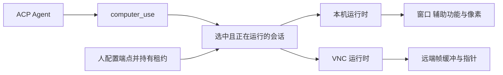

# Pero 的 VNC 边界：Cursor 没有 VNC

Cursor 本会话的 Computer Use 没有 VNC。工具列表里没有 RFB 客户端、服务端、
主机、端口或远端帧缓冲。`computer_start_control` 接管的是这台机器的主显示器，
并移动本机真光标；工具说明里的 remote control 也是这个意思。

本文只给 Pero 定边界。它不增加协议值，不选择 VNC 库，也不改 `use/computer/`。

路线图里的远程桌面包含 SSH、VNC、容器和 Kubernetes，并要求人工接管租约。
这里只写 VNC。SSH、容器和 Kubernetes 若用来接通一个帧缓冲，连接方式归
Desktop 设置，不进入模型请求。

依据是 [ADR 0016](../adr/0016-computer-use-contract.md) 的
`pero.computer-use.v1`，以及
[Cursor 工具回路](../issues/2026-10-30-cursor-computer-use.md)。
Linux X11 已有同一形状：只有窗口像素、只有显式前台输入、没有辅助功能树。
VNC 沿用这个形状，目标从窗口换成一整块远端帧缓冲。

## 两条运行时

模型继续只看见 `computer_use`。本机应用和远端桌面是两个运行实例，用
`runtime_id` 分开。元素 id、截图 id 和观察 id 不能跨实例使用。

本机运行时保持现在的窗口、辅助功能和后台投递。VNC 运行时只广告：

| 契约字段 | VNC 运行时 |
| --- | --- |
| `ComputerTarget.kind` | `desktop` |
| 观察 | `screenshot` |
| 动作 | `click`、`type_text`、`press_key`、`scroll`、`drag` |
| 投递 | `foreground` |
| 寻址 | `pixel` |
| 环境 | 现有 `ComputerDisplay` 没有 `vnc`；实现前先扩展这个枚举 |

`background`、`element` 和辅助功能观察由准入函数拒绝，请求到不了套接字。
模型从 `targets` 的能力表里就能看到这个组合，不需要第二条工具。

## 和 Cursor 整屏路径只在形状上相邻

Cursor 的应用范围靠本机辅助功能树，真光标不动。Cursor 的整屏路径是本机主
显示器。VNC 没有这棵树，也没有「只显示叠层、不移动远端指针」的标准操作。
Pero 将来的 VNC 运行时在形状上靠近整屏路径：一块帧缓冲，一次指针位置，
键盘打进当前焦点。它不是把 Cursor 的工具原样接到远端。

坐标沿用契约里的截图像素，原点在左上，上界由该次帧缓冲的宽高决定。不引入
1280×800 的固定画布。滚动仍是逻辑像素，正方向为右和下；适配器若只能发送
VNC 的滚轮按钮，就做可核对的换算，否则返回 `unsupported`。按键使用契约里的
逻辑键名，在适配器里映射到 RFB keysym。映射表里没有的文本在发送前拒绝。

`observe` 把帧缓冲收成现有的截图证据：图片字节和 SHA-256 留在 Desktop，
线路上只有图片引用和可选的图片内容，没有本地路径，也没有 VNC 地址。
像素动作消费这次观察。帧缓冲没有树可以证明「界面没变」。

`executed` 只表示 RFB 写入已经提交给连接。它不表示远端应用达到了预期。
写入发出之后连接断开，记为 `unknown`，保留原来的 `request_id`，不自动重放。
写入发出之前就拒绝的请求记为 `rejected`。

## 人拥有的部分

模型请求里不能出现主机、端口、密码、套接字或显示编号。这些和现在的可执行
路径、传输地址一样，由人在设置里配置。模型只拿到运行实例 id 和桌面目标。

人工接管是一把租约。人持有租约时，动作在发送前拒绝。人归还租约后，模型用
新的观察继续。模型的 `stop` 只使这个运行实例的句柄失效，不断开远端机器，
也不替人释放租约。人的 Stop 继续关闭整个 Computer Use，直到重新打开。
默认仍然关闭。模型不能自己打开 VNC，也不能自己申请权限。

帧缓冲里的文字是不可信数据，规则与本机窗口内容相同。

## 实现时要证明的行为

实现另开变更。那时至少留下这些记录：

- 能力表只含截图和前台像素动作。元素寻址、后台投递在准入阶段被拒绝。
- 模型请求里带有主机或密码时，请求无效，连接使用的是人已保存的端点。
- 人持有租约时，动作为 `rejected`，远端指针位置不变。
- 写入之后连接中断，回执为 `unknown`，同一 `request_id` 不产生第二次写入。
- 一张真实帧缓冲上的点击、文本、按键、滚动和拖拽能在远端留下可核对的效果。
- 未映射的文本没有部分写入。

容器或 Kubernetes 里的桌面如果最终仍是一块 VNC 帧缓冲，复用这个运行时。
它们不另建一套动作词汇。远端辅助功能如果将来需要，那是另一个运行时，
不从 VNC 帧缓冲里推断控件树。
