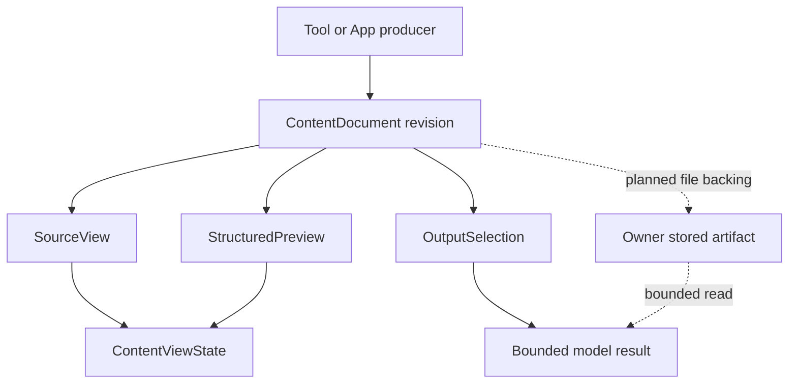

# Zed 内容视图研究与 Pero Data Agent 实现路线

本文是实现前的源码研究。目标是让用户能够阅读、检索、选择和复核代码与 JSON，并让后续 Data Agent 使用有界数据和可读取的完整产物。研究覆盖源数据、编辑器、布局与绘制、聊天内容、表格、工作区、持久化和模型输出链路；不以单个 JSON 组件作为架构终点。

结论：沿用 Zed 的所有权与生命周期设计，在 Pero 已有 GPUI Kit、App SDK 和 Host 上实现。一个来源版本派生用户阅读视图与模型输出；折叠、表格化、格式化和模型限额分别处理。完整参考其逻辑，不意味着引入整个 Zed 编辑器依赖图。

研究初版只提交实现约束。后续实现与实际测量单独记录在 [Content reader 验证](../fitness/content-reader.md)；下文路线是完成定义，不代表所有能力均已接入。性能是否达标必须由实际 Electron/GPUI Wasm 和 App iframe 的同条件测量决定，目前没有“性能最好”的跨产品对比证据。

## 实施校正：恢复内容视图主线

2026-10-29 用户再次明确，优先保证功能与使用流程对齐。此前实现只完成了 Chat 阅读器的一部分，就推进了步骤 5–6 的 JSON 输出预算和文件读取；步骤 4 的 App 消费链路仍未完成。这是实施顺序偏移，不能以局部 JSON 能力替代完整内容视图交付。

| 主线 | 当前状态 | 接下来的验收对象 |
| --- | --- | --- |
| 工作区 Item 与生命周期 | 已有会话/App 导航，补上活动标签显现与稳定身份 | 文档、代码、数据及嵌入内容的打开、切换、恢复、关闭与焦点路由 |
| Editor 与 Markdown | Chat 有保留渲染和来源阅读器 | 普通代码/文档也能使用完整来源视图；查找、折叠、选择与来源定位逐项对齐 |
| WebView 与嵌入式 App | 已有受管 iframe | App 内消费同一来源契约；MCP Apps 的资源发现、标准桥接和生命周期单独补齐 |
| 图标与内容识别 | 已有共享图标资源 | 由内容类型和工作区操作使用统一图标入口，覆盖主题与交互状态 |
| JSON 与数据投影 | Chat 中已有基础阅读与表格投影 | 作为上述视图系统的一种内容消费方式；数据集与图表不能只靠 JSON 字符串展示 |
| 输出预算与文件读取 | Desktop 已有局部能力 | 随完整用户工作流验收，不继续作为视图重构的中心 |

实施优先级恢复为：工作区内容生命周期 → Editor/Markdown/WebView 使用链路 → App 消费验收 → 内容专用投影 → 输出预算与性能优化。当前阅读器验证仅证明已列出的局部操作，未完成的主线仍按下文步骤逐项交付。

## 1. 研究基线与已有能力

| 对象 | 固定基线 | 使用范围 |
| --- | --- | --- |
| Zed | `37faef81f74fc1bb08be9939c4cffc8ede6ced2f`，提交日期 2026-10-27 | 本文所有 Zed 源码结论；不是对未来版本的承诺 |
| GPUI Kit | `ec89cfc36404667b7947aeb3d40b1c2859d729dd`，提交日期 2026-10-28 | Editor、readonly、坐标映射和高亮的复用候选 |
| Pero | `0b17054`，2026-10-29 | 已提交的导航、布局、共享 Chat 与已知缺口；并行未提交功能不计入本研究的交付 |
| Data 插件 | `data-analytics@openai-curated-remote`，安装版本 `1.1.0-exp-baseline` | 阅读其 index、共享规范和 Data App Contract 的数据、来源、组件章节；仅作为未来 Data Agent 的契约参考 |

Pero 当前的边界由 [Architecture](../ARCHITECTURE.md)、[App 平台 ADR](../adr/0007-local-app-platform.md)、[共享 Chat ADR](../adr/0012-shared-gpui-app-chat.md) 和 [内容标签 ADR](../adr/0013-workspace-content-tabs.md) 定义：Host 拥有会话与执行；GPUI 拥有工作台导航和共享 Chat；领域 App 在受管 iframe 内拥有其领域界面与数据。

当前实现与不足：

| 范围 | 已有实现 | 本研究要补齐的能力 |
| --- | --- | --- |
| 内容导航 | `WorkspaceItem`、`WorkspaceRoute`、`WorkspaceNavigation` 单一活动路由 | 文档来源身份、按版本恢复阅读状态；先修复活动标签不可见的问题 |
| 布局与 App | 纯值 `WorkspaceLayout`；受管 iframe 在切换中保留 | GPUI 与 iframe 内的阅读交互分别验收，不假定焦点可自动跨越 |
| Chat 工具内容 | `Tool.output` 保留 ACP 输出，`Tool.content` 提供展示文本；展开时才创建 `StreamText` | 明确源码、结构化内容和预览的类型，避免统一退化成 Markdown |
| Virtual Cell 详情 | `JSON.stringify(..., null, 2).slice(0, 24000)` 放入 `<pre>` | 完整来源可读、截断可见、结构化导航；现有截断只发生在展示路径，不能当成模型预算机制 |
| 冻结上下文 | `ContextReference` 携带内联 Text/Image；文本整组限制为 128,000 bytes | 未来产物引用与有界读取；不能仅把大文件路径填进 `source` 就宣称可读 |
| Data Agent | 尚无本研究提出的数据集、预览与产物读取闭环 | 在现有 App/Host 接缝接入，复用会话、取消与审批所有者 |

对应源码：[Conversation](../../crates/pero-chat-ui/src/conversation.rs)、[工具展示](../../crates/pero-chat-ui/src/tool_ui.rs)、[Virtual Cell 详情](../../apps/virtual-cell/ui-src/components.tsx)、[上下文模型](../../crates/pero-contracts/src/context.rs)、[Host 协议](../../protocol/host.tsp)。工作区已有验收与限制见 [Workspace architecture](../fitness/workspace-architecture.md)。

Composer、模型选择和上下文输入的对齐另外由 [Zed composer parity](zed-composer-parity.md) 跟踪。本研究覆盖结果内容及其消费链路，不把阅读器完成等同于整个 Zed 产品对齐完成。

## 2. Zed 的完整内容链路

### 2.1 源数据：Buffer 不是 View

`text::Buffer` 拥有文本、操作历史与版本；其 snapshot 使用 Rope、片段索引等结构表达文本和位置。`language::Buffer` 在此之上拥有文件、语言、语法解析、诊断、保存版本和冲突等信息。不可变 snapshot 使解析、搜索和绘制可以针对明确版本工作。[Z1] [Z2]

这不是“所有大文件均按需从磁盘加载”的证明。保留整个文本的内存成本、解析成本和只绘制可见区域的成本必须分别衡量。JSON 原始字节也不能在进入视图前经过有损数字转换。

Pero 对齐：先给来源一个稳定身份和版本。已经以字符串到达的工具 JSON 保留原文；若入口已经解析成通用数值，不能从展示对象恢复原始数字字面量。精度保障必须从新的接入边界开始，不能靠格式化补救历史数据。

### 2.2 MultiBuffer：一个编辑器可呈现多个来源片段

`MultiBuffer` 组织多个 Buffer、excerpt 和 diff；普通文件通过 singleton 进入相同 Editor。完整 Editor、单行和自动高度模式复用编辑基础设施。[Z3] [Z4]

这一层解释了 Zed 为什么能在搜索结果、diff 和文件之间保持来源位置，而不是把每个片段都变成独立字符串。Pero 首期只需要单文档和源范围；多文件 excerpts、协作操作历史和复杂 diff 拼接没有当前需求，不列为前置实现。

### 2.3 Editor：保留交互状态

Editor 拥有 Buffer/MultiBuffer、DisplayMap、selection、scroll manager、focus handle、导航与高亮状态。`read_only` 约束内容修改，阅读仍需要选择、复制、查找和焦点。[Z4]

Pero 对齐：阅读器是按文档身份保留的状态，不能在每次 render 或文本流更新时重建。只有来源版本变化才更新内容；更新未变化的只读内容不应重置选区。只读不能用 disabled 替代。

### 2.4 DisplayMap：源坐标与展示坐标分开

Zed 的展示变换依次为 InlayMap → FoldMap → TabMap → WrapMap → BlockMap → DisplayMap 的背景高亮。各层保存自己的坐标类型、snapshot 和增量失效范围。折叠、软换行和附加诊断不改写源文档。[Z5]

Pero 对齐：JSON 树节点、表格单元格、格式化视图与源码之间需要明确映射。源范围采用某个 document revision 内的 UTF-8 byte range；Web 的 UTF-16 selection 在边界转换，不能把字符索引、显示行或排序后行号直接当源位置。已有 Kit 能力先做实测，避免另写一套编辑器坐标引擎。

### 2.5 EditorElement：渲染只是链路末端

Editor 的 Render 入口创建 EditorElement；后者通过 request_layout、prepaint、paint 处理可见行、文本布局、装饰、光标与绘制。[Z6]

可见区域绘制不意味着解析零成本，也不意味着超长单行不会卡顿。Pero 必须分别覆盖视口行布局、语法高亮、JSON 解析、树索引和跨 Wasm/JS 数据复制。不能把 `overflow: auto` 当虚拟化，也不能把虚拟化当模型上下文压缩。

### 2.6 Item / Pane / Dock：内容生命周期进入工作区

Editor 实现 Item、SerializableItem、SearchableItem：标题、图标、dirty 状态、保存、查找、恢复都从同一个内容对象进入工作区。搜索基于 snapshot 在后台产生来源 anchors；持久化分别记录编辑器关联内容、滚动和折叠等状态。[Z7] [Z19]

Pane 激活内容时处理历史、工具栏、状态和焦点，并由 `update_active_tab` 显式滚动到新活动标签。Dock 的 Panel 另有焦点、位置和尺寸契约。[Z8] [Z20]

Pero 已有的路由所有权继续保留。先补 [活动标签可见性缺口](../issues/2026-10-29-workspace-tab-visibility.md)，再为文档增加标题、格式图标和状态的展示值。焦点按用户动作进入内容；轮询与后台来源刷新不抢焦点。完整 Pane/Dock、自由拆分和拖拽并非阅读 JSON 的前置条件。

### 2.7 Chat：原始内容与渲染实例各有生命周期

`acp_thread::MessageContent` 分别保存 source_blocks、source_version 和 rendered blocks；工具内容区分 ContentBlock、Diff、Terminal、DiffPatch 与 fallback Markdown。[Z9]

`agent_ui::EntryViewState` 区分 Live、Restore、Materialize。按需创建视图不能再次执行终端生命周期等副作用；同步依据来源版本，避免无变化更新清空选区或覆盖正在编辑的草稿。嵌入 diff 使用完整只读 Editor 并关闭不适合聊天的 gutter、minimap 等；终端使用 TerminalView。[Z10]

Pero 已有工具体懒创建是合适起点。下一步是在 typed 内容上选择视图，而不是展开后再次把所有内容编码成 JSON 字符串。折叠后可释放昂贵视图，源内容和必要阅读状态由各自所有者保留；重新展开不重新发起工具执行。

### 2.8 Markdown：小代码块不等于完整 Editor

Zed Markdown 支持默认与自定义 CodeBlockRenderer。默认路径负责代码块绘制、换行、复制和滚动；解析阶段缓存代码高亮，流式追加时复用。并不是每个 fenced code block 都创建一个完整 Editor。[Z11]

Pero 采用同样的分级：短消息代码保持轻量路径；明确打开源码、长 JSON 或需要查找/折叠时，按需挂载阅读器。两者共享源文档与复制语义，不将一百个工具结果变成一百个常驻完整编辑器。

### 2.9 JSON 与 JSONL 表格：预览是源码的投影

Zed 的 JSON 语言支持与 JSONL 表格是两条能力。JSON 使用语法高亮/语言服务；`tabular_data_preview` 通过 Editor adapter 向 TableView 提供数据，支持单独打开或在侧边打开预览。它不是任意嵌套 JSON 的通用业务界面。[Z12] [Z13]

JSONL 解析有几个应完整保留的行为：[Z14]

1. 每个非空行必须是 JSON object；空行不占记录，但错误和行号保留物理源行。
2. 列为所有记录字段的并集，按首次出现顺序排列，不能只看第一条记录。
3. 缺失字段与 `null`、字符串 `"null"`、空字符串不同。
4. 使用借用原文的 RawValue 保存值和精确 byte span；重复值、转义字符和大数字仍能定位。
5. 嵌套对象/数组显示紧凑 JSON。紧凑化只移除字符串外无意义空白，避免 Value 再序列化改变数字。
6. 解析在后台执行，重解析有 200ms 冷却；TableView 以 ListState 按可见行绘制，行高取实际字体测量值。[Z15]

其解析仍遍历数据并建立行列，后台排序/筛选也有独立成本。Zed 当前表格排序比较显示文本，不能直接当作 Data Agent 的数字、日期、缺失值排序语义。Pero 的分析型排序必须来自显式列类型，并保留 display row → source row 映射。[Z12] [Z15]

### 2.10 模型输出预算与用户完整输出分开

固定版本的 terminal tool 默认模型返回限额为 16 KiB，并提供 head_lines/tail_lines。源码明确区分用户实时看到的终端输出与最后送回模型的输出；read_file 对大文件可先返回 outline，再通过行范围读取。[Z16] [Z17]

这支持 Pero 的“完整结果供人查看、模型按需选择”方向，但不能据此声称 Zed 会自动将所有大 JSON 写成文件。本文提出的产物落盘、JSON Pointer 和列投影是 Pero 的拟新增能力，需要真正接通读取工具。

## 3. 复用决定

| 候选 | 适合解决的问题 | 决定与边界 |
| --- | --- | --- |
| Pero 已依赖的 GPUI Kit Editor | GPUI 内的源码阅读、选择、查找、折叠、高亮 | 首选；先验证当前构建实际使用的 Kit 版本与 Wasm 功能，不能用另一个 checkout 的 API 作为已交付证据 |
| 直接引入 Zed editor/MultiBuffer/workspace | Zed 完整 IDE 能力 | 不作为首期方案：依赖图、原生能力与当前 Wasm/App 组合不同；参考行为后在现有接缝实现 |
| Web 内专用源码编辑器 | 领域 iframe 或 HTML 预览中的大源码交互 | 在真实 App 有需求时评估 CodeMirror 6；先做同样语料的启动、布局、包体与内存测量，再决定依赖，不预先装进所有 App |
| Monaco | 需要其 IDE/语言服务能力的 Web 场景 | 当前阅读需求不足以支撑新增依赖；本研究没有做出比它更快或更小的实测结论 |
| 普通 `<pre>` | 很短、无需查找/折叠的文本 | 保留轻量用途；不能作为长 JSON/数据集阅读的统一实现 |
| 通用 JSON 树组件 | 对象/数组的渐进展开 | 作为 StructuredPreview 的一种投影，不持有第二份权威数据，不默认展开所有节点 |

参考 Kit 的 EditorState 与 `.readonly(true)`、可选 Syntect 高亮路径。[K1] [K2] 当前 Pero 声明 `gpui-kit = "=0.8.1"`，Chat 开启 Syntect；实际构建来源与目标平台需在实现验收中记录。

复用实现前按对应 crate 的许可与 attribution 处理；例如所检查 Zed editor manifest 标注 GPL-3.0-or-later。本文提出的是对边界和行为的独立实现，不把整仓许可证视为所有文件的统一许可。[Z18]

## 4. Pero 内容模型与所有权（拟实现）

先建立可命名的概念，再添加控件。下表描述职责，不要求一概创建独立 crate、service 或 interface；先在实际消费者附近实现，只有真实复用才提取。

| 概念 | 拥有的数据与不变量 | 所有者 |
| --- | --- | --- |
| `ContentDocument` | 稳定 id、revision、来源、格式、原始字节或可解析引用；相同版本内容不变 | 内容生产者，Host 在接入边界登记引用 |
| `SourceRange` | document id + revision + UTF-8 byte range；范围绑定该版本 | 内容模型；跨 Web 坐标只在边界转换 |
| `StructuredPreview` | object/tree/table 投影及 source range；解析错误位置；无第二份权威内容 | 阅读 UI 的派生状态 |
| `ContentViewState` | 当前模式、选区、scroll、fold、search 与筛选；绑定来源身份和版本 | GPUI 或 App 的实际视图所有者 |
| `OutputSelection` | 预算、字段/行选择、实际省略范围、读取入口；确定性输出 | 拥有模型工具响应的 Host/harness/provider 边界 |
| `DatasetSnapshot` | 未来 Data Agent 的字段类型、grain、来源版本、查询与范围、数据分类 | 领域 App/计算后端；Host 不定义业务指标 |

`ContentDocument` 对内传递 typed 值。入口统一校验身份、格式声明、大小和引用边界；结构解析可以延迟到首次请求预览，结果以该 revision 的 Parsed/Invalid 状态保存。JSON/JSONL 验证通过后，后续预览使用同一解析结果或按版本缓存的索引。不能每个 renderer 再用“尝试 JSON.parse”猜类型。每个新版本按需重新解析，失败则保留可读原文和明确错误。

这是拟实现的数据流。原文、源范围和 revision 是各投影的共同依据，不能从 table displayRows、格式化后的文本或截图反推原文。

来源进入系统的规则：

- 纯文本工具输出保留原文；明确 MIME/format 的 JSON 走结构化路径。未知内容提供纯文本回退。
- ACP Diff、Terminal、Image 等已有类型优先使用现有视图，不能被 JSON 检测覆盖。
- 已由通用 JSON 解析器规范化的结构值标明其来源为结构化响应，不能标榜保留了生产者原始字节。
- Streaming 的 replace 与 append 分开，维护来源版本。未闭合的 JSON 暂留源码；稳定的 JSONL 行可作为后续增量解析单元，不对每个 token 全量重建树。
- 解析、加载与错误状态由事件更新。render 只读取状态，不创建文件、执行查询或激活会话。

## 5. 用户阅读流（拟实现）

### 5.1 从结果进入阅读器

Chat 默认显示任务相关摘要、状态和“查看结果”。短代码/文本保持当前轻量显示；长源码和结构化结果按需展开，必要时进入内容标签。进入后默认选择对当前格式最有用的视图：对象为属性/树，记录集合为表格，未知文本为源码。用户始终能回到原文。

仅展示适用的模式控制：`预览 / 源码`；表格的列选择、筛选、查找按需出现。格式图标表示类型，运行/错误状态由现有状态来源决定，不以图标颜色充当唯一提示。复用 DESIGN.md 的颜色、字体和焦点规则。

### 5.2 源码视图

保留选择、复制、行号、查找、折叠、横向滚动与可选软换行；readonly 仍能聚焦。短 JSON 可切换格式化展示，但原文始终是权威数据。格式化如未维护 source map，只能复制展示文本，不能把其选区作为原文范围发送给 Agent。

长单行默认避免昂贵软换行；语法高亮按能力和测量降级，降级时原文、选择与复制仍可用。复制操作区分“原文”“选中内容”“当前表格范围”，不能把屏幕上的省略号复制成完整结果。

### 5.3 结构化预览

对象按需展开，数组不一次创建所有 DOM/GPUI 节点；同结构对象数组或 JSONL 可进表格。通用预览不会自动把任意嵌套对象扁平化成分析表，也不会默认计算聚合。

单元格显示与源类型分开：整数、大数、decimal、字符串数字、时间字符串、boolean、null、missing 均有明确语义。显示精度由领域 schema 决定；原始 lexeme 和单位不能被格式化覆盖。重复 key 的策略在入口确定：通用源码保留全部文本；首期结构化预览遇到重复 key 明确报出不支持，不能静默展示最后一个值。

大对象/数组先显示局部可读结果和真实总量（若已知），再按需读取更多。未知总量显示未知；“只看前 N 行”必须说明范围，不暗示已经检查全量。解析错误定位至实际源位置，并允许继续查看源码或重试读取。

### 5.4 生命周期与状态

| 状态 | 用户反馈与恢复 | 资源行为 |
| --- | --- | --- |
| Loading | 显示正在读取/解析；可取消或返回 | 不阻塞导航和共享 Chat |
| Empty | 区分空文件、空对象、空数组与零行结果 | 不生成虚假列/统计值 |
| Streaming | 显示更新中；未完成 JSON 可读源码 | 合并更新，避免逐 token 全量解析 |
| Ready | 可查找、复制、切换模式、定位来源 | 保留该版本有效的阅读状态 |
| Error | 给出读取/解析错误与位置，可重试或看原文 | 不把旧表格标记成新结果 |
| Unavailable | 说明产物未取得或读取入口不可用 | 不假装路径就是可读取内容 |

隐藏视图停止无意义的布局与解析工作；关闭标签不取消计算、不删除产物。释放视图后保留必要阅读状态；同 revision 重开恢复，revision 变化时丢弃无法迁移的源范围，并明确刷新结果。缓存首先利用实际 owner 的生命周期；仅在测量显示需求后增加限额/淘汰策略。

## 6. JSON 输出减量与文件读取（拟实现）

“压缩”需要分别讨论：

| 操作 | 实际减少 | 仍须解决的问题 |
| --- | --- | --- |
| UI 折叠/虚拟化 | 绘制与布局工作 | 原文的存储、解析与模型输入可能完全不变 |
| Minify | 序列化空白和部分 wire bytes | 字段/行仍完整进入模型；不能承诺固定 token 收益 |
| gzip 等传输压缩 | 存储/传输 bytes | 解码后的模型上下文不因此变小 |
| 字段投影、行范围、摘要 | 模型实际接收的内容 | 保留真实 scope、遗漏说明和追加读取方法 |
| 完整结果存文件 + 有界读取 | 重复返回大结果的成本、后续上下文量 | 文件所有者、可读位置、版本与工具能力必须真实存在 |

首期 `OutputSelection` 接受完整结果与明确预算，返回 summary、选中字段/记录、原始总量（若已知）、省略信息、document revision 和可执行的后续读取说明。策略是确定性函数；LLM 摘要可作为上层功能，不能代替数值和范围的真实记录。

预算初期用可精确统计的 UTF-8 bytes/行/字段上限；有实际 provider tokenizer 时再记录 token 数。不要拿字符串长度冒充 token。保留错误、状态、数据单位、查询范围等解释结果必需的字段；字段选择来自工具/领域契约，不能通用猜测哪些业务字段“不重要”。

### 6.1 文件引用必须走通读取

完整原文由其实际执行 owner 存储。Host 本机结果由 Host 保存，远端 Worker 结果仍归 Worker/已有产物通道，App 结果继续由 App 后端拥有。UI 不另建通用文件服务，不能把本机绝对路径当成远程 Agent 可访问的路径。

新增引用需要 id、revision/digest、media type、byte size、producer/source identity，以及该执行环境真实支持的读取方式。schema/version 为结构化结果提供解释依据。沿已有协议生成 TypeSpec/Rust/TS 表示，在外部边界校验后传 typed 值。

落盘顺序为：保存完整结果 → 确认成功与版本 → 生成有界响应 → Agent 使用读工具验证可读。写入失败则返回明确错误或仍可承载的内联结果；不能返回不存在的引用。文件存储不是把完整 JSON 再嵌到另一个 JSON 字段中。

读取能力分步实现：

1. 原文行/byte 范围，响应含实际范围、版本、剩余信息和输出限额；byte 范围需明确 UTF-8 边界行为。
2. JSON Pointer 定位某个节点；节点过大继续返回有界预览与引用。JSONL 按记录范围读取，并保留物理源行。
3. Data Agent 的行范围和显式列投影，由领域后端执行；首期不引入任意查询语言。

UI 预览成功不代表 Agent 已能读取；两条消费路径分别验收。现有 ACP Agent 自己的工具结果预算归其实现所有；Pero 仅观察 ACP 输出时不能事后宣称已经减少了该 Agent 的模型输入。预算策略放在 Pero 实际拥有工具响应的边界，不新增第二套 Agent loop。

## 7. 面向 JSON Data Agent 的扩展（拟实现）

用户点名的 [Data 插件](plugin://data-analytics@openai-curated-remote)提供了可参考的契约：有界 reviewed rows、稳定 query/component identity、来源和变换、源数据与 displayRows 分开、图表与导出使用一致筛选范围。本文依据安装版本的 `shared/data-app.md` 的 Reviewed data and provenance、Components and interactions 章节；这不代表 Pero 已接入该插件的 runtime、连接器或发布系统。

Data Agent 应以领域 App + 现有 Host 会话/执行边界接入。数据获取、计算和领域校验在已有 App 后端或获准执行端；GPUI 呈现任务与会话，Web App 呈现表格、图表和来源。通用阅读器负责 JSON 可读性，领域 App 决定指标与科学含义。

### 7.1 数据集快照契约

`DatasetSnapshot` 在真实 Data Agent 开始接入时落实 schema，至少需要：

| 字段概念 | 必须表达的含义 |
| --- | --- |
| identity/version | dataset id、query id、来源版本、产生该结果的方法版本 |
| fields | 字段名、逻辑类型、单位、允许缺失；decimal/大整数保留精确表达 |
| grain | 每行代表什么；主键仅在来源或实际校验支持时声明 |
| scope | 时间窗、timezone、查询筛选、实际覆盖与分页限制 |
| provenance | 来源文件/API/查询及可复现的非秘密参数，按执行顺序记录变换 |
| classification | observed、synthetic、target、scenario 等真实分类；未知保持未知 |
| data/reference | 有界内联记录或可解析产物引用，明确总量是否已知 |
| qualifications | null/missing、质量问题、未完成时间窗和方法限制 |

这些概念不要求首期补成通用分析平台。先以一个实际 App 的记录集验证，再抽取真实共享契约。JSON 是交换格式，不决定存储引擎；Arrow/Parquet、DuckDB、远端仓库等仅在实际规模和执行需求出现后评估，不纳入阅读器依赖。

### 7.2 视图与数据范围一致

源码、表格、图表、复制、导出与送给模型的选择均绑定 dataset revision 和 scope。显示行排序用源行身份映射；row index 不能当稳定记录 id。筛选结果不能覆盖原始查询数据；当前筛选为 sourceRows 子集还是仅 displayRows，必须在领域契约里明确。

图表组件绑定 query id 和稳定 component id；单位、时间范围和来源可查看。source inspector 可分为 Overview、Data preview、Query/SQL、Evidence flow，仅在对应信息存在时显示。没有真实 SQL/查询链接就保持缺失，不能从 id 拼接“可复现”链接。

表格不是统计结论。通用控件不自动对重叠人群求和、不把 supplied score 当置信度、不把 missing 当零、不从几条预览行推断全量质量。聚合、比率、误差范围和科学方法由领域计算和验证规则定义。

### 7.3 对 Agent 的上下文

默认提供 schema、grain、scope、行数是否完整、已知质量问题、小样本和产物引用。样本说明选择规则及范围；不能把样本统计伪装为全量统计。需要具体数据时按行/列/节点读取，同一次回答使用对应版本，来源变化则返回版本不匹配并允许显式刷新。

已有 `ContextReference` 继续表达用户冻结选择。未来文件背书能力应在原契约中清楚演进并验证旧历史兼容，不另外创建名字不同、职责相同的 context 存储系统。

## 8. 性能设计与验收

### 8.1 先约束成本，再比较实现

- 关闭的工具结果不创建 Editor 或预览解析树；协议接入必需的解析另计，内容未变不重置 Editor。
- 按可见行/节点绘制，保持稳定 item identity；不在 render 中 stringify 全量结果。
- 解析与投影按 document revision 缓存；过滤/排序更新行映射，避免复制每个大单元格。
- 解析任务结果只应用到对应 revision，过期结果不覆盖新结果。这是流更新的正常正确性要求，不增加通用并发框架。
- Native 的 background executor 与 Wasm 主线程不同。必须测量真正运行线程；浏览器重计算若阻塞，再在已有 Web 边界引入必要 Worker 或有界分块，不把 `async` 当 off-thread。
- 初始挂载、源文本副本、Rust/JS/iframe 传输分别记录。一个来源所有者不意味着跨进程绝无副本；优化应定位实际副本和生命周期。

### 8.2 可复现语料

以下是拟建的 benchmark 矩阵，数据量是测试档位，不代表产品已支持这些上限。每份语料记录生成脚本、seed、bytes、记录/列数和 digest；不提交大二进制 fixture。

| 语料 | 拟测档位/变化 | 主要检查 |
| --- | --- | --- |
| 普通 JSON object | 10 KiB / 1 MiB / 10 MiB | 首次阅读、展开、查找、切换源码 |
| JSONL/对象数组 | 10k / 100k records，窄表与宽表 | 列并集、解析、滚动、筛选/排序、范围读取 |
| Minified JSON | 同字节量的单行与多行 | 软换行、文本 shaping、高亮退化 |
| 语义边界 | 大整数、长 decimal、escaped Unicode、重复值、null/missing、重复 key | 原文保真、位置映射、明确错误 |
| Streaming | append / replace、半个 JSON、连续完整 JSONL 行 | 每版本工作量、选区保留、旧结果不回写 |
| 多视图 | 8 个标签、100 个折叠结果、连续开关 20 次 | 非活动成本、焦点、释放与内存趋势 |
| Data App | 相同数据切表格/图表/来源并复制/导出 | scope 一致、嵌入开销、来源可追踪 |

### 8.3 指标与初始门槛

这些是待基线校准的工程目标，**当前测量值均为未测**；达不到则记录结果、剖析后调整实现或明确支持范围，不能把目标写成验收结果。

| 指标 | 拟定门槛/比较方式 |
| --- | --- |
| 首个有用内容 | 1 MiB 文档冷开目标 ≤500ms；大结果先显示可取消读取状态与局部可读内容 |
| 持续交互 | scroll/selection 的 p95 frame time 目标 ≤16.7ms（60Hz）；在实际 Electron 中采样 |
| 输入响应 | 查找输入、展开/折叠的可见响应 p95 目标 ≤100ms；异步搜索完成时间另记 |
| 主线程阻塞 | 记录所有 >50ms 长任务；用户交互时不得出现来源于同步全量解析的长任务 |
| 解析与映射 | 各记录 wall time、执行线程和峰值内存；数据量增加后的成本曲线须可解释 |
| 内存回收 | 记录打开前、打开后、关闭后及 20 次循环曲线；无无界增长，不能只比较一次 GC 前后 |
| 懒挂载 | 100 个折叠结果不新增完整 Editor；只对用户实际打开的内容建立必要视图 |
| 模型减量 | 返回 bytes、实际 tokenizer tokens（若可用）、保留/省略范围、后续读取成功率；完整数据可恢复 |

测量记录硬件、OS、Electron/Chromium、Kit 和源码版本、release/dev、Wasm 优化、窗口尺寸、字体、数据 digest、冷/热状态和测量工具。冷开/热开至少各 30 次并报告样本数、中位数、p95、最大值；帧指标取持续交互样本。比较候选时固定条件，不用 native Zed 的帧率直接证明 Wasm Pero 的性能。

### 8.4 正确性与实际 UI 验证

核心测试针对行为表：原文/数值/范围保真、JSONL 列并集、missing/null、非法记录、版本替换、预算输出与读取后可恢复。测例不依赖具体控件调用顺序。

少量 shell 测试证明实际 producer → 存储 → 引用 → 读工具 → UI/Agent 的接线。使用 temp data home 和可观察完成信号；不靠 sleep 等待线程。

真实 Electron 需检查：light/dark、窄窗、键盘查找/复制/折叠、焦点与 IME、切换标签/iframe、取消/错误恢复、长单行和超长值、100 个折叠工具结果。捕获截图和性能 trace；UI 证据按仓库约定放 `test-results/`，验证结论写入 `docs/fitness/`。浏览器预览、native developer preview、开发 Electron 和安装包分开记录。

## 9. 实现顺序与完成定义

按单一关注点提交；每步完成后保留可运行路径，不一次迁移所有工具/App。具体实施范围与未完成项由上述验证记录维护，步骤 0 的独立问题沿用已有 incident。

| 步骤 | 有界交付 | 完成条件 |
| --- | --- | --- |
| 0. 导航补齐 | 活动标签 reveal 与稳定 element identity | 宽/窄窗 8 标签、循环激活、关闭前方标签后焦点正确 |
| 1. 文档来源模型 | ContentDocument/SourceRange、格式入口和 revision 规则；先接一个实际文本结果 | 原文保真、typed 边界、版本替换行为通过；不新增一套业务状态机 |
| 2. GPUI 源码阅读 | 实际 Kit Editor 只读接入、懒挂载、查找/复制/折叠、来源定位 | Wasm/Electron 实测与基线记录；不会重置无变化选区 |
| 3. 结构化预览 | object/tree、JSONL/同结构记录表、源码关联 | 精确数值、缺失语义、错误行号、虚拟行和筛选映射通过 |
| 4. App 消费 | 为第一个有需求的 App 接入共享契约和合适 Web 视图 | Virtual Cell 详情可阅读完整来源；GPUI/iframe 各自验收，Web 编辑器依赖由测量决定 |
| 5. 输出选择 | 在 Pero 拥有的工具响应入口应用 OutputSelection | 测得模型实际收到的减量；UI 仍可查看完整结果 |
| 6. 文件背书 | 完整结果保存、引用、范围读取、失败恢复 | Agent 确实能读；跨 owner 情况明确不支持或走已有传输，不能返回无效路径 |
| 7. Data Agent 垂直闭环 | 一个真实领域数据集、schema/grain/provenance、表格/图表、按需读取 | 查询→结果→预览→有界模型上下文→复核的一条真实链路与范围一致性证据 |

步骤 1–4 对齐用户要求的“先优化 view”；步骤 5–6 单独解决输出减量。设计上提前保留共同来源与引用，不让 view 重构演变成一次性平台重写。若步骤 2 实测 Kit 存在缺口，记录具体缺口和基准，优先使用消费端包装；只有实际必要才讨论上游改动。

尚需在对应实施步骤确定：当前构建 Kit 的确切来源、JSON/JSONL 初始支持上限、Web 源码视图选型、实际 Agent 可用的读取工具、App/Worker 产物保留策略。它们不阻塞本研究提交，也不能在未实现前写进“已支持”。

## 10. 固定版本源码索引

链接均固定 revision。源码锚点是研究入口，结论以该版本实际实现为准；没有运行 Zed benchmark，也没有在本次提交中完成 Pero 性能验收。

| 链路 | 源码入口 |
| --- | --- |
| 文本与语言数据 | [Z1] text::Buffer；[Z2] language::Buffer |
| 内容组织与编辑状态 | [Z3] MultiBuffer；[Z4] Editor |
| 坐标与可见绘制 | [Z5] DisplayMap；[Z6] EditorElement |
| 工作区和恢复 | [Z7] Item/search/serialize；[Z8] Pane；[Z19] persistence；[Z20] Dock Panel |
| ACP 与聊天挂载 | [Z9] MessageContent；[Z10] EntryViewState |
| Markdown 代码 | [Z11] CodeBlockRenderer 与同文件高亮缓存 |
| JSON 表格 | [Z12] 用户语义；[Z13] adapter；[Z14] parser；[Z15] TableView |
| 模型有界输出 | [Z16] terminal tool；[Z17] read_file tool |
| 依赖与复用 | [Z18] editor manifest；[K1] Kit Editor；[K2] Kit EditorState |

[Z1]: https://github.com/zed-industries/zed/blob/37faef81f74fc1bb08be9939c4cffc8ede6ced2f/crates/text/src/text.rs#L59
[Z2]: https://github.com/zed-industries/zed/blob/37faef81f74fc1bb08be9939c4cffc8ede6ced2f/crates/language/src/buffer.rs#L104
[Z3]: https://github.com/zed-industries/zed/blob/37faef81f74fc1bb08be9939c4cffc8ede6ced2f/crates/multi_buffer/src/multi_buffer.rs#L74
[Z4]: https://github.com/zed-industries/zed/blob/37faef81f74fc1bb08be9939c4cffc8ede6ced2f/crates/editor/src/editor.rs#L969
[Z5]: https://github.com/zed-industries/zed/blob/37faef81f74fc1bb08be9939c4cffc8ede6ced2f/crates/editor/src/display_map.rs#L1
[Z6]: https://github.com/zed-industries/zed/blob/37faef81f74fc1bb08be9939c4cffc8ede6ced2f/crates/editor/src/element.rs#L8479
[Z7]: https://github.com/zed-industries/zed/blob/37faef81f74fc1bb08be9939c4cffc8ede6ced2f/crates/editor/src/items.rs#L635
[Z8]: https://github.com/zed-industries/zed/blob/37faef81f74fc1bb08be9939c4cffc8ede6ced2f/crates/workspace/src/pane.rs#L1485
[Z9]: https://github.com/zed-industries/zed/blob/37faef81f74fc1bb08be9939c4cffc8ede6ced2f/crates/acp_thread/src/acp_thread.rs#L2042
[Z10]: https://github.com/zed-industries/zed/blob/37faef81f74fc1bb08be9939c4cffc8ede6ced2f/crates/agent_ui/src/entry_view_state.rs#L285
[Z11]: https://github.com/zed-industries/zed/blob/37faef81f74fc1bb08be9939c4cffc8ede6ced2f/crates/markdown/src/markdown.rs#L548
[Z12]: https://github.com/zed-industries/zed/blob/37faef81f74fc1bb08be9939c4cffc8ede6ced2f/docs/src/languages/json.md
[Z13]: https://github.com/zed-industries/zed/blob/37faef81f74fc1bb08be9939c4cffc8ede6ced2f/crates/tabular_data_preview/src/tabular_data_preview.rs#L38
[Z14]: https://github.com/zed-industries/zed/blob/37faef81f74fc1bb08be9939c4cffc8ede6ced2f/crates/tabular_data_preview/src/parser.rs#L182
[Z15]: https://github.com/zed-industries/zed/blob/37faef81f74fc1bb08be9939c4cffc8ede6ced2f/crates/tabular_data_preview/src/table_view.rs#L96
[Z16]: https://github.com/zed-industries/zed/blob/37faef81f74fc1bb08be9939c4cffc8ede6ced2f/crates/agent/src/tools/terminal_tool.rs#L25
[Z17]: https://github.com/zed-industries/zed/blob/37faef81f74fc1bb08be9939c4cffc8ede6ced2f/crates/agent/src/tools/read_file_tool.rs#L153
[Z18]: https://github.com/zed-industries/zed/blob/37faef81f74fc1bb08be9939c4cffc8ede6ced2f/crates/editor/Cargo.toml#L6
[Z19]: https://github.com/zed-industries/zed/blob/37faef81f74fc1bb08be9939c4cffc8ede6ced2f/crates/editor/src/persistence.rs#L268
[Z20]: https://github.com/zed-industries/zed/blob/37faef81f74fc1bb08be9939c4cffc8ede6ced2f/crates/workspace/src/dock.rs#L36
[K1]: https://github.com/longbridge/gpui-kit/blob/ec89cfc36404667b7947aeb3d40b1c2859d729dd/crates/component/src/input/editor.rs#L83
[K2]: https://github.com/longbridge/gpui-kit/blob/ec89cfc36404667b7947aeb3d40b1c2859d729dd/crates/base/src/input/editor/mod.rs#L1

## 11. MCP Apps：采用标准桥接，不能推定 Zed 已支持

2026-10-29 核对 [Zed 官方 MCP 文档](https://zed.dev/docs/ai/mcp)：公开列出的能力是 Tools 和 Prompts；本文固定版本中，`crates/`、`docs/` 和 workspace manifest 未检索到 `ui://`、`ui/initialize`、`ui.resourceUri` 或 MCP Apps Host 路径。结论限定为该版本源码与当前公开声明，不能将其普通 MCP 支持或 ACP resource 内容转换当成 MCP Apps 兼容证据。

[MCP Apps 标准](https://github.com/modelcontextprotocol/ext-apps/blob/main/specification/2026-01-26/apps.mdx)及 [官方 SDK 概览](https://apps.extensions.modelcontextprotocol.io/api/documents/Overview.html)定义的是另一条完整链路：

1. Host 协商 `io.modelcontextprotocol/ui` 能力。Server 的工具通过 `_meta.ui.resourceUri` 关联 `ui://` HTML 资源；旧的扁平 metadata 兼容按对应协议版本处理。
2. Host 使用 `resources/read` 取得资源，验证 MIME 与资源元数据，在隔离 iframe 中加载。嵌入 HTML 只是中间一步，还需要标准通信与生命周期。
3. View 发起 `ui/initialize`；Host 回应能力、主题、容器等上下文，初始化完成后发送 tool-input/tool-result 通知。
4. View 通过 JSON-RPC over `postMessage` 调用 Host 桥接的工具、请求界面变化或更新模型上下文。Host 继续拥有工具授权和会话绑定。
5. Host 在卸载时执行 resource teardown，并按资源身份复用模板；组件可支持 inline、fullscreen、pip 等模式，实际可用模式以 Host 声明为准。

Pero 现有 App iframe、主题/语言和 Host 生命周期是可复用的基础，但它们没有实现 MCP Apps 协商、资源解析、`AppBridge` 或上述 `ui/*` 协议。未来可复用受管显示 slot，在 Host/MCP adapter 处补上标准桥接；外部 MCP HTML 的来源与资源策略应按标准实现，不能直接视为已经安装的本地 App。

未来 MCP App surface 的身份需要绑定 server、resource URI、tool call 和 conversation；它与已安装 App 的 `name/panel` 是不同来源，不能通过伪造 AppCatalog 项目复用授权。ACP 转交的外部 Agent 是否保留 MCP 工具的 UI metadata、是否允许 Host 读取对应资源，也必须单独接线；当前 ACP 文本结果不能重建丢失的 UI 声明。

对 Data Agent，优先采用“模型获摘要与 dataset 引用，View 通过 app 可见工具分页读取数据，用户选中范围时才更新模型上下文”的路径。`structuredContent` 的存在本身不能证明数据不会进入模型上下文；Host 必须明确控制结果路由和上下文选择。完整行集、图表状态和每次滚动操作不应自动变成新的模型输入。

当前 `content_read` 是普通 MCP 工具的文件读取基础，不等于 MCP Apps 支持。当前先以完整来源阅读和用户操作的功能等价为验收门槛，再优化性能与输出体积；MCP Apps Host 属于后续明确的兼容能力，实施时直接评估官方 SDK 的 `AppBridge`/`App`，不另造一套相似的 RPC 协议。
