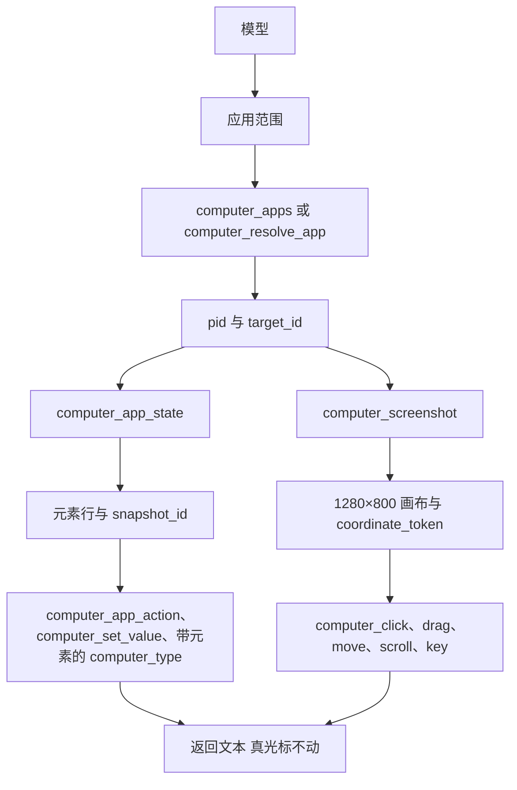
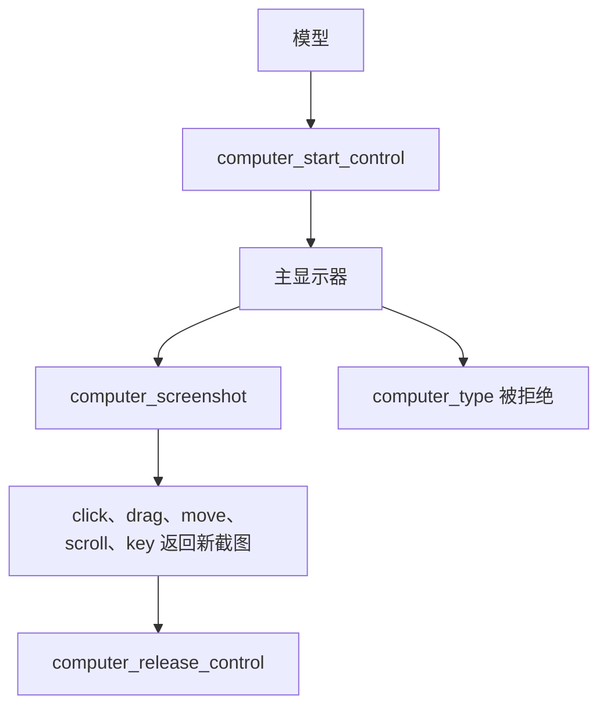

# Cursor Computer Use 的模型回路比已接入的辅助功能驱动更窄

对比对象是 2026-10-30 本会话实际可用的 Cursor Computer Use，以及
[github.com/phodal/pero](https://github.com/phodal/pero) 的 `origin/master`
（`168f6bc`）。GitHub 上没有对应的开放 issue；路线图里的 Computer Use
仍未勾选。远端帧缓冲如何接入，写在
[Cursor VNC 边界](../design-docs/cursor-computer-use-vnc.md)，这次只定边界，不改契约和驱动。

## 本会话里的实现

这里描述的是模型实际调用的工具契约，依据是 2026-10-30 本会话拿到的
Computer Use 工具定义。图里的每一格都对应一个工具或一个该定义写明的结果。
辅助进程、截图 API，以及应用范围内的点击最终走辅助功能还是投递鼠标事件，
工具定义没有给出，所以不画进图里。

默认路径不接管显示器，也不移动人正在用的光标。调用串行，同一时刻只有一个
动作。先解析应用，再观察，再按锚点类型动作。

`computer_apps` 只列出普通应用，最前面的排在第一，并给出 `pid` 和
`target_id`。Spotlight、通知中心和菜单附加项不在列表里。这一步不需要权限。
`computer_resolve_app` 用且只用一个选择器：`pid`、bundle id、`.app` 路径或
应用名。应用没在运行时会启动，并请求系统不要激活它。有的应用仍会自己到前台，
返回值会说明。

观察分成两路，可以复用：

- 截图是应用窗口，坐标落在固定 1280×800 画布上，原点在左上。返回
  `coordinate_token`。窗口移动、缩放，或又截了一次图，这个 token 失效。
- `computer_app_state` 返回文本树。一行是 `[id] 角色 name= value= settable actions=`。
  最后一行是 `snapshot_id`。带 `settable` 的元素可以用 `computer_set_value`
  直接替换值，不发按键。`actions=` 里的名字，例如 `show-menu`、
  `scroll-to-visible`，交给 `computer_app_action`。按钮、链接、菜单项、
  复选框和标签页用 `press`。行末 `(+N descendants omitted)` 表示子树被截断；
  用该元素 id 和当前 `snapshot_id` 再读一次，新 id 并入同一次快照。
- 树还有效时，截图会复用已有 `snapshot_id`，不再走树。`snapshot_id` 保持到
  重新读树、窗口或应用变了，或者某次编辑打开 sheet、换掉了行。元素动作返回
  文本，不附带新截图。

像素动作在应用范围下必须带上最新的 `coordinate_token`。点击可选左、右、中键，
次数 1 到 3。拖拽给出起点和终点。`computer_move` 只移动指针，用来引出悬停
界面。滚动按方向和滚轮格数。这些调用的返回值仍是文本，下一次动作前要再观察。
点偏的目标会被拒绝。

`computer_type` 优先带元素 id。没有元素 id 时，写入刚才点中的字段，或当前
聚焦字段；没有聚焦就先点一个字段。它不移动真光标。`computer_key` 发送单个键
或和弦，例如 `cmd+l`。`computer_wait` 只等待，不截图，上限 30 秒。

权限不是事先查询出来的通行证。缺辅助功能或屏幕录制时，动作被拒绝，并说明人
要授予哪一项。Windows 上这两项在该工具定义里始终视为已授予。

另一条路径是整屏接管。只有人要求接管显示器时才进入。它会移动真光标。这条
路径拒绝文字输入。

应用范围对应 Pero 的后台窗口操作。整屏范围对应移动真实指针的桌面操作。
VNC 只有帧缓冲和远端指针，对得上后一条，对不上前一条。

## 两边已经对齐的部分

两边的默认路径都是操作一个应用窗口，而不是抢走整块屏幕。观察都包含辅助功能
树和截图。输入词汇都覆盖点击、文本、按键、滚动和拖拽。后台输入都不把目标
应用变成前台。句柄过期后都要求重新观察。macOS 都依赖辅助功能和屏幕录制权限。

| 回路 | Cursor，本会话 | Pero `168f6bc` |
| --- | --- | --- |
| 模型入口 | 十几个独立工具，每次一个调用 | 一个 `computer_use`：`status`、`targets`、`open`、`observe`、`act`、`receipt`、`stop` |
| 目标 | `pid` + `target_id`；可按 bundle id、路径、名称或 pid 启动且不激活 | 不透明窗口引用；`open` 只接受应用名 |
| 元素锚点 | `snapshot_id` 在树不变时跨多次动作有效 | 每次 `act` 消费观察，包括被拒绝的动作 |
| 像素锚点 | 固定 1280×800 画布，另附 `coordinate_token` | 该次截图像素，再按窗口边界换算 |
| 点击 | 元素 `press`，或像素点击 | 后台单击走 Point 的辅助功能阶梯；前台、双击和像素走鼠标事件 |
| 文本 | 可直接替换可写元素的值；否则对已聚焦字段输入 | 聚焦后发送 Unicode 键事件 |
| 结果 | 文本，或一张新截图 | `executed` / `rejected` / `unknown` 回执；`executed` 只表示已投递 |

## 模型实际做不成的事

### 1. 可写控件不能按值替换

Point 的 macOS 驱动已经实现 `set_value`，直接写辅助功能值，不发按键。
Windows 驱动明确返回未实现。Pero 的公开动作只有 `type_text`：先把元素设为
聚焦，再 `post_text`。投影层只给文本框、编辑框和组合框挂上 `type_text` 与
`press_key`。

对模型来说，改一个已有值要先清空再逐字输入。光标位置、输入法和选区都会介入。
Cursor 对标了 `settable` 的元素直接替换值，同一次树快照里可以连续填多个字段。

### 2. 元素自称支持的动作没有进入观察

Point 的快照带有 `AXPress`、`AXOpen`、`AXConfirm`、`AXShowMenu` 这类动作名。
单击时驱动会按按钮走一整条阶梯，右键只走菜单阶梯，并把实际生效的动作写进
结果。Pero 在 `use/computer/crates/computer-macos/src/bridge.rs` 里只把含有
`AXPress` 的控件标成可调用，`computer-core` 的 `into_element` 再收成
`click`：可调用，或角色名包含 `Button`。

因此只应答 `AXOpen` 的行、折叠三角和许多网页控件不会被广告为可点击。模型
只能改猜像素。前台单击和双击即使广告了 `click`，也会改走元素中心的鼠标事件，
绕开这条阶梯。模型也看不到哪一个辅助功能动作真正生效。

Cursor 把元素的 `actions=` 原样给模型，`press` 之外可以直接调用
`show-menu`、`scroll-to-visible` 等已列出的动作。

### 3. 一次观察只能支撑一个动作

`use/computer/crates/computer-runtime/src/runtime.rs` 的 `act` 在派发前就
`observations.remove`。ADR 0016 把这定成规则：尝试过的动作都会消费观察。
填三个字段就是三次观察加三次动作，每次都带一张截图。拒绝同样作废观察，模型
不能在同一棵树上改锚点再试。

Cursor 的 `snapshot_id` 保持到树被替换、窗口变化或动作报告快照过期。元素
动作的返回值是文本，不强制立刻再截图。像素动作另用 `coordinate_token`，窗口
移动或缩放后才失效。

消费观察能挡住过期坐标，这是 Pero 更严的一边。它同时把元素动作的往返放大了。
若要放宽，需要改 ADR 0016 的这一条，并只对会替换树的动作和像素输入保持消费。

### 4. 被截断的子树不能展开

观察有 `truncated`。Point 同时记录宽度截断和深度截断。模型看到缺了一截之后，
没有按元素继续展开的操作。缺席不能当成「没有这个控件」。

Cursor 的一行可以标 `(+N descendants omitted)`。把该元素 id 和当前
`snapshot_id` 再读一次，新 id 并入同一次快照。

### 5. 没有悬停，打开应用只认名字

公开动作里没有移动指针而不点击。依赖悬停才出现的菜单和工具提示只能用点击
碰运气。

`open` 的参数是最长 128 字的应用名。Cursor 可以用 bundle id、`.app` 路径、
本地化名称或 pid 解析，并请求系统启动时不激活。部分应用仍会自己到前台，
返回值会说明这一点。同名或本地化名称在 Pero 里会指错应用。

### 6. 像素坐标被压进一张固定画布

Cursor 的点击、拖拽、滚动和移动都使用 1280×800 的截图画布，原点在左上。
窗口比例偏离这张画布时，模型点中的像素和窗口里的点会错位。应用目标下，这些
动作的返回值还是文本，下一次动作前必须再截图。

Pero 的点是该次截图的从零开始的像素，适配器按 `image_width` / `image_height`
换到窗口边界。这一边应保持。不要把固定画布引进契约。

## Pero 已经更完整、不应为对齐而拆掉的部分

- 能力广告按运行实例列出观察通道和动作/投递/寻址组合。不支持的组合在进入
  原生输入前由纯函数拒绝。
- 回执区分已执行、拒绝和结果未知。未知表示输入可能已经发生。相同
  `request_id` 返回原回执，冲突输入被拒绝，没有自动重放。
- 人的 Stop 会关掉后续输入，直到重新打开。模型的 `stop` 只使原生句柄失效。
- 默认关闭。模型不能自己打开开关，也不能替人申请系统权限。
- 安全字段不回传值；辅助功能树不完整时不保存截图。
- 调用绑定当前选中且正在运行的会话。证据保存图片字节和 SHA-256，线路上
  不出现本地路径。
- 后台投递不会悄悄变成全局输入。纯 Wayland 返回不可用，而不是假装自己是 X11。
- Linux X11 已有真实窗口的点击、文本、按键、滚动和拖拽记录。Windows 仍只有
  交叉编译证据。这两项已写在 `docs/fitness/computer-use.md`，不属于本分析
  要新开的缺口。

## 建议拆开的后续问题

每一项单独改，不要合成一次「补齐 Computer Use」。

1. macOS 增加按值写入。动作只在元素可写且非安全字段时广告。沿用 Point 的
   `set_value`，不要用按键模拟替换。Windows 驱动仍是未实现，契约里就不要
   广告。
2. 观察保留元素自称支持的动作名，单击结果写明实际生效的那一个。前台单击和
   双击在存在辅助功能动作时继续走阶梯，不要改投元素中心的鼠标事件。
3. 先决定观察生命周期，再改代码。元素动作在运行时报告树仍有效时可以复用
   同一次观察；像素输入和会打开 sheet、替换行的动作继续消费观察。这是
   ADR 0016 的规则变更。
4. 对 `truncated` 的元素提供按 id 展开，新元素并入同一次观察，不强制新截图。
5. `open` 增加 bundle id。应用名保留给已经唯一的情况。
6. 悬停先不加入契约。等一个真实应用证明菜单或提示只在指针移动后出现，再加
   一种不点击的指针动作。

## 当前 master 的点击路径

`168f6bc` 的 `use/computer/crates/computer-macos/src/desktop.rs` 里，只有后台
单击调用 `ClickMethod::Accessibility`。前台单击、双击和像素点击走窗口鼠标事件。
公开契约仍然没有 `set_value`、原生动作名、子树展开和观察复用。
