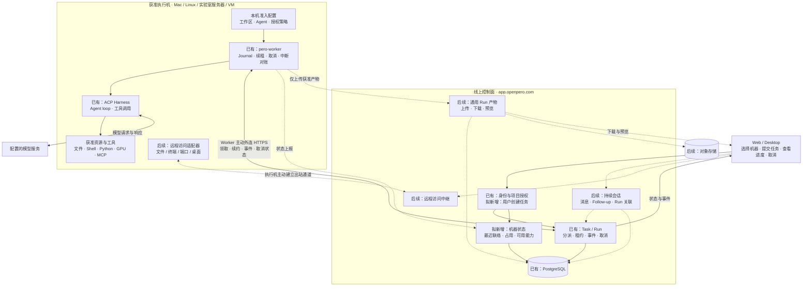
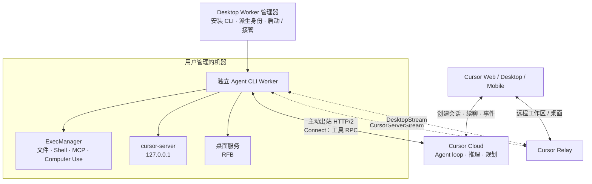

# 架构参考：Pero 自有执行机与远程 Agent

## 潜在架构图

“已有”表示现有代码底座，不代表线上端到端验收。首版保留执行机上的 ACP Agent loop；虚线表示拟接入或后续扩展。

Cloud 拥有项目授权、Run 与租约；执行机拥有本机准入、进程与工具执行。在线观察不授予执行权限；科研数据按授权保留在执行侧，执行完成、独立验证与结果接受分别记录。

## 参考架构

### Cursor Self-Hosted Machines

- [Self-Hosted Machines](https://cursor.com/docs/cloud-agent/self-hosted)
- [My Machines](https://cursor.com/docs/cloud-agent/self-hosted/my-machines)
- [Team Pools](https://cursor.com/docs/cloud-agent/self-hosted/pool)
- [Computer Use / Desktop Sharing](https://cursor.com/docs/cloud-agent/self-hosted/computer-use)

本机静态参考：Cursor 3.30.8，应用 commit `4a44c846d0b817fab060823f93c63ea2861ac190`；应用下载的 Agent CLI 为 `2026.11.11-b912975`。主要实现位置为 `molten/dist/engine/engine.cjs`（SelfHostedWorkers、CloudRemoteMachines、CloudFollowUps）、CLI 的 `connect-pool-worker.js`（Connect / ExecManager / CursorServerStream / DesktopStream）、`cursor-resolver` 与 `pty-host`。这些是静态实现依据，未执行 Worker 或验证账户功能开关。

### Pero 现有架构

- [ADR 0002：远程任务分派与执行权威](https://github.com/phodal/pero/blob/c4f4ecdaf85b0a23dc3b04e1581bd680bba67b23/docs/adr/0002-remote-task-dispatch.md)
- [ADR 0010：Desktop Worker 设备注册](https://github.com/phodal/pero/blob/c4f4ecdaf85b0a23dc3b04e1581bd680bba67b23/docs/adr/0010-desktop-worker-enrollment.md)
- [独立 Worker 与本机准入](https://github.com/phodal/pero/blob/c4f4ecdaf85b0a23dc3b04e1581bd680bba67b23/crates/pero-worker/README.md)
- [ADR 0018：受信 Worker 与 Agent Sandbox](https://github.com/phodal/pero/blob/c4f4ecdaf85b0a23dc3b04e1581bd680bba67b23/docs/adr/0018-agent-sandbox-runtime.md)

