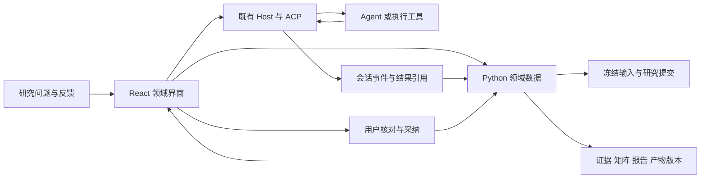

# 用官方源码改进 Pero 科研工作台

研究日期：2026-10-29。对照 Pero HEAD：`393bea7972bc765d2f831636bb460320378fac80`；工作区同时存在其他任务的未提交改动，本轮未修改产品代码。

**已克隆 12 个官方仓库。最值得 Pero 优先借鉴的是 ScholarQA 的证据矩阵和引用交互、OpenScholar demo 的候选稿比较、AI Scientist-v2 的实验详情联动，以及 Paper2Agent 的参考运行与验证记录。**它们解决的是不同问题，没有一个公开实现能直接替代 Pero 科研工作台。当前 Pero 应先补齐研究提交与方法版本的稳定关联，再增强论文、报告和产物的呈现。执行、取消和授权继续归现有 Host；Python 保管科研领域数据与结果，React 负责领域交互。以下将源码观察、官方文档描述与 Pero 建议分别标明，所有改进方案均未在本轮实现。

## 12 个仓库覆盖算法、界面、组件和集成示例

源码统一保存在 `/Users/phodal/test/paper-agent-research/`，没有复制进 Pero App。每个 checkout 的 origin、完整 SHA、提交时间、许可观察和范围记在 [manifest.json](/Users/phodal/test/paper-agent-research/manifest.json)，复现方式见 [目录说明](/Users/phodal/test/paper-agent-research/README.md)。下面的提交链接固定本次阅读对象，提交日期不代表产品发布日期。

| 克隆目录 / 官方仓库 | 固定提交 | 公开实现的实际范围 | 许可观察 |
| --- | --- | --- | --- |
| `paper-qa` / Future-House/paper-qa | [c692d0d](https://github.com/Future-House/paper-qa/tree/c692d0dfeac4a0296599f7fe21a253a58b7ac12a) | PaperQA2 Python 库、工具循环、CLI；本次未发现独立应用前端 | [Apache-2.0](https://github.com/Future-House/paper-qa/blob/c692d0dfeac4a0296599f7fe21a253a58b7ac12a/LICENSE) |
| `OpenScholar` / AkariAsai/OpenScholar | [0e9b8fb](https://github.com/AkariAsai/OpenScholar/tree/0e9b8fb912273d3dae39e593da86e4f6d3bf8de1) | 检索、生成、自反馈与条件补检索；主算法仓 | [Apache-2.0](https://github.com/AkariAsai/OpenScholar/blob/0e9b8fb912273d3dae39e593da86e4f6d3bf8de1/LICENSE) |
| `ai2-scholarqa-lib` / allenai/ai2-scholarqa-lib | [19e6827](https://github.com/allenai/ai2-scholarqa-lib/tree/19e6827ba9e7fe05068624d0851f38cd74ff5efc) | ScholarQA 管线、API、React 报告与文献矩阵；不代表 Asta 全部产品 | [根目录 Apache-2.0](https://github.com/allenai/ai2-scholarqa-lib/blob/19e6827ba9e7fe05068624d0851f38cd74ff5efc/LICENSE)，但 [ui/package.json](https://github.com/allenai/ai2-scholarqa-lib/blob/19e6827ba9e7fe05068624d0851f38cd74ff5efc/ui/package.json#L5) 标 `UNLICENSED`，直接复制 UI 前需澄清范围 |
| `open-scholar-demo` / allenai/open-scholar-demo | [565cfbb](https://github.com/allenai/open-scholar-demo/tree/565cfbb4e77fa520196631cc710147de2b9a4ca1) | 官方主仓链接的独立 demo；引文卡与草稿比较 | [Apache-2.0](https://github.com/allenai/open-scholar-demo/blob/565cfbb4e77fa520196631cc710147de2b9a4ca1/LICENSE) |
| `Paper2Agent` / jmiao24/Paper2Agent | [8c2d059](https://github.com/jmiao24/Paper2Agent/tree/8c2d059165ef8cdcb70dbea76655b9c2b55b38e6) | Paper2MCP 技能、流程契约、实际验证及 Notebook 产物脚本 | [MIT](https://github.com/jmiao24/Paper2Agent/blob/8c2d059165ef8cdcb70dbea76655b9c2b55b38e6/LICENSE) |
| `AI-Scientist-v2` / SakanaAI/AI-Scientist-v2 | [96bd516](https://github.com/SakanaAI/AI-Scientist-v2/tree/96bd51617cfdbb494a9fc283af00fe090edfae48) | 实验树搜索、执行与生成的 HTML 实验视图 | [AI Scientist Source Code License v1.0](https://github.com/SakanaAI/AI-Scientist-v2/blob/96bd51617cfdbb494a9fc283af00fe090edfae48/LICENSE)，不是 MIT |
| `kosmos-figures` / EdisonScientific/kosmos-figures | [8194472](https://github.com/EdisonScientific/kosmos-figures/tree/819447258cb53782fb3b7ddd63be8d65acf8f078) | Kosmos 报告图表、Notebook 与验证分析产物，非 Agent 平台源码 | 本次检出树未找到 LICENSE，复用许可未确认 |
| `AutoResearchClaw` / aiming-lab/AutoResearchClaw | [be4ba47](https://github.com/aiming-lab/AutoResearchClaw/tree/be4ba4755bf1b52220f25e13b2293b5956590070) | 科研执行、API/WebSocket 与遗留前端；界面有占位和装配缺口 | [MIT](https://github.com/aiming-lab/AutoResearchClaw/blob/be4ba4755bf1b52220f25e13b2293b5956590070/LICENSE) |
| `AgentLaboratory` / SamuelSchmidgall/AgentLaboratory | [d9017d9](https://github.com/SamuelSchmidgall/AgentLaboratory/tree/d9017d90e329112d2a80b7712f37ee9094d2cd27) | 终端人工反馈、阶段产物与 AgentRxiv 服务 | [MIT](https://github.com/SamuelSchmidgall/AgentLaboratory/blob/d9017d90e329112d2a80b7712f37ee9094d2cd27/LICENSE) |
| `pdf.js` / mozilla/pdf.js | [87b369c](https://github.com/mozilla/pdf.js/tree/87b369cd9d4cfe415b587b26a8d81f486db02874) | 本轮补充的 PDF 渲染、文本层与高亮基础组件 | [Apache-2.0](https://github.com/mozilla/pdf.js/blob/87b369cd9d4cfe415b587b26a8d81f486db02874/LICENSE) |
| `elicit-api-examples` / elicit/api-examples | [89e24c1](https://github.com/elicit/api-examples/tree/89e24c1b28510079aad24fcd73f8052858cc7257) | Elicit 官方 API 示例，非 Research Agent 产品前后端 | [MIT](https://github.com/elicit/api-examples/blob/89e24c1b28510079aad24fcd73f8052858cc7257/LICENSE) |
| `scite-extension` / scitedotai/scite-extension | [b676165](https://github.com/scitedotai/scite-extension/tree/b676165d2d40154a23534807f7739121d03feae3) | Scite 浏览器扩展、引用 badge，非 Assistant 平台 | [MIT](https://github.com/scitedotai/scite-extension/blob/b676165d2d40154a23534807f7739121d03feae3/LICENSE) |

**本次做的是固定提交的源码检查。**没有安装或运行第三方依赖、调用模型、启动上游 UI、执行科学实验，也没有测成本、延迟、定位准确率、故障恢复或无障碍表现。代码存在与集成可用是两个结论。许可证表用于说明本次对象，不构成复制代码的许可兼容性结论。

【官方文档范围】Kosmos 的持久 Agent、沙箱、共享文件系统和交互进度视图来自 Edison 工程文章；其公开 `kosmos-figures` 不能用来验证整个平台实现。Elicit 与 Scite 已找到的公开仓库也只覆盖示例或扩展。Consensus、SciSpace 本轮未定位到可归属官方的完整产品仓库，仅保留官方功能文档；这不意味着断言它们不存在其他公开代码。([Kosmos 工程描述](https://advances.edisonscientific.com/research/how-we-built-kosmos/)、[Elicit 示例范围](https://github.com/elicit/api-examples/blob/89e24c1b28510079aad24fcd73f8052858cc7257/README.md#L13-L34)、[Scite API](https://scite.ai/api)、[Consensus Help](https://help.consensus.app/en/articles/9922726-why-do-people-choose-consensus)、[SciSpace Chat PDF](https://scispace.com/chat-pdf))

## 可视化的关键是让证据、修订和实验能够互相定位

### ScholarQA 把比较表做成有来源的单元格

【源码观察】ScholarQA 的表格不是一段 Markdown。`TableCell` 显式表达原值、显示值、loading、error、metadata 和用户覆盖字段。React `CellWithEvidence` 读取 `metadata.evidenceId`，在用户打开弹层时取证据，并展示支持片段与论文身份。这是 Pero 最值得优先借鉴的模式：**点击某个比较值，就能核对它来自哪篇论文的哪段证据。**类型里的编辑字段不等于该快照的界面已经支持编辑；所查单元格组件主要显示 `display_value`。([单元格类型](https://github.com/allenai/ai2-scholarqa-lib/blob/19e6827ba9e7fe05068624d0851f38cd74ff5efc/api/scholarqa/table_generation/table_model.py#L5-L75)、[按需证据组件](https://github.com/allenai/ai2-scholarqa-lib/blob/19e6827ba9e7fe05068624d0851f38cd74ff5efc/ui/src/components/report/LitTable/CellWithEvidence.tsx#L18-L53))

【源码观察】矩阵按窗口宽度显示 1/2/3 个比较列，始终保留论文列；正文通过 Markdown 的 `Paper` 组件把引文映射到结构化 citations。另有 `Model` 组件提示内容来自模型记忆且没有相关来源。引用弹层包含元数据、摘录和 Semantic Scholar 外链，所查组件并非 PDF 页内定位器。([矩阵布局](https://github.com/allenai/ai2-scholarqa-lib/blob/19e6827ba9e7fe05068624d0851f38cd74ff5efc/ui/src/components/report/LitTable.tsx#L20-L64)、[正文引用与模型记忆](https://github.com/allenai/ai2-scholarqa-lib/blob/19e6827ba9e7fe05068624d0851f38cd74ff5efc/ui/src/components/report/Section.tsx#L21-L77)、[引文卡](https://github.com/allenai/ai2-scholarqa-lib/blob/19e6827ba9e7fe05068624d0851f38cd74ff5efc/ui/src/components/widgets/EvidenceCard.tsx#L53-L101))

【Pero 建议】先做一个明确比较任务，例如几篇论文的模型、数据集、指标、单位与限制。矩阵格保存证据引用，明确区分缺失、冲突、模型提取值与人工修订值；正文引文和矩阵格共用现有证据侧栏。桌面先考虑固定论文列与横向滚动，窄窗再验证逐列比较，按实际任务选择布局。

### OpenScholar demo 让用户看见候选稿改了什么

【源码观察】OpenScholar 独立 demo 有 `previousSection` 和 `react-diff-viewer`，允许打开草稿对比；正常报告仍用 `Paper` override 显示来源。比较前会按句拆分并清理部分年份、引用编号差异，因此它是阅读辅助，不能代替原始报告与引用集合的版本比较。([草稿差异处理](https://github.com/allenai/open-scholar-demo/blob/565cfbb4e77fa520196631cc710147de2b9a4ca1/ui/src/components/report/Report.tsx#L17-L42)、[引用渲染](https://github.com/allenai/open-scholar-demo/blob/565cfbb4e77fa520196631cc710147de2b9a4ca1/ui/src/components/report/Report.tsx#L88-L132)、[比较入口](https://github.com/allenai/open-scholar-demo/blob/565cfbb4e77fa520196631cc710147de2b9a4ca1/ui/src/components/report/Report.tsx#L144-L158))

【Pero 建议】反馈产生候选 `ReportRevision`，显示新增证据、修改段落和修改原因，用户采纳后形成新版本。对比同时覆盖正文与来源变化；人工修改不被后续 Agent 输出覆盖。这样“继续研究”有可审阅结果，而不是只往聊天历史追加一段新答案。

### AI Scientist-v2 把实验节点联动到代码、指标和图片

【源码观察】AI Scientist 的 `Node` 保存父子关系、计划、代码、metric、异常、用时、图路径、seed、消融与超参信息。生成的 p5.js 树可以点击节点，旁边联动显示代码、数据集指标表、错误、图像与模型视觉反馈；代码使用 highlight.js，图片来自节点关联路径。它确有可研究的交互实现，但属于生成的 HTML 报告视图，不能据此称为完整的持久科研 Web App。([Node 数据](https://github.com/SakanaAI/AI-Scientist-v2/blob/96bd51617cfdbb494a9fc283af00fe090edfae48/ai_scientist/treesearch/journal.py#L43-L118)、[节点选择](https://github.com/SakanaAI/AI-Scientist-v2/blob/96bd51617cfdbb494a9fc283af00fe090edfae48/ai_scientist/treesearch/utils/viz_templates/template.js#L313-L345)、[详情、表与图](https://github.com/SakanaAI/AI-Scientist-v2/blob/96bd51617cfdbb494a9fc283af00fe090edfae48/ai_scientist/treesearch/utils/viz_templates/template.js#L477-L565))

【Pero 建议】优先做平面的实验对照表：配置差异、数据集、指标/单位/方向、耗时、执行状态、验证范围和图表。选中行再展开代码与产物。等到真实任务出现父子实验和分支探索，再加树视图；无需为展示一棵树提前建设并行调度框架。

### PDF.js 提供文本层，高亮仍需要可靠的锚点

【源码观察】PDF.js 把页面渲染、文本层和高亮分开。`TextLayerBuilder` 读取 `streamTextContent()`，把文本 div 与字符串映射交给高亮器；高亮器把匹配范围转换成 div/offset，find controller 再滚到对应页面位置。它能提供可选中的 PDF 文本，却不会自动把任意 OCR/Markdown 偏移变成 PDF 页坐标。([文本层](https://github.com/mozilla/pdf.js/blob/87b369cd9d4cfe415b587b26a8d81f486db02874/web/text_layer_builder.js#L94-L132)、[位置映射](https://github.com/mozilla/pdf.js/blob/87b369cd9d4cfe415b587b26a8d81f486db02874/web/text_highlighter.js#L103-L142)、[定位滚动](https://github.com/mozilla/pdf.js/blob/87b369cd9d4cfe415b587b26a8d81f486db02874/web/pdf_find_controller.js#L566-L579))

【Pero 建议】先保存原文件摘要、页面号、选中文字与定位来源；有可靠页坐标才做页内高亮。纯文本或 Markdown 证据继续使用文本上下文定位。原文件版本与解析文本版本分别可追溯，避免从另一套提取结果编造页内精确位置。

### 有些公开界面仍是遗留或占位实现

【源码观察】AutoResearchClaw 的 server 只在 `frontend/` 存在时挂载静态界面，当前检出树提供的是 `frontend-legacy/`。其 `PaperPreview` 显示的是 Markdown/TeX/PDF 文件“available”；`ExperimentMonitor` 虽创建 canvas，所查指标逻辑只生成数值卡。这些文件适合研究页面分工，不能当作已完成 PDF 和曲线渲染的样板。([静态挂载](https://github.com/aiming-lab/AutoResearchClaw/blob/be4ba4755bf1b52220f25e13b2293b5956590070/researchclaw/server/app.py#L104-L130)、[PaperPreview](https://github.com/aiming-lab/AutoResearchClaw/blob/be4ba4755bf1b52220f25e13b2293b5956590070/frontend-legacy/src/components/PaperPreview.js#L17-L31)、[ExperimentMonitor](https://github.com/aiming-lab/AutoResearchClaw/blob/be4ba4755bf1b52220f25e13b2293b5956590070/frontend-legacy/src/components/ExperimentMonitor.js#L7-L58))

【源码观察】Agent Laboratory 的人工协作主要是终端输出和 `input()`，收集接受/拒绝及修改建议后再迭代。AgentRxiv 的 Flask 服务引用网页模板，但本次已跟踪文件中未找到这些模板；不能把这个快照直接当作完整网页工作台。Scite 扩展则确有 supporting/contradicting/mentioning 计数与撤稿等提醒的阅读上下文展示，这些来自 API 分类，不是浏览器现场验证科学结论。([人工反馈](https://github.com/SamuelSchmidgall/AgentLaboratory/blob/d9017d90e329112d2a80b7712f37ee9094d2cd27/ai_lab_repo.py#L547-L574)、[AgentRxiv 路由](https://github.com/SamuelSchmidgall/AgentLaboratory/blob/d9017d90e329112d2a80b7712f37ee9094d2cd27/app.py#L121-L156)、[Scite Tally](https://github.com/scitedotai/scite-extension/blob/b676165d2d40154a23534807f7739121d03feae3/src/components/Tally.js#L84-L116))

## Agent 交互要暴露真实研究活动，并区分预算与恢复承诺

### PaperQA2 的工具与证据模型比聊天包装更值得读

【源码观察】PaperQA2 将文档 `Doc`、原文片段 `Text` 与面向问题的 `Context` 分开，保留内容哈希、文档关联、问题、摘要和相关性分值。`GatherEvidence` 根据具体子问题取证据，`GenerateAnswer` 用当前证据回答，工具有初始化与完成回调。这为“正在搜索什么、读到了什么、哪些来源支持回答”提供了明确接点。相关性分数用于排序，不能显示成科学结论的置信概率。([Doc/Text/Context](https://github.com/Future-House/paper-qa/blob/c692d0dfeac4a0296599f7fe21a253a58b7ac12a/src/paperqa/types.py#L75-L277)、[GatherEvidence](https://github.com/Future-House/paper-qa/blob/c692d0dfeac4a0296599f7fe21a253a58b7ac12a/src/paperqa/agents/tools.py#L217-L311)、[GenerateAnswer](https://github.com/Future-House/paper-qa/blob/c692d0dfeac4a0296599f7fe21a253a58b7ac12a/src/paperqa/agents/tools.py#L314-L372))

【源码观察】PaperQA2 默认 `timeout=500s`、`max_timesteps=None`；步数限制可由调用方设置。超时或截断后的兜底仍会调用 `gen_answer`，且位于原 `asyncio.timeout` 范围之外。因此应借鉴它的有界操作与状态表达，不能宣称默认提供严格的全过程时间或费用上限。([默认设置](https://github.com/Future-House/paper-qa/blob/c692d0dfeac4a0296599f7fe21a253a58b7ac12a/src/paperqa/settings.py#L651-L672)、[截断后生成](https://github.com/Future-House/paper-qa/blob/c692d0dfeac4a0296599f7fe21a253a58b7ac12a/src/paperqa/agents/main.py#L155-L183))

### OpenScholar 的补检索是有条件的，修订需要人工可审阅

【源码观察】OpenScholar 先生成初稿，启用自反馈后最多处理前三条反馈；含新问题且开启 `ss_retriever` 时才补检索，再去重、重排并修订。部分新稿采纳使用答案字数比例超过原稿 0.9 的启发式；它防止异常缩短，不能验证证据充分或结论正确。([主流程与采纳分支](https://github.com/AkariAsai/OpenScholar/blob/0e9b8fb912273d3dae39e593da86e4f6d3bf8de1/src/open_scholar.py#L606-L700))

【Pero 建议】把补检索呈现为“证据缺口 → 查询 → 新来源 → 候选修改”。开始时限制具体查询次数、证据数量与上下文大小，复用既有 Host 工具路径。若未来承诺总时间/费用上限，必须覆盖最后生成和并发外部调用，不能只在工具循环顶部检查。

### ScholarQA 有部分结果和阶段反馈，但尚不能据此证明持久续跑

【源码观察】ScholarQA 将问题拆解、检索、重排、引文提取、大纲和分节生成串联，逐节写回部分结果。前端 `StepProgress` 展示历史步骤、当前步骤、错误等真实 `TaskStep` 数据。这比把长任务压缩成一个旋转图标更适合研究工作。([管线入口](https://github.com/allenai/ai2-scholarqa-lib/blob/19e6827ba9e7fe05068624d0851f38cd74ff5efc/api/scholarqa/scholar_qa.py#L638-L726)、[分节报告](https://github.com/allenai/ai2-scholarqa-lib/blob/19e6827ba9e7fe05068624d0851f38cd74ff5efc/api/scholarqa/scholar_qa.py#L541-L625)、[StepProgress](https://github.com/allenai/ai2-scholarqa-lib/blob/19e6827ba9e7fe05068624d0851f38cd74ff5efc/ui/src/components/StepProgress.tsx#L11-L58))

【源码观察】其 API 通过 `task_id` 轮询，后台使用 fork 与本地状态文件。检查超时会把状态标为失败，所查分支没有相应终止子进程的 handle。这支持查询已存状态，不能仅据此承诺服务重启后从未完成步骤续跑，或“界面失败即计算停止”。AI Scientist 也发现 checkpoint 保存，但本次未找到配套加载/恢复入口。([ScholarQA API 与 fork](https://github.com/allenai/ai2-scholarqa-lib/blob/19e6827ba9e7fe05068624d0851f38cd74ff5efc/api/scholarqa/app.py#L125-L193)、[超时状态](https://github.com/allenai/ai2-scholarqa-lib/blob/19e6827ba9e7fe05068624d0851f38cd74ff5efc/api/scholarqa/app.py#L262-L270)、[AI Scientist checkpoint](https://github.com/SakanaAI/AI-Scientist-v2/blob/96bd51617cfdbb494a9fc283af00fe090edfae48/ai_scientist/treesearch/agent_manager.py#L249-L272))

【Pero 建议】研究活动显示真实检索、读取、提取和写作事件、已产出的章节与来源数量。运行、取消和审批投影 Host 的状态；领域活动不另建执行状态机。没有明确总量时不显示虚构百分比，也不从模型自然语言推断阶段。

## Pero 应保留现有职责，补齐提交身份、科学内容和产物关联

### 当前已有证据入口，主要渲染仍是纯文本

【Pero 源码观察】`Reader` 按空行拆段并识别标题，原 PDF 通过外链打开；`ReportView` 正文是 React 文本段落，实验代码使用 `<pre><code>`。当前确有 Reader/Report/EvidencePanel，但没有完整的 Markdown 表格、数学公式、图片产物或 PDF 页内阅读能力。([Reader 与 ReportView](/Users/phodal/workspaces/pero/apps/paper-agent/ui-src/documents.tsx:6)、[实验内容](/Users/phodal/workspaces/pero/apps/paper-agent/ui-src/documents.tsx:67))

【Pero 源码观察】`EvidenceReference.locate()` 在冻结文本上严格查找连续引文，返回位置、标题和上下文，证据侧栏已有 `<mark>` 高亮。这个契约应保留。ScholarQA 的定位包含规范化和词重叠回退，不能在借鉴时将近似定位悄悄变成精确核验；即便逐字命中，也只说明找到了原文，不说明引用足以支持结论。([Pero 引文定位](/Users/phodal/workspaces/pero/apps/paper-agent/backend/paper_agent/reports.py:10)、[证据侧栏](/Users/phodal/workspaces/pero/apps/paper-agent/ui-src/documents.tsx:78)、[ScholarQA 定位回退](https://github.com/allenai/ai2-scholarqa-lib/blob/19e6827ba9e7fe05068624d0851f38cd74ff5efc/api/scholarqa/scholar_qa.py#L230-L341))

【Pero 源码观察】共享 GPUI Chat 已有 retained `TextViewState::markdown()` 和流式选择状态，它属于 Rust/GPUI，不能直接作为 React iframe 组件导入。本轮在 App SDK/Paper App 局部依赖中未看到现成 React Markdown、KaTeX 或 MathJax renderer。后续应先明确 Web 内容与引用契约，再按真实复用需要放入 SDK；保留已有共享 Chat 的渲染和会话能力。([GPUI Markdown](/Users/phodal/workspaces/pero/crates/pero-chat-ui/src/stream.rs:112)、[流式状态](/Users/phodal/workspaces/pero/crates/pero-chat-ui/src/stream.rs:195)、[App SDK](/Users/phodal/workspaces/pero/packages/app-sdk/src/index.tsx:1))

### 冻结输入还需要关联方法、目标和实际执行

【Pero 源码观察】`ResearchInput` 保存论文、问题与验证计划，但最终 prompt 仍按当前函数重新生成；`AppSessionBinding` 有 app/request/agent/prompt，没有 workspace 字段。UI 用 React state 保存 sessionId、运行状态和输出，并在完成后保存报告；打开已有 intent 会清空 sessionId。当前持久化输入和报告，尚未形成足以恢复未归档执行结果的完整提交关联。([ResearchInput](/Users/phodal/workspaces/pero/apps/paper-agent/backend/paper_agent/model.py:149)、[执行绑定](/Users/phodal/workspaces/pero/crates/pero-runtime/src/apps/agent.rs:28)、[useResearch](/Users/phodal/workspaces/pero/apps/paper-agent/ui-src/use-research.ts:6))

【Pero 建议】先命名 `ResearchSubmission`：保存冻结输入、实际方法/指令版本、执行目标、Host session/turn 和结果引用。方法代码变化、用户重跑和刷新查看有明确身份，UI 仅订阅和呈现。Host 继续拥有执行状态，Python 保存领域关联及不可变结果。这里补的是现有执行的关联，不是在 Python 另建 Task/Run/Step/Attempt 调度器。

【Pero 建议】`EvidenceAnchor` 统一内容版本、匹配方式与文本位置，并允许未来增加可靠 PDF 页/区域定位；`EvidenceMatrix` 保存字段、格值和来源；`ReportRevision` 保存基线、候选修改与采纳。这些类型按实际功能逐个引入，不为草案一次性建设所有领域对象或通用接口。

下面是建议的职责与数据流，**不是本轮新增的运行实现**。

### 方法验证与产物身份应先于实验树

【源码观察】Paper2Agent 的技能契约要求先直接运行上游得到参考结果，再做最小包装与独立验证。实际 `verify_mcp_server.py` 会启动 stdio server、列工具、按 cases 真正调用并记录输出与 artifact 检查；`inventory-only` 与真正调用分开。文件存在、JSON 子集匹配不等于数值容差正确或论文结论复现。流程文档的要求，也不证明每次第三方转换都已完成这些验证。([流程契约](https://github.com/jmiao24/Paper2Agent/blob/8c2d059165ef8cdcb70dbea76655b9c2b55b38e6/skills/paper2agent/paper2mcp/SKILL.md#L17-L47)、[实际 MCP 调用验证](https://github.com/jmiao24/Paper2Agent/blob/8c2d059165ef8cdcb70dbea76655b9c2b55b38e6/skills/paper2agent/paper2mcp/scripts/verify_mcp_server.py#L102-L150)、[验证范围](https://github.com/jmiao24/Paper2Agent/blob/8c2d059165ef8cdcb70dbea76655b9c2b55b38e6/skills/paper2agent/paper2mcp/references/runtime-verification.md#L28-L50))

【源码观察】其 Notebook 图片提取脚本会记录 cell、output、媒体类型和图片 SHA-256，manifest 还关联原 Notebook 摘要。这比报告中只有一个图片路径更适合追溯。Pero 当前实验记录主要是 Agent 报告的文件、命令、预期和观察，provenance 明确为 `agent-reported`，尚不能作为可信执行回执。([图片 manifest](https://github.com/jmiao24/Paper2Agent/blob/8c2d059165ef8cdcb70dbea76655b9c2b55b38e6/skills/paper2agent/paper2mcp/scripts/extract_notebook_images.py#L82-L134)、[Pero 实验记录](/Users/phodal/workspaces/pero/apps/paper-agent/backend/paper_agent/reports.py:83))

【Pero 建议】方法复用阶段再引入 `MethodRevision`、`ReferenceCheck` 与 `ArtifactReference`：分别固定方法代码/入口/环境、参考数据/预期/容差/观察，以及产物类型/摘要/生成输入/执行引用。图、表、代码和 Notebook 摘要按各自类型呈现，能追到生成代码和输入。界面分别表达执行完成、参考一致、论文指标复现和科学结论采纳；Agent 的文字陈述不自动升级验证等级。

【Pero 边界】默认共享 Python env、按 App 覆盖的选择继续保留。venv 隔离依赖与进程入口，不提供文件系统或网络沙箱。Host 已有 ACP 会话与取消归属，领域 App 不因本次研究再建一套聊天、权限或执行控制面。PostgreSQL、Kubernetes、GPU、持久工作流仅在具体任务需要并有验收目标时再决策。([Python 环境选择](/Users/phodal/workspaces/pero/crates/pero-runtime/src/apps/python.rs:9)、[Host App Agent](/Users/phodal/workspaces/pero/crates/pero-host/src/app_agent.rs:65)、[ADR 0007](/Users/phodal/workspaces/pero/docs/adr/0007-local-app-platform.md:62))

## 下一轮用真实论文验收四个结果，再决定扩展范围

以下顺序是建议，不表示本轮已交付。它把交互改进建立在可查询输入与结果上，同时让每一步能单独评审。

| 顺序 | 可独立交付的结果 | 具体验收 |
| --- | --- | --- |
| 1 | 冻结研究提交、方法指令与执行目标 | 同一提交能追到确切输入和 Host session/turn；隐藏或重开面板能查看既有结果；方法模板变化不改写旧输入；状态与取消仍来自 Host |
| 2 | Reader/Report 的科学内容呈现与证据定位 | 一份真实论文的标题、列表、表格、代码、公式和图片可读；选文绑定冻结来源；引文打开同一证据侧栏；有 PDF 页定位才做页内高亮 |
| 3 | 有来源的比较矩阵与候选稿 | 几篇论文按明确字段比较；格值能回到证据；缺失/冲突可见；人工修改与生成值分开；新稿可比对并显式采纳 |
| 4 | 一个真实方法的参考运行与产物对照 | 固定上游版本、数据和环境；参考与包装结果按预期/容差比较；图表关联生成代码与执行；受测产物和最终交付版本一致 |

**下一轮最有价值的样本是一份含双栏、公式、表格、图片和重复引文的真实论文。**先用它确认选择定位、正文呈现、证据跳转与导出是否一致，再决定是否需要 OCR、额外解析器或完整 PDF viewer。对同一个问题加入几篇对照论文，即可继续验收矩阵；不必先造通用图谱或仪表盘。

【验收范围】UI 实现后需实际检查加载、空、运行、成功、错误、禁用状态，以及键盘、浅深主题、窄窗、长内容和导出。共享 Chat 与领域主面板分别承担沟通和证据/结果核对；采用 Pero 现有主题与任务布局。这里要求的是下一轮真实运行证据，本次静态源码阅读不代替它。([Pero UI 约定](/Users/phodal/workspaces/pero/AGENTS.md:1)、[DESIGN.md](/Users/phodal/workspaces/pero/DESIGN.md:1))

本轮产出是可复核的官方源码集合与对比报告。完整调研笔记见 [证据与 Agent](</Users/phodal/workspaces/pero/research_notes/科研 Agent 源码与交互对比/evidence-agents.md>)、[交互与渲染](</Users/phodal/workspaces/pero/research_notes/科研 Agent 源码与交互对比/visual-rendering.md>)、[方法与执行](</Users/phodal/workspaces/pero/research_notes/科研 Agent 源码与交互对比/methods-execution.md>)。未核对不可访问原文的全部 42 个链接，也不宣称覆盖它的全部 13 组实现。
